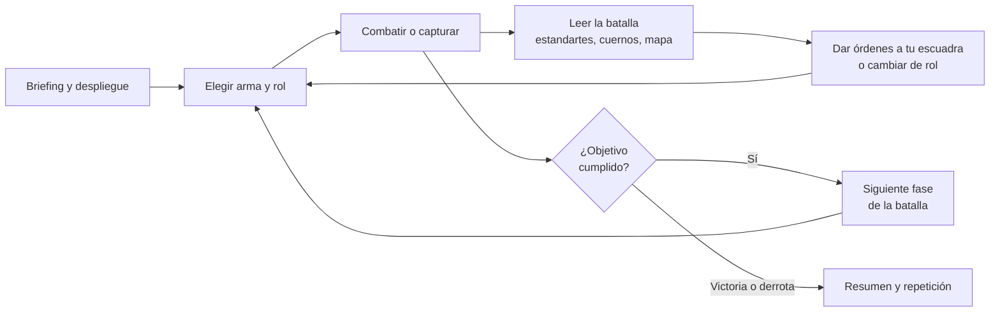
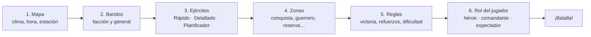
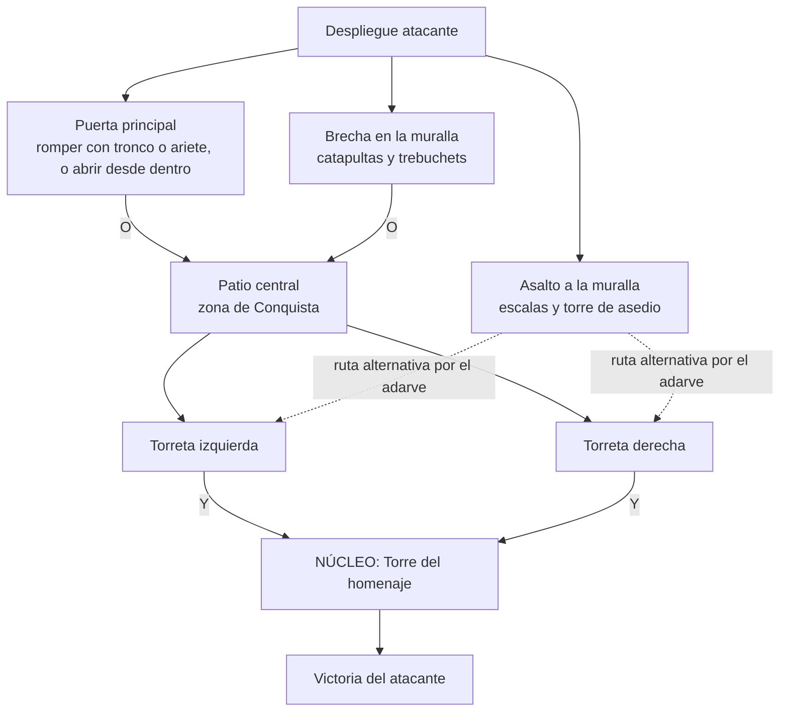
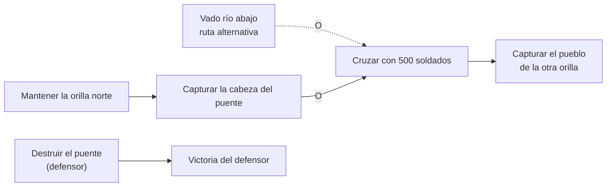
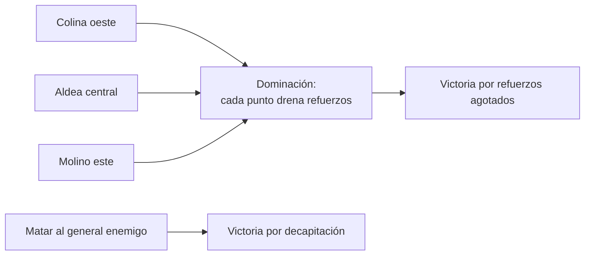
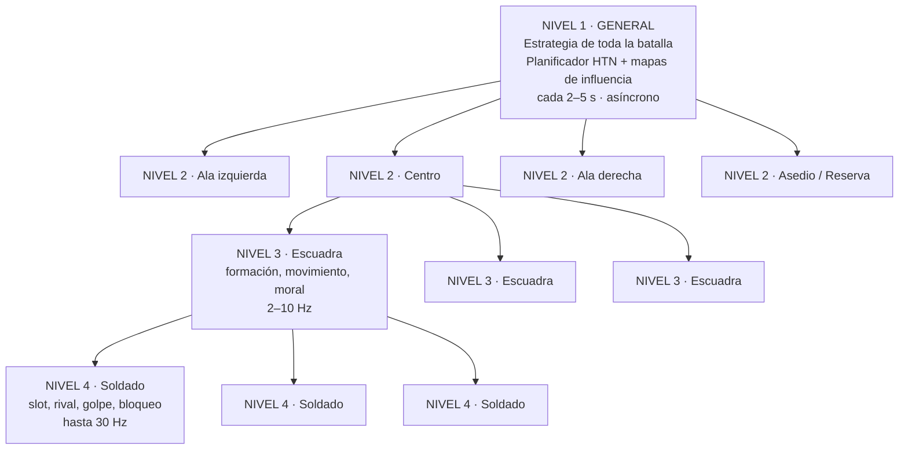
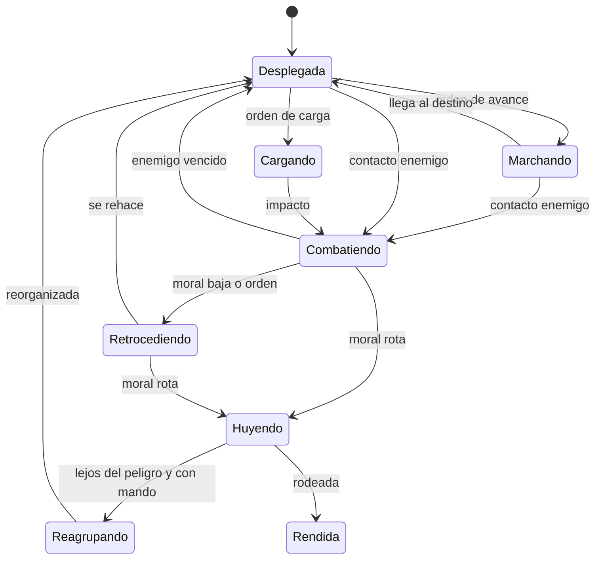
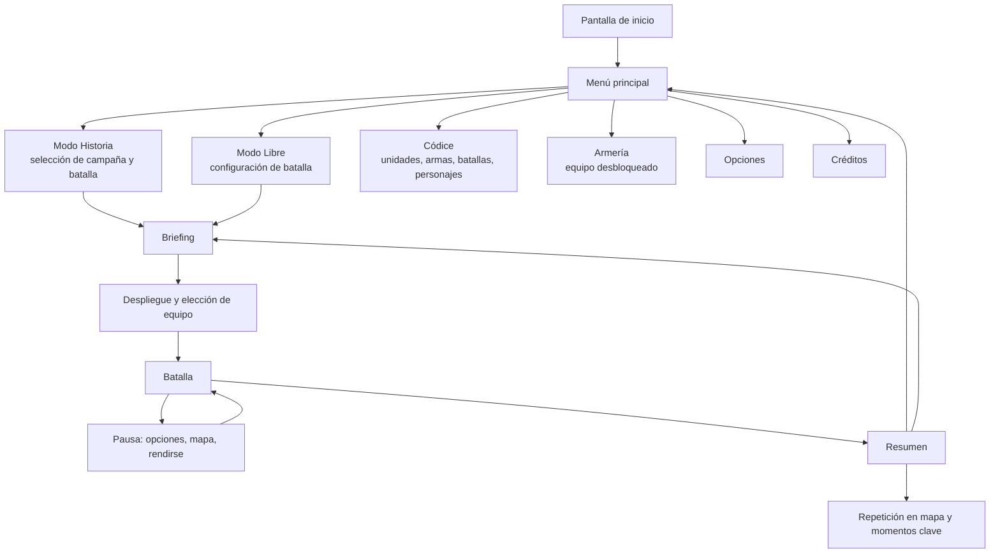
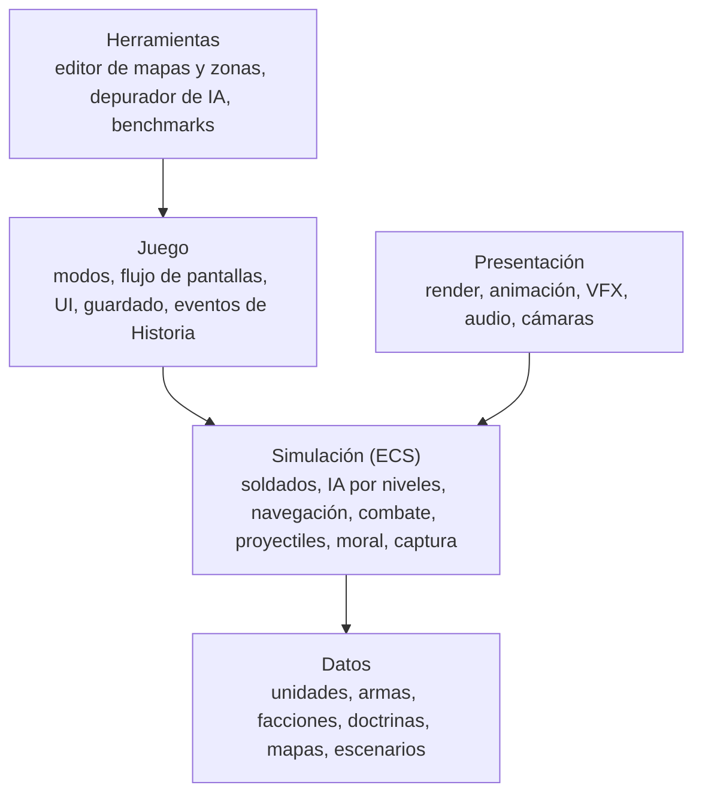
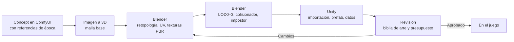

# ESTANDARTES — GDD · Volumen I: Diseño general

> **Volúmenes del GDD** ([índice](README.md)): **I. Diseño general** (este documento) · [II. Niveles de la Edad Media](02_Niveles_Edad_Media.md) · [III. Arquitectura de la IA](03_Arquitectura_IA.md) · [IV. Guía de construcción](04_Guia_de_Construccion.md) · [V. Constructor de mapas y mods](05_Mapas_y_Mods.md)
>
> **Título provisional de la saga:** *Estandartes* · **Primer juego:** *Estandartes: Edad Media*
> **Plataforma:** PC (Windows, Steam) · **Motor:** Unity 6 LTS · **Versión del documento:** 0.3 (30-10-2026)
> **Estado:** pre-producción. Este documento es la referencia viva del proyecto: todo cambio de diseño se refleja aquí.

---

## Índice

- [0. Ficha del juego](#0-ficha-del-juego)
- [1. Visión y pilares](#1-visión-y-pilares)
- [2. Bucles de juego](#2-bucles-de-juego)
- [3. Modo Historia](#3-modo-historia)
- [4. Modo Libre](#4-modo-libre)
- [5. Objetivos, captura y asedios](#5-objetivos-captura-y-asedios)
- [6. El héroe](#6-el-héroe)
- [7. Unidades, armas y facciones](#7-unidades-armas-y-facciones)
- [8. Inteligencia artificial](#8-inteligencia-artificial)
- [9. Optimización y rendimiento](#9-optimización-y-rendimiento)
- [10. Mapas y entornos](#10-mapas-y-entornos)
- [11. Flujo de juego y pantallas](#11-flujo-de-juego-y-pantallas)
- [12. HUD, interfaz y accesibilidad](#12-hud-interfaz-y-accesibilidad)
- [13. Controles](#13-controles)
- [14. Dirección de arte](#14-dirección-de-arte)
- [15. Audio](#15-audio)
- [16. Narrativa y códice](#16-narrativa-y-códice)
- [17. Progresión y modelo de negocio](#17-progresión-y-modelo-de-negocio)
- [18. Tecnología y arquitectura](#18-tecnología-y-arquitectura)
- [19. Pipeline de producción con IA](#19-pipeline-de-producción-con-ia)
- [20. Hoja de ruta](#20-hoja-de-ruta)
- [21. Épocas futuras](#21-épocas-futuras)
- [22. Riesgos y mitigaciones](#22-riesgos-y-mitigaciones)
- [23. Requisitos de sistema](#23-requisitos-de-sistema)
- [24. Glosario](#24-glosario)
- [Anexo A. Estadísticas base de unidades](#anexo-a-estadísticas-base-de-unidades)
- [Anexo B. Algoritmo de reparto automático](#anexo-b-algoritmo-de-reparto-automático)
- [Anexo C. Ejemplo completo de asedio](#anexo-c-ejemplo-completo-de-asedio)
- [Anexo D. Presupuestos de rendimiento](#anexo-d-presupuestos-de-rendimiento)

---

## 0. Ficha del juego

| Campo | Valor |
|---|---|
| Título provisional | **Estandartes** (alternativas: *Campo contra Campo*, *Hierro y Estandarte*, *Línea de Batalla*) |
| Género | Acción táctica en tercera persona con batallas masivas (simulación de batalla + combate personal) |
| Perspectiva | Tercera persona por defecto, primera persona opcional (tecla de alternancia) |
| Plataforma | PC — Windows 10/11 64 bits, distribución en Steam |
| Jugadores | Un jugador contra la IA. Simulación diseñada para añadir cooperativo en el futuro |
| Motor | Unity 6 LTS con DOTS (Entities, Jobs, Burst) |
| Estilo visual | Realista histórico (barro, metal gastado, telas teñidas, luz natural) |
| Épocas | **Saga que recorre la historia de la guerra.** Primer juego: **Edad Media**. Después, por este orden: **Japón feudal** (samuráis), **era de la pólvora** (arcabuces, mosquetes y fusiles de chispa), **era del rifle** (siglo XIX) y, aparte, la **Antigüedad**. Posible ampliación posterior hasta la actualidad, fuera del juego base (ver [21](#21-épocas-futuras)) |
| Modos | **Historia** (batallas reales reconstruidas) y **Libre** (batallas configurables) |
| Comunidad | Después del lanzamiento: **constructor de mapas** dentro del juego y **soporte de mods** con Steam Workshop (ver [Volumen V](05_Mapas_y_Mods.md)) |
| Modo Historia del primer juego | **5 niveles:** Hastings (1066), Château Gaillard (1203–1204), Las Navas de Tolosa (1212), Puente de Stirling (1297) y Agincourt (1415) (ver [Volumen II](02_Niveles_Edad_Media.md)) |
| Escala objetivo | 4.000 soldados activos a 60 FPS en equipo recomendado; preset *Épico* con 10.000+ activos; ejércitos totales de hasta 20.000 con oleadas de refuerzo |
| Clasificación prevista | PEGI 16 (violencia realista; sangre configurable) |
| Modelo de negocio | Premium (pago único) + expansiones grandes de época |
| Juegos de referencia | *Mount & Blade II: Bannerlord* (héroe dentro de la batalla), *Conqueror's Blade* (héroe + escuadras + asedios), *Chivalry 2* (combate cuerpo a cuerpo y asedios por fases), *Total War* (escala y formaciones), *Ultimate Epic Battle Simulator 2* (escala masiva), *Kingdom Come: Deliverance* (realismo histórico) |

**Frase de venta:** *"Lucha dentro de las batallas que cambiaron la historia: un solo soldado capaz de empuñar cualquier arma, rodeado de miles de guerreros que piensan, dudan, resisten y huyen como personas."*

---

## 1. Visión y pilares

### 1.1 Visión

El jugador no mira la batalla desde arriba: **está dentro**. Siente el muro de escudos temblar cuando llega la carga, oye silbar las andanadas de flechas, ve a su capitán gritar órdenes y a los soldados de alrededor dudar cuando cae el estandarte. Cada soldado de la IA tiene su papel (lancero, ballestero, caballero, artillero de catapulta…) y lo ejecuta con criterio, mientras el jugador puede ser **cualquiera de ellos**, cambiando de arma y de rol según lo que pida la batalla.

### 1.1.1 Una saga a lo largo de la historia

*Estandartes* es una **saga** que recorre la historia de la guerra con la misma base técnica y la misma IA:

1. **Edad Media** (primer juego): espadas, escudos, lanzas, arcos, ballestas, caballos, catapultas, trebuchets, balistas, troncos y arietes para derribar puertas, torres de asedio.
2. **Japón feudal**: samuráis con katana, yari, naginata y arco yumi; ashigaru; primeros arcabuces.
3. **Era de la pólvora**: picas y arcabuces, mosquetes y fusiles de chispa con bayoneta.
4. **Era del rifle** (siglo XIX): rifles, artillería moderna, líneas y orden abierto.
5. **Antigüedad** (como expansión aparte): legiones, falanges, elefantes de guerra.
6. Más adelante, y **fuera del juego base**, la saga podría ampliarse hasta la actualidad.

El objetivo a largo plazo es un **Modo Historia muy completo** que cubra todas esas épocas. Se empieza con **5 niveles medievales** y se va ampliando. Para que esto sea viable, unidades, armas e IA se diseñan **independientes de la época** (ver [7.1](#71-principios) y [7.9](#79-unidades-a-través-de-las-épocas)).

### 1.2 Pilares de diseño

Cada decisión de diseño se mide contra estos cinco pilares, por orden de prioridad:

1. **Inmersión total.** Nada debe romper la sensación de estar en una batalla real: ni soldados quietos sin motivo, ni caídas de rendimiento, ni HUD invasivo. Si algo hay que sacrificar, se sacrifica antes la información en pantalla que la sensación de presencia.
2. **IA viva.** Los soldados parecen personas: tienen miedo, se cansan, se ayudan, rotan la primera fila, reaccionan con retraso humano y se equivocan a veces. Los mandos enemigos planean, engañan y se adaptan.
3. **Escala sin colapso.** Miles de soldados en pantalla sin que la IA se vuelva tonta ni el juego se ralentice. La complejidad de la IA se paga con optimización, no con recortes de comportamiento (ver [sección 9](#9-optimización-y-rendimiento)).
4. **Autenticidad histórica.** Armas, tácticas, terreno y ambientación fieles a cada batalla. Las licencias creativas se documentan en el códice.
5. **Un héroe, todos los roles.** El jugador puede luchar con espada y escudo, disparar el arco o la ballesta, cargar a caballo, manejar una catapulta o empujar una torre de asedio. La IA, en cambio, se especializa: cada soldado cumple su función.

### 1.3 Qué NO es este juego

- No es un juego de estrategia por turnos ni de gestión de imperio (no hay mapa de campaña con economía en el lanzamiento).
- No es un MMO ni un juego competitivo en línea.
- No es un simulador "de cápsulas": cada soldado debe leerse como una persona, no como un punto.

---

## 2. Bucles de juego

### 2.1 Bucle de batalla (minuto a minuto)



1. **Prepararse:** el jugador revisa el briefing, elige su equipo (hasta 4 armas) y, si su rango lo permite, ajusta el despliegue.
2. **Luchar:** combate en primera línea, dispara desde la retaguardia, opera armas de asedio o carga a caballo.
3. **Leer la batalla:** estandartes, cuernos, gritos de los capitanes y el estado de los objetivos indican dónde se le necesita.
4. **Decidir:** cambiar de arma o de zona, ordenar a su escuadra, ir a reforzar un flanco que cede.
5. **Fases:** cada objetivo conquistado o perdido cambia la batalla (se abre la puerta, se toman las torres, llega la caballería de refuerzo).

### 2.2 Bucle de sesión

Una batalla dura entre **20 y 45 minutos**. Al terminar, el jugador ve el resumen (bajas, momentos clave, objetivos), obtiene estrellas y desbloqueos y elige la siguiente batalla o prueba una variante en Modo Libre.

### 2.3 Meta-bucle (largo plazo)

- **Modo Historia:** avanzar por la campaña de la época, desbloqueando batallas, facciones, unidades, mapas y entradas del códice.
- **Modo Libre:** todo lo desbloqueado en Historia queda disponible para crear batallas propias, guardarlas y compartirlas mediante un código de escenario.
- **Épocas:** cada expansión añade una campaña, armas, unidades y mapas nuevos que también se integran en el Modo Libre (incluidos enfrentamientos entre épocas como modo "¿Y si…?").

---

## 3. Modo Historia

### 3.1 Concepto

Campañas de batallas reales, reconstruidas con su terreno, su clima, sus ejércitos y su desarrollo histórico. Es **campo contra campo**: dos ejércitos enfrentados. El jugador encarna a un soldado protagonista dentro de uno de los bandos; la IA controla a todos los demás soldados de ambos ejércitos, cada uno en su rol.

### 3.2 Estructura de una batalla

| Fase | Descripción |
|---|---|
| **Briefing** | Narración del cronista sobre un mapa animado (estilo "mapa de época" con fichas que se mueven): contexto, fuerzas, terreno y objetivos. 1–3 minutos, se puede saltar. |
| **Despliegue** | El ejército aparece en sus posiciones históricas. Con rango suficiente, el jugador puede ajustar algunas escuadras dentro de su zona de despliegue. |
| **Batalla por fases** | La batalla sigue los hitos históricos mediante **eventos guionizados con condiciones** (llegada de refuerzos, carga de caballería, cambio de clima). La IA juega libremente entre eventos: el resultado no está escrito, pero la historia empuja. |
| **Objetivos** | Principales (ganar la batalla, tomar/defender un punto) y secundarios (salvar al abanderado, destruir las torres de asedio antes de que lleguen, capturar al comandante enemigo). |
| **Epílogo** | El cronista cuenta qué pasó realmente y cómo se compara con la partida del jugador. Se desbloquean entradas del códice. |

**Variante "¿Y si…?":** tras completar una batalla, se puede jugar desde el bando contrario o con alteraciones (sin lluvia en Agincourt, sin el pastor guía en Las Navas…).

### 3.3 El protagonista y la muerte

- Cada batalla tiene un **protagonista con nombre**, un soldado ficticio pero plausible (un escudero normando en Hastings, un zapador picardo en Château Gaillard, un escudero castellano en Las Navas…). Las variantes "¿Y si…?" permiten jugar también desde el bando perdedor.
- Aunque el protagonista tiene un arma "propia" de su historia, puede **recoger y usar cualquier arma** y ejercer cualquier rol (ver [sección 6](#6-el-héroe)).
- **Muerte — modo "Relevo" (por defecto):** al caer, el jugador toma el control de otro soldado de su escuadra o de una cercana mientras queden refuerzos. La batalla nunca se detiene y el cronista lo integra en el relato ("otro hombre recogió su espada…").
- **Muerte — modo "Clásico":** se vuelve al último punto de control (al inicio de cada fase).
- Dificultad *Maestro de guerra*: el relevo solo es posible si hay un aliado a menos de 30 m.

### 3.4 Campaña del primer juego: 5 niveles medievales

El Modo Historia de *Estandartes: Edad Media* arranca con **cinco batallas reales**, elegidas por ser representativas y porque en cada una gana quien toma la mejor decisión estratégica. Cada nivel está diseñado en detalle (mapa, fases, objetivos, IA, eventos y notas históricas) en el **[Volumen II](02_Niveles_Edad_Media.md)**.

| Nivel | Batalla | Fecha | El jugador lucha con | Idea estratégica |
|---|---|---|---|---|
| 1 | **Hastings** | 14-10-1066 | Normandos | Romper un muro de escudos en altura con armas combinadas y **retiradas fingidas** |
| 2 | **Asedio de Château Gaillard** | 1203–6-3-1204 | Franceses | Tomar un castillo **recinto a recinto**: zapa, brecha e infiltración por la capilla |
| 3 | **Las Navas de Tolosa** | 16-7-1212 | Castellanos | **Flanqueo** por un paso oculto de la sierra y asalto final al palenque del califa |
| 4 | **Puente de Stirling** | 11-9-1297 | Escoceses | **Paciencia y cuello de botella**: atacar cuando ha cruzado la vanguardia enemiga |
| 5 | **Agincourt** | 25-10-1415 | Ingleses | **Elegir el terreno**: estacas, barro y bosques que encajonan al enemigo |

El primer nivel hace también de tutorial: enseña uno a uno todos los roles (arquero, infante, jinete) dentro de la propia batalla.

### 3.5 Un Modo Historia que crece

- **Más batallas medievales** en actualizaciones (candidatas: Jerusalén 1099, Hattin 1187, Arsuf 1191, Bannockburn 1314, Crécy 1346, Aljubarrota 1385, Grunwald 1410, Orleans 1429, Constantinopla 1453; ver [Volumen II, 4](02_Niveles_Edad_Media.md#4-candidatas-para-ampliar-la-campaña-medieval)).
- **Una campaña por cada época** nueva de la saga (ver [21](#21-épocas-futuras)).
- A largo plazo, el Modo Historia forma una **línea temporal** navegable de la historia militar, desde la Antigüedad hasta el siglo XIX.

### 3.6 Dificultad

| Nivel | IA | Jugador |
|---|---|---|
| **Recluta** | Reacciones más lentas, planes más simples | Asistencia de bloqueo, más vida, relevo siempre disponible |
| **Veterano** (por defecto) | IA completa | Sin asistencias |
| **Maestro de guerra** | IA completa con planes más profundos y menos errores | Daño realista, fuego amigo completo, relevo limitado |

La dificultad **nunca** da ventajas ocultas de estadísticas a la IA: cambia su calidad de decisión, su tiempo de reacción y su margen de error (ver [8.9](#89-dificultad-sin-trampas)).

---

## 4. Modo Libre

### 4.1 Concepto

Batallas configurables de principio a fin: el jugador elige mapa, bandos, tamaño y composición de los ejércitos, zonas y reglas de victoria. Es el "laboratorio de guerra" del juego y el modo pensado para la rejugabilidad infinita y para disfrutar viendo a la IA en acción.

### 4.2 Pasos de configuración



1. **Mapa:** mapas históricos de la campaña (una vez desbloqueados) y mapas genéricos (llanura, colinas, río con puente, bosque, pueblo, castillo, ciudad amurallada, desfiladero). Se elige clima (despejado, nublado, lluvia, niebla, tormenta), hora del día y estación.
2. **Bandos:** facción de cada ejército y **personalidad del general enemigo** (o aleatoria): *agresivo*, *prudente*, *astuto*, *tradicionalista* (ver [8.3](#83-nivel-1-el-general)).
3. **Ejércitos:** tres niveles de detalle (abajo).
4. **Zonas:** plantilla de zonas o diseño libre (abajo).
5. **Reglas:** condiciones de victoria, refuerzos, munición limitada sí/no, fuego amigo, límite de tiempo, dificultad.
6. **Rol del jugador:** cómo participa en la batalla.

### 4.3 Composición de ejércitos: tres niveles

#### Nivel 1 — Rápido: "pon dos números"

El jugador escribe **dos cantidades**: tamaño de su ejército y tamaño del ejército enemigo (por ejemplo, 2.000 contra 3.500). El **algoritmo de reparto** genera automáticamente una composición coherente y su despliegue:

- Parte de la **doctrina de la facción** (proporciones históricas: los ingleses del siglo XIV llevan muchos arqueros de arco largo; los almohades, caballería ligera y arqueros a caballo; los castellanos, caballería pesada y ballesteros…).
- La ajusta según el **mapa** (más infantería en bosques y castillos, más caballería en llanuras, máquinas de asedio solo si hay murallas) y según el **rol** (atacante o defensor).
- Redondea por **escuadras completas**, respeta mínimos de mando (capitanes, abanderados, músicos) y topes de asedio.
- Genera un **despliegue** inicial (centro, alas, vanguardia de tiradores, reserva, artillería).

Opciones: *"Equilibrado"* (composición estándar), *"Contrarrestar al enemigo"* (la IA adapta su mezcla a la tuya) y *"Histórico"* (proporciones lo más fieles posible). El algoritmo está detallado en el [Anexo B](#anexo-b-algoritmo-de-reparto-automático).

#### Nivel 2 — Detallado: cantidad por tipo

El jugador indica cuántos soldados quiere de cada tipo (por ejemplo, 400 hombres de armas, 300 lanceros, 250 ballesteros, 80 caballeros, 2 trebuchets). El sistema forma las escuadras y propone un despliegue que puede aceptarse o editarse. Un **contador de puntos** opcional permite batallas equilibradas por coste.

#### Nivel 3 — Planificador: lo montas tú

Vista táctica del mapa donde el jugador:

- Coloca **escuadras** una a una (o arrastra bloques) dentro de las zonas de despliegue.
- Asigna a cada escuadra un **papel**: *Guerrero* (combatir y sostener un frente), *Conquistador* (tomar y mantener puntos), *Apoyo* (tiradores, asedio), *Reserva* (entra cuando el general lo decide o cuando se cumple una condición).
- Da **órdenes iniciales**: mantener posición, avanzar hasta X, flanquear por la ruta Y, esperar señal (cuerno), emboscar.
- Puede hacer lo mismo con el **ejército enemigo** o dejar que su general lo planifique solo.

Las configuraciones se guardan como **escenarios** y se pueden compartir con un código.

### 4.4 Zonas del mapa

El mapa se divide en **zonas**. Cada zona tiene un **tipo**, un **dueño** inicial (propio, enemigo o neutral) y, opcionalmente, **objetivos** dentro (ver [5](#5-objetivos-captura-y-asedios)). No hay distribuciones fijas: **cualquier combinación de zonas y objetivos es válida en cualquier mapa**, y el jugador puede crear las suyas en el Planificador.

| Tipo de zona | Función |
|---|---|
| **Conquista** | Contiene un punto capturable (bandera, edificio, torre, puente, colina). Quien la controla gana su efecto: puntos, drenaje de refuerzos enemigos, punto de refuerzo adelantado o desbloqueo de otros objetivos. |
| **Guerrero** | Frente de combate. No se captura, se **sostiene**: las escuadras con papel *Guerrero* combaten para impedir el paso o empujar al enemigo. Si un bando la domina, el otro pierde el acceso a lo que protegía. |
| **Despliegue** | Donde aparece cada ejército y por donde entran sus refuerzos. |
| **Reserva** | Retaguardia donde esperan las escuadras de reserva. |
| **Artillería** | Posiciones de catapultas, trebuchets, balistas (o cañones en otras épocas), con munición y dotación. |
| **Suministro** | Carros de flechas, virotes, armas de repuesto y agua. Si se pierde, se acaba la munición. |
| **Emboscada** | Zona oculta (bosque, hondonada) donde se esconden escuadras hasta una señal. |
| **Refuerzo** | Punto de entrada de refuerzos que se puede ganar o perder. |
| **Retirada** | Ruta y zona segura hacia donde se repliegan las escuadras con orden. |
| **Prohibida** | Zona intransitable o de acceso limitado (por diseño o por reglas del escenario). |

**Plantillas de zonas.** Son solo **ejemplos de partida** que se pueden editar o mezclar:

| Plantilla | Distribución | Tipo de batalla |
|---|---|---|
| **Choque** | Dos zonas de Guerrero enfrentadas | Batalla campal pura: gana quien rompe al otro |
| **Conquista doble** | Una zona de Conquista por bando y una zona de Guerrero en medio | Defender lo tuyo, tomar lo suyo, pelear el centro |
| **Doble frente** | Dos zonas de Guerrero en paralelo y una de Conquista detrás de cada una | Dos batallas a la vez: decidir dónde reforzar |
| **Línea de conquista** | 3–5 zonas de Conquista en línea con zonas de Guerrero entre ellas | Frente móvil tipo "tira y afloja" |
| **Asalto escalonado** | Cadena de zonas de Conquista con dependencias | Asedios por fases (castillo, ciudad, campamento fortificado) |
| **Cuello de botella** | Una zona de Conquista estrecha (puente, vado, paso de montaña) entre dos zonas de Guerrero | Controlar el paso |
| **Rey de la colina** | Una zona de Conquista central rodeada de zonas de Guerrero | Todos contra el centro |
| **Emboscada** | Ruta de marcha con zonas de Emboscada a los lados | Atravesar o tender la trampa |
| **Personalizado** | El jugador pinta zonas, asigna tipos y enlaza dependencias | Lo que quieras |

### 4.5 Condiciones de victoria

Se pueden combinar varias:

- **Aniquilación o rendición:** el ejército enemigo muere, huye o se rinde (la moral es la condición más habitual de derrota, como en las batallas reales).
- **Dominación:** cada zona de Conquista controlada drena los refuerzos (*tickets*) del enemigo.
- **Núcleo:** capturar el objetivo final de la cadena (por ejemplo, la torre del homenaje).
- **Resistir:** el defensor gana si aguanta X minutos.
- **Decapitación:** matar o capturar al general enemigo.

### 4.6 Rol del jugador en Modo Libre

| Rol | Descripción |
|---|---|
| **Héroe** (por defecto) | Igual que en Historia: un soldado dentro de la batalla, con relevo al morir y mando sobre su escuadra. Puede abrir el mapa táctico para dar órdenes al resto del ejército si elige ser también el general. |
| **Comandante** | Cámara táctica libre; controla todo su ejército con órdenes por escuadra. Pausa táctica opcional (pausa activa para dar órdenes). |
| **Espectador** | Ambos ejércitos controlados por la IA. Cámara libre, cámara cinemática automática que busca la acción, seguir a un soldado concreto, cámara lenta. Ideal para disfrutar de la IA y para grabar. |

---

## 5. Objetivos, captura y asedios

### 5.1 Grafo de objetivos

Todos los objetivos de un mapa forman un **grafo con dependencias**: un objetivo está *bloqueado* hasta que se cumplen sus requisitos. Las dependencias pueden ser **Y** (hacen falta todas) u **O** (basta con una), lo que permite **rutas alternativas** y **varias vías de victoria**. Sirve igual para asedios que para campo abierto, y la IA lo usa directamente para planificar (ver [8.3](#83-nivel-1-el-general)).

**No hay estructuras fijas:** el castillo de abajo es solo un ejemplo. Cada mapa (y cada escenario del Modo Libre) define su propio grafo con cualquier combinación de tipos de objetivo.

**Tipos de objetivo:**

| Tipo | Se cumple cuando… | Ejemplos |
|---|---|---|
| **Capturar** | Un bando controla el punto el tiempo necesario | Bandera, patio, torre, colina, pueblo |
| **Mantener** | Se conserva una zona durante X minutos | Sostener la cresta hasta el anochecer |
| **Destruir** | Un elemento llega a 0 de vida | Máquina de asedio, empalizada, puente, carros de suministro |
| **Abrir / romper** | Se abre un paso | Puerta (con tronco, ariete o desde dentro), brecha en la muralla, rastrillo |
| **Defender** | Un elemento sobrevive | El general, un estandarte, una aldea, el campamento |
| **Escoltar** | Algo llega a su destino | Ariete, torre de asedio, convoy, mensajero |
| **Matar o capturar al líder** | El mando enemigo cae o se rinde | General, comandante de ala, el califa en su tienda |
| **Recuperar** | Se lleva algo a una zona propia | Estandarte caído, cadáver de un noble, cofre |
| **Resistir** | Pasa el tiempo sin perder una condición | Aguantar hasta que lleguen refuerzos |
| **Cruzar / romper la línea** | Un número de soldados llega al otro lado | Atravesar un puente, romper el frente |
| **Quemar** | Se prende fuego a un elemento | Torre de asedio, tejados, mantas |
| **Infiltrarse** | Un grupo pequeño llega sin ser descubierto | Entrar por la capilla o una poterna |
| **Construir / minar** | Un trabajo de ingeniería termina | Rellenar el foso, minar una torre, plantar estacas |

**Ejemplo 1 — castillo** (puerta → patio → dos torretas → torre del homenaje):



- Para atacar el **núcleo** hay que controlar **las dos torretas** (Y); el patio se alcanza por la puerta **o** por una brecha (O).
- Varias rutas = varias decisiones para el jugador y para la IA (el general atacante puede fingir el ataque por la puerta mientras manda el asalto real por las escalas).

**Ejemplo 2 — puente** (cuello de botella):



**Ejemplo 3 — campo abierto** (dominación con tres puntos y decapitación):



### 5.2 Reglas de captura

| Regla | Detalle |
|---|---|
| **Área** | Cada punto tiene un radio (o un volumen, en edificios) que define quién está "dentro". |
| **Presencia ponderada** | Cuenta cada soldado vivo, no huyendo y dentro del área: infantería ×1, caballería ×0,5 (no puede tomar interiores), dotación de asedio ×0, héroe ×3. |
| **Velocidad** | Si solo hay un bando: `velocidad = base × min(1 + log2(presencia / umbral), 3)`. Más gente captura más rápido, pero con rendimientos decrecientes. Tiempo base: 30–90 s según el punto. |
| **Disputa** | Si están los dos bandos, el progreso se congela salvo que uno supere al otro 2:1; entonces avanza a un tercio de la velocidad. |
| **Bloqueo** | Un punto bloqueado (requisitos sin cumplir) no se puede capturar. Su icono y la propia IA lo saben. |
| **Recaptura** | Por defecto, los puntos se pueden recuperar. Algunos son **de no retorno** (una puerta destruida no se puede cerrar). |
| **Reversión lenta** | Si un punto parcialmente capturado queda vacío, el progreso vuelve lentamente a su dueño. |

### 5.3 Efectos de capturar

| Objetivo | Efecto al capturarlo |
|---|---|
| **Puerta** | Se abre el paso al patio; los arietes se liberan para la siguiente puerta. |
| **Patio** | El atacante adelanta su **punto de refuerzo**; los defensores del patio se repliegan. |
| **Torretas** | Se desactivan las **balistas de torre** y los vertederos de aceite de ese tramo; los arqueros atacantes ganan altura sobre el núcleo. |
| **Núcleo** | Victoria del atacante (o fase final si el escenario la tiene). |
| **Puntos de campo** (colina, puente, pueblo) | Ventaja de terreno, control de paso, drenaje de refuerzos, visión. |

### 5.4 Máquinas y elementos de asedio

| Elemento | Uso | Contra |
|---|---|---|
| **Tronco de asalto** (ariete de mano) | Un tronco cargado a mano por 6–10 hombres para derribar puertas; rápido de improvisar, pero sin protección | Ballesteros de las almenas, rocas |
| **Ariete cubierto** | Rompe puertas; 10–16 hombres lo empujan bajo un techo de pieles | Aceite hirviendo, fuego, rocas |
| **Torre de asedio** | Empujada por 20 hombres; al tocar la muralla baja un puente y descarga a 40 soldados en el adarve | Flechas incendiarias, trebuchets, defensores en el puente |
| **Escalas** | Rápidas y baratas; los defensores pueden empujarlas con horquillas | Defensores en las almenas |
| **Mangonel / catapulta** | Proyectiles medianos contra almenas y tropas | Salidas de caballería, contra-artillería |
| **Trebuchet de contrapeso** | Daño enorme a muros, abre **brechas** en tramos pre-definidos; recarga lenta | Salidas, contra-artillería |
| **Balista / escorpión de campo** | Disparo preciso de largo alcance contra tropas y máquinas | Tiradores enemigos |
| **Balista de torre** | Fija en las torretas de la muralla; castiga arietes y torres | Capturar la torreta |
| **Defensas** | Aceite hirviendo y rocas sobre la puerta, rastrillos, empalizadas, fosos, estacas de arqueros | — |
| **Zapadores** | Construyen mantas y empalizadas, reparan, apagan fuegos | — |

### 5.5 Comportamiento del defensor

- **Defensa en profundidad:** el general defensor no lo apuesta todo a la puerta; mantiene reservas en el patio y en el núcleo.
- **Repliegue escalonado:** al perder un punto, las escuadras se retiran con orden a la siguiente línea (con retaguardia que cubre la retirada) en lugar de morir donde están.
- **Contraataques:** si el atacante deja un punto débilmente guardado, la IA defensora lo intenta recuperar.
- **Salidas:** la caballería defensora puede salir por una poterna para quemar máquinas de asedio.
- **Última resistencia:** en el núcleo, la moral defensora recibe un bonus (no hay a dónde huir) y es más difícil que se rindan.

### 5.6 Refuerzos

Cada ejército tiene un **fondo de refuerzos** (tickets). Los refuerzos llegan en oleadas por la zona de despliegue (o por el punto de refuerzo adelantado). Así se pueden simular ejércitos totales de hasta 20.000 hombres manteniendo un número de soldados activos simultáneos adecuado al equipo del jugador.

---

## 6. El héroe

### 6.1 Concepto

El jugador es **un soldado más** en lo físico (muere de unos pocos golpes bien dados, se cansa, puede ser derribado), pero es el único capaz de ejercer **todos los roles**: puede pasar de la primera línea a la muralla, de la ballesta a la catapulta, del caballo al ariete. Su poder no está en tener más vida, sino en su **versatilidad**, su **criterio** y su capacidad de **mando**.

### 6.2 Cámara

- **Tercera persona** por defecto, cámara sobre el hombro con cambio de lado. Se aleja ligeramente al ir a caballo o al operar máquinas.
- **Primera persona** opcional (tecla `V`), con visión limitada por el yelmo si se lleva uno cerrado (opción de desactivar el efecto).
- **Cámara de momentos** (opcional): breves planos cinemáticos en eventos clave (la torre de asedio toca la muralla, cae el estandarte enemigo) sin quitar el control más de 2 segundos.

### 6.3 Equipo

- Hasta **4 ranuras de arma** + escudo (si el arma lo permite) + armadura (cabeza, torso, brazos, piernas).
- Cambio rápido con `1`–`4` o rueda del ratón. Cambiar de arma tarda lo que tardaría de verdad (desenvainar, colgarse el arco).
- **Recoger armas** del suelo o de los carros de suministro (flechas, virotes, jabalinas, escudos de repuesto).
- El **peso** total afecta a velocidad, estamina y capacidad de nadar o trepar escalas.

| Combinación típica | Rol |
|---|---|
| Espada + escudo, lanza, arco corto | Todoterreno de infantería |
| Ballesta + pavés + espada corta | Tirador de asedio |
| Hacha danesa a dos manos, espada + escudo | Rompe-muros de escudos |
| Lanza de caballería + espada + escudo (a caballo) | Caballero |
| Arco largo + estacas + daga | Arquero inglés |

### 6.4 Combate cuerpo a cuerpo

- **Direccional:** ataque y bloqueo en 4 direcciones (arriba, izquierda, derecha, estocada). La dirección se decide con el movimiento del ratón al pulsar. Fácil de aprender, difícil de dominar.
- **Golpe cargado:** mantener el botón aumenta el daño y deja abierto al atacante.
- **Bloqueo y parada:** bloqueo manual en la dirección correcta; ventana de **parada perfecta** (~200 ms) que desequilibra al rival.
- **Escudo:** bloquea un arco frontal (100°–140° según tamaño) incluso contra flechas; se desgasta y se puede romper. **Golpe de escudo** y **patada** para romper guardias.
- **Estamina:** atacar, bloquear y correr la consumen. Sin estamina los golpes son lentos y el bloqueo cede.
- **Daño físico y por zonas:** tres tipos de daño (corte, perforación, contundente) contra la armadura de cada zona del cuerpo. Cabeza ×1,5, torso ×1, extremidades ×0,75. La velocidad relativa (cargas) multiplica el daño.
- **Empuje y masa:** en el choque de formaciones, el jugador siente la **presión de la masa**: puede ser empujado, quedar atrapado o derribado.
- **Fuego amigo:** activo (realismo). En *Recluta* y *Veterano* el daño a aliados se reduce; en *Maestro de guerra* es completo.
- La IA usa **exactamente las mismas reglas** (ver [8.6](#86-nivel-4-el-soldado)).

### 6.5 Armas a distancia

| Arma | Mecánica |
|---|---|
| **Arco corto / compuesto** | Mantener para tensar; el pulso tiembla si se mantiene demasiado. Daño según la tensión. Flecha con física balística y efecto del viento. Rápido. |
| **Arco largo** | Mucho alcance y potencia; tensado lento y alto coste de estamina. Ideal para andanadas. |
| **Ballesta** | Recarga lenta (pie en el estribo, ~5 s) y muy vulnerable mientras se recarga; mira estable, gran penetración. Se combina con el **pavés** (escudo grande que se planta en el suelo). |
| **Jabalinas / honda** | Alcance corto, sin necesidad de recarga; útil para hostigar. |

- **Munición limitada** (por ejemplo, 24 flechas o 20 virotes), reabastecible en carros o recogiendo del suelo.
- **Andanadas:** el jugador puede ordenar a los arqueros de su escuadra disparar a un punto o a discreción.
- **Flechas incendiarias** en asedios (braseros junto a las máquinas) contra torres, arietes y tejados.

### 6.6 Montura

- Montar y desmontar cualquier caballo libre o propio.
- Carga con lanza (el daño depende de la velocidad), tajos a caballo, arquería montada para facciones que la usan.
- Los caballos se asustan, se cansan y pueden caer; los **lanceros en erizo** son su pesadilla.

### 6.7 Máquinas de asedio

Todas las máquinas se pueden **operar en primera persona de rol**:

- **Catapulta / trebuchet:** ajustar ángulo y carga, con una **trayectoria orientativa** que se puede desactivar en *Maestro de guerra*. El jugador hace de apuntador; la dotación de IA recarga.
- **Balista:** apuntado directo, ideal para cazar dotaciones enemigas.
- **Tronco de asalto, ariete y torre de asedio:** el jugador se une a los que cargan o empujan (acelera el avance) o los protege.
- **Defensas:** volcar aceite, soltar rocas, empujar escalas con horquilla.

### 6.8 Mando

El héroe lidera **su escuadra** (30–80 soldados) con órdenes rápidas:

| Orden | Efecto |
|---|---|
| Seguidme | La escuadra sigue al héroe manteniendo formación |
| Mantened posición | Se quedan en el punto marcado |
| ¡Carga! | Carga contra el objetivo señalado |
| Formación | Línea, columna, muro de escudos, cuña, erizo, dispersa |
| Disparad a voluntad / alto el fuego | Para tiradores |
| Andanada al punto | Arqueros disparan a la zona marcada |
| Retirada | Repliegue ordenado a la posición marcada |

- Las órdenes **viajan como en la realidad**: con voz si la escuadra está cerca, con cuerno o tambor si hay músico, con señal de estandarte a distancia (ver [8.7](#87-vida-y-naturalidad)).
- **Rango:** en Historia, algunas batallas dan al protagonista el mando de varias escuadras. En Libre, el jugador puede ser general y abrir el **mapa táctico** (`M`).
- Estar cerca del héroe da un pequeño **bonus de moral** a los aliados (lo ven luchar).

### 6.9 Salud y heridas

- Sin regeneración automática completa. Las heridas leves se recuperan poco a poco fuera de combate; las graves reducen la estamina y la velocidad.
- **Vendaje** (`H`): tarda unos segundos y deja al héroe vulnerable.
- Sangrado opcional en *Maestro de guerra*.

### 6.10 Progresión del héroe

Ligera, para no romper el realismo:

- **Maestría por arma:** usar un arma la mejora un poco (tensado algo más rápido, bloqueos que gastan menos estamina, recarga más ágil). Máximo +15 %.
- **Desbloqueo de equipo** por épocas y facciones (armaduras, armas, monturas) para Historia y Libre.
- Sin árbol de habilidades mágicas ni estadísticas infladas.

---

## 7. Unidades, armas y facciones

### 7.1 Principios

- **Datos, no código:** todas las unidades, armas y facciones se definen como datos editables (ver [18.4](#184-datos-del-juego)). Cambiar el balance no requiere programar.
- **Piedra-papel-tijera histórico:** la caballería pesada arrasa a los tiradores en campo abierto; los lanceros en erizo detienen a la caballería; los tiradores castigan a la infantería lenta; la infantería pesada rompe a los lanceros en melé cerrada.
- **Variedad visual:** cada soldado combina piezas modulares de su cultura y época, de modo que no haya dos iguales.
- **Independiente de la época:** cada unidad pertenece a un **arquetipo** (infantería de choque, de asta, de línea, tiradores, hostigadores, caballería de choque o ligera, artillería, ingenieros, mando) y declara sus **capacidades** (escudo, formación anti-caballería, recarga, fuego por filas, humo, bayoneta, cobertura, montada…). Sus armas pertenecen a una **familia** (filo, asta, contundente, arco, ballesta, fuego de avancarga, fuego de retrocarga o repetición, artillería de torsión, de contrapeso o de pólvora). La IA razona sobre arquetipos y capacidades, así que añadir una época es sobre todo añadir datos (ver [7.9](#79-unidades-a-través-de-las-épocas) y [Volumen III, 20](03_Arquitectura_IA.md#20-extensión-a-otras-épocas)).
- **El listado de abajo es el de la Edad Media** (primer juego). No es cerrado: se ampliará con más tipos y con las unidades de cada época nueva.

### 7.2 Infantería

| Unidad | Equipo | Fuerte contra | Débil contra |
|---|---|---|---|
| **Levas** | Lanza corta, escudo, gambesón o nada | Nadie en particular; números | Todo lo entrenado; huyen pronto |
| **Hombres de armas** | Espada o maza, escudo, cota de malla o placas | Infantería ligera, tiradores en melé | Caballería pesada a la carga, tiradores a distancia |
| **Lanceros** | Lanza larga y escudo | Caballería (erizo/muro de lanzas) | Infantería pesada, tiradores |
| **Piqueros** | Pica de 5 m, formación cerrada (*schiltron*) | Caballería, frontales | Flancos, tiradores, terreno irregular |
| **Infantería pesada a dos manos** | Hacha danesa, espadón, alabarda | Muros de escudos, armadura | Tiradores, lanceros en número |
| **Paveseros** | Pavés grande y lanza corta | Protegen a los ballesteros | Lentos |

### 7.3 Tiradores

| Unidad | Alcance orientativo | Notas |
|---|---|---|
| **Arqueros** | 150 m | Cadencia alta, poca penetración |
| **Arqueros de arco largo** | 250 m | Andanadas devastadoras; plantan estacas delante |
| **Ballesteros** | 200 m (efectivo 100 m) | Gran penetración, recarga lenta, protegidos por paveses |
| **Hostigadores** | 30 m | Jabalinas u hondas; rápidos, sin armadura |

*Los alcances son valores de juego, ajustados para la jugabilidad a partir de referencias históricas.*

### 7.4 Caballería

| Unidad | Notas |
|---|---|
| **Caballería ligera** | Exploración, flanqueo, persecución de los que huyen, caza de tiradores |
| **Caballería pesada (caballeros)** | Carga devastadora con lanza; necesita espacio y reagruparse tras cada carga |
| **Arqueros a caballo** | Hostigamiento a distancia, tácticas de huir y disparar (almohades) |

### 7.5 Mando y apoyo

Estas figuras son el **sistema nervioso** de la IA (ver [8.7](#87-vida-y-naturalidad)):

| Figura | Función |
|---|---|
| **General** | Planifica la batalla. Si muere, el ejército sufre un golpe de moral enorme y el siguiente al mando tarda en reorganizarlo. |
| **Capitán** | Uno por escuadra o por grupo de escuadras: transmite órdenes, mantiene la cohesión. |
| **Abanderado** | Punto de reunión visual. Si cae el estandarte, la escuadra se desorganiza; recuperarlo es un objetivo en sí mismo. |
| **Músico** (cuerno, tambor, trompeta) | Transmite órdenes a distancia rápidamente y sube la moral. |
| **Zapadores** | Construyen, reparan y apagan fuegos. |
| **Aguadores / camilleros** (decorativos con efecto leve) | Recuperan fatiga y retiran heridos en la retaguardia; aportan vida a la escena. |

### 7.6 Máquinas de asedio

Ver la tabla de [5.4](#54-máquinas-y-elementos-de-asedio): tronco de asalto, ariete, torre de asedio, escalas, mangonel, trebuchet y balistas. Cada máquina tiene **dotación de IA** que la mueve, la recarga y la repara; si la dotación muere o huye, la máquina queda inutilizada hasta que otra dotación (o el jugador) la tome.

### 7.7 Modelo de daño

```
daño_final = daño_base_arma
           × multiplicador_tipo           (corte / perforación / contundente)
           × (1 − armadura_zona_tipo × (1 − penetración_arma))
           × multiplicador_zona           (cabeza 1,5 · torso 1,0 · extremidades 0,75)
           × factor_impulso               (velocidad relativa, golpe cargado, carga montada)
```

- La armadura se mide de 0 a 1 por zona y por tipo de daño (la malla para bien el corte y mal el contundente; la placa para casi todo salvo la maza y las saetas de ballesta a corta distancia).
- Los escudos absorben el golpe si cubren la dirección del impacto y pierden durabilidad.

### 7.8 Facciones del primer juego

Para que la producción sea viable, las facciones se agrupan en **culturas visuales** que comparten piezas de equipo; cada facción es una variante con su heráldica, su doctrina y su mezcla de unidades. Las del primer juego son las de los 5 niveles:

| Cultura visual | Facciones | Nivel |
|---|---|---|
| **Noroccidental temprana** (s. XI) | Anglosajones, normandos | 1 · Hastings |
| **Franco-angevina** (c. 1200) | Reino de Francia, Inglaterra angevina | 2 · Château Gaillard |
| **Ibérica cristiana** (s. XIII) | Corona de Castilla, Corona de Aragón, reino de Navarra (y órdenes militares) | 3 · Las Navas de Tolosa |
| **Andalusí-magrebí** (s. XIII) | Califato almohade | 3 · Las Navas de Tolosa |
| **Escocesa e inglesa** (finales del s. XIII) | Escoceses, Inglaterra | 4 · Puente de Stirling |
| **Anglo-francesa tardía** (s. XV) | Inglaterra, Francia | 5 · Agincourt |

Las facciones de las batallas candidatas (cruzados, fatimíes, portugueses, bizantinos, otomanos…) se añadirán con esas batallas.

**Doctrinas** (resumen; usadas por el algoritmo de reparto y por el general de IA):

| Facción | Rasgos de doctrina |
|---|---|
| Anglosajones | Muro de escudos de huscarles y milicias, hachas danesas, posiciones en altura, poca caballería |
| Normandos | Armas combinadas: arqueros, infantería y caballería pesada; retiradas fingidas |
| Francia (c. 1200) | Ingeniería de asedio, caballería pesada, ballesteros |
| Castilla, Aragón y Navarra | Caballería pesada de la nobleza y las órdenes, jinetes ligeros, milicias concejiles, ballesteros |
| Almohades | Caballería ligera, arqueros, fintas y envolvimientos, infantería de élite en torno al califa |
| Escoceses | Lanceros en *schiltron*, terreno favorable, poca caballería |
| Inglaterra (s. XIV–XV) | Mucho arco largo, hombres de armas desmontados, posiciones defensivas con estacas |
| Francia (s. XV) | Caballería pesada abundante y agresiva, hombres de armas desmontados, ballesteros; mando fragmentado |

### 7.9 Unidades a través de las épocas

Cada época añade unidades nuevas sobre los mismos arquetipos. Resumen orientativo (se detallará en el GDD de cada expansión):

| Época | Unidades y armas representativas | Máquinas y artillería | Conductas nuevas de IA |
|---|---|---|---|
| **Edad Media** (primer juego) | Espada y escudo, lanza, pica, hacha danesa, arco, arco largo, ballesta, jabalina; caballería ligera y pesada | Tronco de asalto, ariete, torre de asedio, mangonel, trebuchet, balista | La base de todo el sistema |
| **Japón feudal** | Samuráis con katana, yari, naginata y arco yumi; ashigaru con yari y arcabuz (*teppō*); caballería samurái | Arietes y torres de asedio, primeros cañones | Desafíos singulares entre samuráis, moral por honor, descargas de arcabuces |
| **Era de la pólvora** | Piqueros, arcabuceros, mosqueteros, fusileros con bayoneta, coraceros, dragones | Cañones de asedio y de campaña | Formaciones mixtas de pica y fuego (tercios), contramarcha, humo que reduce la visión, recarga coordinada |
| **Era del rifle** (s. XIX) | Infantería de línea con rifle, cazadores y tiradores en orden abierto, húsares, lanceros, coraceros | Artillería de campaña con bala y metralla | Línea, columna y cuadro, cobertura, contra-batería |
| **Antigüedad** (expansión aparte) | Legionarios con *pilum* y *scutum*, hoplitas y falangitas con sarisa, honderos, arqueros, caballería, carros | Escorpiones, balistas, onagros, elefantes de guerra | Testudo, lanzamiento de *pila* antes de la carga, empuje de falange, pánico por elefantes |

---

## 8. Inteligencia artificial

> La IA es el corazón del juego. Esta sección describe **qué hace** y **cómo piensa** desde el punto de vista del jugador; la [sección 9](#9-optimización-y-rendimiento) describe **cómo se consigue que funcione con miles de soldados**. La arquitectura completa (datos, sistemas, algoritmos, fórmulas, hilos y orden de implementación) está en el **[Volumen III](03_Arquitectura_IA.md)**.

### 8.1 Qué debe sentir el jugador

- **"Esto tiene un plan":** el enemigo flanquea, finge, espera el momento, concentra fuerzas donde estás débil.
- **"Son personas":** dudan antes de la carga, rotan la primera fila cuando se cansan, ayudan a un compañero herido, huyen cuando todo está perdido y se reagrupan si alguien los reúne.
- **"Nunca se quedan tontos":** ninguna escuadra se queda parada sin motivo, atascada en una pared o dando vueltas.
- **"Me juega limpio":** la IA no ve a través de las colinas ni tiene estadísticas ocultas; pierde por errores creíbles y gana por buenas decisiones.

### 8.2 Arquitectura jerárquica

La IA se divide en **cuatro niveles de mando**, como un ejército real. Cada nivel piensa a un ritmo distinto y con información de distinto detalle: los niveles altos piensan poco a menudo sobre mucha información resumida; los bajos piensan muy a menudo sobre poca información local.



| Nivel | Quién | Decide | Frecuencia | Técnica principal |
|---|---|---|---|---|
| 1 | **General** | Plan de batalla, reparto de fuerzas entre alas, uso de reservas, retirada | Cada 2–5 s (y por eventos) | **HTN** (planificador jerárquico de tareas) + mapas de influencia + evaluación de planes por simulación |
| 2 | **Comandantes de ala** (3–6 por ejército) | Qué escuadra hace qué tarea y cuándo; sincronizar ataques | Cada 1–2 s | **Utility AI** (puntuación de opciones) + asignación por subasta |
| 3 | **Escuadra** (30–120 soldados) | Formación, ruta, cuándo cargar o retroceder, rotación de filas | 2–10 Hz según relevancia | Máquina de estados jerárquica + flow fields + slots de formación |
| 4 | **Soldado** | A quién atacar, cuándo golpear o bloquear, mantener su puesto | Hasta 30 Hz cerca del jugador | Máquina de estados ligera + utilidad local + evitación |

Las órdenes **bajan** (General → Comandante → Escuadra → Soldado) y la información **sube** resumida (Soldado → Escuadra: "estamos perdiendo, moral 30 %"; Escuadra → Comandante: "necesitamos apoyo"; Comandante → General: "el ala derecha cede").

### 8.3 Nivel 1: el general

**Información que usa** (solo la que su ejército conoce):

- **Mapas de influencia** (rejilla de baja resolución sobre el mapa): presencia propia y enemiga, amenaza cuerpo a cuerpo y a distancia, control territorial, zonas batidas por tiradores o artillería, visibilidad y valor de los objetivos.
- **Grafo de objetivos** (ver [5.1](#51-grafo-de-objetivos)): qué está bloqueado, qué se puede tomar, qué hay que defender.
- **Niebla de guerra:** el general solo conoce lo que han visto sus soldados y exploradores. Recuerda la última posición conocida del enemigo y estima dónde puede estar ahora (memoria con incertidumbre creciente).
- **Estado de sus fuerzas:** moral, fatiga, bajas y munición de cada ala.

**Cómo decide:**

1. **Biblioteca de planes (HTN):** planes compuestos de tareas, con variantes históricas por doctrina:
   - *Asalto frontal* · *Yunque y martillo* (aguantar en el centro y golpear con la caballería por el flanco) · *Retirada fingida* (Hastings) · *Doble envolvimiento* · *Defensa en profundidad* · *Asalto escalonado* (asedios) · *Finta y ataque real* (amenazar la puerta, entrar por las escalas) · *Decapitación* (ir a por el general enemigo) · *Esperar refuerzos* · *Retirada ordenada*.
2. **Evaluación por simulación:** antes de elegir, el general **simula en segundo plano** cada plan candidato con el modelo abstracto de batalla (el mismo que usa la simulación lejana, ver [9.3](#93-lod-de-ia-en-cuatro-niveles)): decenas de partidas aceleradas en un hilo aparte, con variaciones aleatorias. Elige el plan con mejor resultado esperado **ponderado por su personalidad**.
3. **Replanificación** cuando: una tarea del plan falla, cambia mucho la moral, aparece información nueva (se descubre una fuerza oculta), se pierde o se gana un objetivo, o el jugador hace algo inesperado.
4. **Compromiso y paciencia:** un plan no se abandona al primer contratiempo (inercia de decisión), para que el general no parezca indeciso.

**Personalidades:**

| Personalidad | Comportamiento |
|---|---|
| **Agresivo** | Ataca pronto, usa la caballería sin reservas, acepta bajas altas |
| **Prudente** | Espera, mantiene reservas grandes, busca terreno favorable, se retira a tiempo |
| **Astuto** | Prefiere fintas, emboscadas, retiradas fingidas y ataques por la ruta inesperada |
| **Tradicionalista** | Sigue la doctrina histórica de su facción al pie de la letra (útil en el Modo Historia) |

En el Modo Historia, cada general histórico tiene su personalidad y planes preferidos (Guillermo de Normandía: astuto; la caballería francesa de Crécy: agresiva y desordenada…).

### 8.4 Nivel 2: comandantes de ala

Cada comandante recibe del general una **tarea de alto nivel** ("toma la torreta izquierda", "sostén el centro 5 minutos", "rodea el bosque y ataca al flanco cuando suene el cuerno") y la convierte en tareas para sus escuadras.

- **Utility AI:** cada par (escuadra, tarea) recibe una puntuación combinando *consideraciones*: distancia, superioridad local (del mapa de influencia), idoneidad del tipo de unidad (lanceros contra caballería), fatiga, moral, valor del objetivo y coherencia con el plan.
- **Asignación por subasta:** las escuadras "pujan" por las tareas según su puntuación; se resuelve de forma voraz con correcciones (o con el algoritmo húngaro cuando hay pocas escuadras) para evitar que todas vayan al mismo sitio.
- **Sincronización:** coordina tiempos ("los arqueros disparan tres andanadas; después carga la infantería"; "la caballería no carga hasta que la infantería enemiga esté trabada").
- **Peticiones de apoyo:** una escuadra en apuros pide ayuda; el comandante decide si manda reservas o si ordena el repliegue.

### 8.5 Nivel 3: la escuadra

La escuadra es la **unidad táctica** básica, con su capitán, su abanderado y, si tiene, su músico.

**Formaciones:** línea, columna de marcha, muro de escudos, cuña, erizo / *schiltron*, testudo improvisado contra flechas, orden abierto (tiradores), círculo defensivo.

**Slots de formación:** cada formación define posiciones (*slots*) relativas al capitán. Los soldados se asignan a los slots según su rol: los mejor armados en primera fila, los veteranos en los extremos, el abanderado en el centro de la segunda fila. Al girar o cambiar de formación, la reasignación minimiza los desplazamientos (no se cruzan todos).

**Estados de la escuadra:**



**Comportamientos de escuadra:**

- **Navegación compartida:** toda la escuadra usa el mismo *flow field* (campo de flujo) hacia su destino; cada soldado sigue su slot (ver [9.5](#95-navegación-masiva)).
- **Frente de combate:** al chocar dos formaciones se forma una **línea de contacto**. Solo la primera fila combate; las de detrás empujan, esperan o relevan.
- **Rotación de filas:** los soldados cansados o heridos de la primera fila se retiran hacia atrás y les releva la segunda (comportamiento histórico que da muchísima vida a la escena).
- **Cohesión:** si la formación se dispersa demasiado (tras una carga, en un bosque), la escuadra se para a reformar si es seguro.
- **Moral de escuadra:** media ponderada de la moral individual, con el capitán y el estandarte como multiplicadores.

### 8.6 Nivel 4: el soldado

Cada soldado tiene una **máquina de estados ligera** (en formación, buscando rival, en duelo, retrocediendo, huyendo, herido, muerto) y toma micro-decisiones por **utilidad local**:

- **Mantener su slot** mientras no haya contacto; evitar a compañeros y obstáculos.
- **Elegir rival:** entre los enemigos al alcance, puntúa por distancia, si le está atacando, si está de espaldas o herido, y si ya lo atacan otros (para repartir rivales y no hacer "montoneras" irreales).
- **Combatir con las mismas reglas que el jugador:** ataque y bloqueo direccional, estamina, parada, golpes de escudo. La IA **lee la dirección del ataque** del rival con un **tiempo de reacción humano** y un margen de error que depende de su habilidad.
- **Autopreservación:** retrocede si está herido, se cubre con el escudo bajo las flechas, se aparta de una carga de caballería si no está en formación de erizo.
- **Tiradores:** eligen blanco (prioridad a lo que amenaza a su escuadra), corrigen la puntería tras fallar, buscan línea de tiro, se retiran si la infantería se acerca.
- **Dotaciones de asedio:** cargan, apuntan, reparan y piden protección.

### 8.7 Vida y naturalidad

Lo que convierte a miles de agentes en **personas**:

| Sistema | Qué hace |
|---|---|
| **Personalidad individual** | Cada soldado nace con rasgos aleatorios dentro del rango de su tipo de unidad: *valor*, *agresividad*, *destreza*, *disciplina*, *experiencia*. Dos lanceros de la misma escuadra no reaccionan igual. |
| **Moral individual y contagio** | La moral sube y baja por eventos: ver caer compañeros, ser flanqueado o atacado por la espalda, una carga de caballería que se acerca, la caída del estandarte o del general, el fuego, la fatiga; y sube con victorias locales, gritos de guerra, músicos, el estandarte cerca y el héroe luchando al lado. El **miedo se contagia** a los vecinos más rápido que el valor (contagio asimétrico). |
| **Umbrales de moral** | *Firme* → *vacilante* (combate con más cautela) → *retrocede* → *huye* → *se rinde* (si está rodeado). Los que huyen pueden **reagruparse** junto a un capitán o estandarte si no se les persigue. |
| **Fatiga** | Correr, cargar, combatir y la armadura pesada cansan. El calor (Las Navas) y el barro (Agincourt) cansan más. La fatiga reduce la velocidad, la fuerza y la moral. |
| **Tiempos de reacción humanos** | Entre 150 y 600 ms según la habilidad, el cansancio y el miedo. Nadie reacciona al instante. |
| **Imprecisión y errores** | Los tiradores fallan, los soldados a veces leen mal la dirección de un ataque, un recluta puede tropezar. Los errores siguen distribuciones creíbles, no son aleatorios puros. |
| **Cadena de mando con retrasos** | Las órdenes llegan a cada escuadra según cómo se transmiten: voz (cerca, rápido), músico (0,5–1,5 s), estandarte o mensajero a caballo (varios segundos). Si muere el capitán o cae el estandarte, la escuadra **se desorganiza** hasta que alguien toma el mando. |
| **Comportamientos ambientales** | Golpear los escudos antes de la carga, gritos de guerra, mirar al jugador cuando pasa, rezar antes del choque, arrastrar a un compañero herido, rematar a un caído, celebrar una captura, señalar al enemigo, beber agua en la retaguardia. |
| **Voces y *barks*** | Frases cortas contextuales en el idioma de su facción ("¡Cerrad filas!", "¡Caballería por la izquierda!", "¡A mí!"), con prioridad y sin repetirse. |
| **Memoria corta** | Un soldado recuerda quién mató a su compañero de al lado y lo prefiere como rival; una escuadra recuerda que ese bosque tenía una emboscada. |
| **Adaptación al jugador** | El general registra los hábitos del jugador (si flanquea siempre por el mismo lado, si usa mucho la ballesta, si es un héroe que arrasa) y responde: refuerza ese flanco, despliega paveses o manda a una escuadra de élite a por él. |

### 8.8 Director de batalla

Un sistema por encima de la IA (inspirado en el *AI Director* de *Left 4 Dead*) que cuida la **experiencia del jugador** sin alterar el resultado de la batalla:

- Mide la **intensidad** que vive el jugador (enemigos cerca, daño recibido, tiempo sin acción) y procura un ritmo con picos y respiros.
- Garantiza que **siempre haya algo significativo** cerca del jugador: si el jugador está en una zona tranquila, prioriza que la escuadra más cercana reciba la siguiente orden de avance, que pase una carga de caballería por su lado o que un capitán le pida ayuda.
- Decide qué soldados reciben **más detalle de simulación y animación** (ver [9.3](#93-lod-de-ia-en-cuatro-niveles)): siempre los que el jugador ve y tiene cerca.
- Gestiona la **cámara de momentos** y los acentos de audio (silencio antes del choque, música en la carga).
- **Prohibido hacer trampas visibles:** no teletransporta tropas, no cambia estadísticas ni da información que la IA no tenga.

### 8.9 Dificultad sin trampas

| Parámetro | Recluta | Veterano | Maestro de guerra |
|---|---|---|---|
| Tiempo de reacción de los soldados | 300–700 ms | 200–550 ms | 150–450 ms |
| Error de lectura de la dirección del ataque | 35 % | 20 % | 10 % |
| Profundidad de evaluación de planes del general | 1 plan + variantes | 4 planes | 8 planes, más simulaciones |
| Ruido en la elección de planes | Alto | Medio | Bajo |
| Uso de fintas y emboscadas | Raro | Normal | Frecuente |
| Estadísticas de unidades | Iguales | Iguales | Iguales |

En el Modo Libre existe además un control explícito de **"Ventaja"** (opcional, visible) para quien quiera batallas desiguales a propósito.

### 8.10 Guardas contra la IA tonta

Reglas de seguridad que vigilan a la IA y la corrigen:

- **Detector de atascos:** si una escuadra o soldado no progresa hacia su destino en X segundos, se recalcula la ruta, se le reasigna o se le cambia de tarea.
- **Anti-oscilación:** histéresis en todas las decisiones (no cambiar de objetivo por una mejora mínima) e inercia de compromiso.
- **Escuadras ociosas:** ninguna escuadra puede estar sin tarea más de unos segundos; el comandante la reasigna.
- **Sentido común:** reglas duras de alto nivel (no dejar el último objetivo sin defensa; no cargar con caballería contra un erizo de picas salvo desesperación; no meter tiradores en melé voluntariamente).
- **Validación de planes:** antes de ejecutar un plan, se comprueba que sus rutas existen y que las tareas son viables.

### 8.11 Herramientas y métricas de calidad de IA

- **Depurador visual en el juego:** mapas de influencia como mapa de calor, flechas de flow field, estado y tarea de cada escuadra, plan activo del general en una línea de tiempo, motivo de cada decisión ("elegí X porque…").
- **Batallas de regresión:** escenas de prueba automáticas (un muro de escudos contra una carga, un asedio corto, una retirada fingida) que se ejecutan en cada cambio y comparan resultados.
- **Métricas:** soldados o escuadras ociosas por minuto, eventos de atasco por minuto, variedad de planes elegidos, porcentaje de órdenes completadas, duración media de batallas y valoración de credibilidad de los *playtesters*.

---

## 9. Optimización y rendimiento

> Objetivo: que la IA pueda ser **todo lo compleja que hemos descrito** con miles de soldados **sin que el juego se ralentice ni la IA se vuelva tonta**. La regla de oro: **gastar el cálculo donde el jugador lo percibe** y simular de forma más barata, pero coherente, todo lo demás.

### 9.1 Objetivos de rendimiento

| Preset | Soldados activos simultáneos | Resolución / calidad | Objetivo |
|---|---|---|---|
| **Bajo** | 1.500 | 1080p, calidad baja | 30 FPS estables en equipo mínimo |
| **Medio** | 2.500 | 1080p, calidad media | 60 FPS en equipo recomendado |
| **Alto** | 4.000 | 1080p–1440p, calidad alta | 60 FPS en equipo recomendado |
| **Épico** | 10.000+ | 1440p, calidad alta | 60 FPS en equipo alto (ver [23](#23-requisitos-de-sistema)) |

- **Ejércitos totales** de hasta 20.000 soldados mediante oleadas de refuerzo (ver [5.6](#56-refuerzos)).
- **Tiempo de simulación** (todas las capas de IA, movimiento, combate y proyectiles) ≤ 8 ms por tick en hilos de trabajo con 4.000 soldados en el equipo recomendado.
- **Cero tirones**: ninguna pausa por recolector de basura ni picos al empezar grandes choques. Se mide el percentil 99 del tiempo de frame, no solo la media.

### 9.2 Arquitectura orientada a datos

- **Unity DOTS:** cada soldado es una **entidad** (Entities), con sus datos en componentes compactos dispuestos en memoria de forma contigua (*Structure of Arrays*). Los sistemas recorren miles de soldados de golpe aprovechando la caché de la CPU.
- **Jobs + Burst:** toda la lógica masiva se ejecuta en **todos los núcleos** del procesador mediante *jobs*, compilados con **Burst** a código nativo vectorizado (SIMD). Sin esto, la escala objetivo es inalcanzable.
- **Simulación separada del render:** la batalla se simula a **tick fijo de 30 Hz**; el render va a la tasa de refresco del monitor e **interpola** posiciones y rotaciones entre ticks. Así la simulación no depende de los FPS y el coste es predecible.
- **Determinismo práctico:** tick fijo, orden de sistemas estable y generadores aleatorios con semilla por entidad. Permite **repeticiones** de batalla en la misma máquina, depuración reproducible y prepara el **cooperativo futuro** (modelo con anfitrión autoritativo y replicación por relevancia que reutiliza el LOD de IA como filtro de qué enviar).
- **Héroe híbrido:** el jugador es un *GameObject* clásico (Animator completo, IK, Cinemachine, física de alta calidad) reflejado como entidad para que la simulación lo vea igual que a cualquier soldado.

### 9.3 LOD de IA en cuatro niveles

Igual que los modelos 3D tienen niveles de detalle, la **IA también**. Cada soldado (o escuadra) se asigna a un nivel según su **relevancia**:

```
relevancia = distancia_al_jugador_ponderada
           + bonificación_si_está_en_pantalla
           + bonificación_si_combate_contra_el_jugador_o_su_escuadra
           + bonificación_si_es_objetivo_del_Director_de_batalla
           + bonificación_si_está_en_un_objetivo_disputado
```

La asignación es **por presupuesto**, no solo por distancia: se ordenan los soldados por relevancia y se llenan los cupos de cada nivel (por ejemplo, 150 en L0, 1.500 en L1, el resto en L2/L3). Así el coste total está acotado haga lo que haga la batalla.

| Nivel | Quién (orientativo) | Decisión | Movimiento | Combate | Animación y render |
|---|---|---|---|---|---|
| **L0 · Primer plano** | ≤ 40 m del jugador o en duelo con él (cupo ~150) | Completa, 20–30 Hz | Slots + evitación precisa (ORCA) | Golpe a golpe con cápsulas de impacto, bloqueo direccional, reacciones | Animator completo con IK y mezcla, *ragdolls*, malla LOD0 |
| **L1 · Cercano** | 40–120 m o muy visible (cupo ~1.500) | Completa, 10 Hz | Flow field + separación por vecinos | Golpe a golpe simplificado (tiempos y cápsulas básicas) | Animación por GPU con mezcla de 2 clips, malla LOD1 |
| **L2 · Medio** | 120–350 m | La escuadra decide; el soldado ejecuta a 2–5 Hz | Sigue su slot, sin evitación fina | **Resolución estadística** por parejas en la línea de contacto (probabilidad de golpe y daño a partir de las mismas estadísticas) | Animación por GPU de baja frecuencia, malla LOD2–3 |
| **L3 · Lejano u oculto** | > 350 m o fuera de la vista y sin relevancia | Solo la escuadra, 1 Hz | La escuadra se mueve como un bloque | **Modelo agregado tipo Lanchester** calibrado: bajas y moral por escuadra | Impostores (billboards) o nada si no se ve |

**Reglas para que nadie note el cambio:**

- **Histéresis:** subir de nivel es inmediato; bajar requiere que la relevancia caiga un 15 % por debajo del umbral durante varios segundos. Así no hay parpadeos.
- **Coherencia estadística:** los modelos de L2 y L3 se **calibran automáticamente** con miles de combates simulados en L1 (ver [9.17](#917-batallas-headless-para-balance)), de modo que el resultado esperado de un choque es el mismo en cualquier nivel (tolerancia objetivo ≤ 5 %).
- **Transiciones con sentido:** al pasar de L3 a L1, los soldados de la escuadra se materializan en sus slots con la fatiga, heridas y moral que les corresponden según el modelo agregado.
- **Nada se congela:** lo que está lejos sigue luchando, avanzando y muriendo. El jugador puede mirar con el catalejo o volar con la cámara de espectador y siempre encontrará la batalla viva.

### 9.4 Planificador de tiempo y presupuestos

- **Presupuesto por sistema:** cada sistema de IA tiene asignados unos milisegundos por tick (ver [Anexo D](#anexo-d-presupuestos-de-rendimiento)).
- **Actualización escalonada (*time-slicing*):** los soldados se reparten en "cubos" por su identificador (`id % N`), de forma que cada tick solo se actualiza una fracción en los niveles que piensan a menos de 30 Hz. La carga queda repartida y uniforme.
- **Despertar por eventos:** un soldado que recibe un golpe, una orden o detecta una amenaza se despierta inmediatamente aunque no le tocara pensar. Se evita el sondeo constante.
- **Colas de prioridad:** las peticiones caras (calcular un flow field nuevo, replanificar un ala) entran en colas con prioridad por relevancia y se atienden dentro del presupuesto; nada caro se hace "porque sí" en el hilo principal.
- **Asíncrono para lo estratégico:** el general y los comandantes piensan en hilos de baja prioridad y aplican sus decisiones cuando están listas; no bloquean ningún frame.

### 9.5 Navegación masiva

Calcular una ruta A* por soldado con miles de soldados es inviable. En su lugar:

- **Flow fields (campos de flujo):** una rejilla donde cada celda apunta hacia el destino. Se calcula **una vez por destino** y la usan todos los soldados que van allí. Como los destinos importantes (objetivos, posiciones de despliegue) son pocos, **el coste de navegación casi no crece con el tamaño del ejército**.
- **Jerárquico por sectores:** el mapa se divide en sectores (p. ej. 64 × 64 celdas de 1 m) unidos por un grafo de portales. Primero se busca la ruta entre sectores y luego se calcula el flow field **solo de los sectores atravesados**, de forma perezosa y con caché LRU.
- **Costes de terreno:** pendiente, barro, bosque, agua poco profunda, peligro (zonas batidas por arqueros, según el mapa de influencia) y preferencia por caminos.
- **Cambios dinámicos:** al abrirse una puerta o una brecha, o al quemarse una empalizada, solo se invalidan los sectores afectados.
- **Castillos y murallas:** navegación **multicapa (2.5D)** con niveles (patio, adarve, torres) unidos por enlaces (escaleras, escalas, puente de la torre de asedio). Los NavMesh de Unity se reservan para el héroe y casos especiales.
- **Evitación local:** las formaciones ya evitan la mayoría de choques gracias a los slots; el resto se resuelve con **separación por vecinos** (barata) y, solo en L0, con **ORCA/RVO**.

### 9.6 Particionado espacial

- **Hash espacial** (rejilla uniforme de celdas de 2–4 m) reconstruido cada tick **en paralelo** con ordenación por conteo. Responde en tiempo casi constante a "¿quién está cerca de mí?".
- Lo usan la elección de rival, la separación, la percepción, el contagio de moral, la captura de zonas y las colisiones de proyectiles.
- **Coste:** reconstruir el hash para 10.000 soldados cuesta del orden de una fracción de milisegundo repartido entre núcleos.

### 9.7 Mapas de influencia

- Rejilla de baja resolución (celdas de 8 m) con varias capas: **presencia** propia y enemiga, **amenaza** melé y a distancia, **control**, **peligro** (artillería, andanadas), **visibilidad** y **valor** de objetivos.
- Se actualizan con *jobs* cada 0,5–1 s, con suavizado temporal (para que no salten) y difusión espacial (la amenaza "se extiende" un poco alrededor).
- La IA de alto nivel razona sobre estos mapas en lugar de sobre miles de soldados: "¿dónde es débil el enemigo?" se responde leyendo unos pocos miles de celdas.

### 9.8 Percepción barata

- **Sin rayos por soldado.** La percepción individual usa el hash espacial dentro de un radio corto.
- **Línea de visión por escuadra:** los tiradores comprueban la visibilidad del blanco una vez por escuadra cada 0,5 s con **rayos en lote** (`RaycastCommand`, en paralelo), no por cada arquero.
- **Horizonte precalculado:** el terreno se preprocesa para responder rápido "¿se ve el punto B desde A?" a distancia (colinas, bosques); los interiores de castillo usan conjuntos de visibilidad precalculados.
- **Niebla de guerra por mapa de visibilidad:** lo que conoce cada ejército se guarda en una capa del mapa de influencia, no en cada soldado.

### 9.9 Combate a escala

- **Línea de contacto:** cuando dos formaciones chocan, se calculan las parejas de rivales a lo largo del frente con el hash espacial. Solo la primera fila combate; las demás empujan o esperan (lo que, además, es históricamente correcto).
- **Golpes con cápsulas sencillas** en L0–L1 (sin física de malla); resolución estadística en L2; modelo agregado en L3.
- **Presión de masa:** el empuje entre formaciones se calcula como fuerza agregada por fila, no como colisiones individuales.

### 9.10 Proyectiles

- **Balística propia en Burst** para miles de flechas, virotes, piedras y jabalinas simultáneas: sin *Rigidbody* ni colisionadores por proyectil.
- Colisión contra el hash espacial (soldados), el campo de alturas (terreno) y una lista corta de colisionadores estáticos (muros, escudos plantados).
- **Andanadas agregadas:** una andanada de 200 flechas lejanas se simula como una "nube" estadística que cae sobre una zona; solo las que pasan cerca del jugador se simulan una a una y se ven en detalle.
- Flechas clavadas en el suelo, escudos y cuerpos como **instancias** con límite y reciclaje.

### 9.11 Animación y render de multitudes

| Técnica | Uso |
|---|---|
| **Animator completo + IK** | Héroe y soldados L0 |
| **Animación por GPU** (texturas de animación de huesos con mezcla entre 2 clips en el *shader*) | Soldados L1–L2: miles de personajes animados con coste de CPU casi nulo |
| **Vertex Animation Textures (VAT)** | Elementos repetitivos y lejanos (estandartes, cuerpos lejanos, caballos L2–L3) |
| **LOD de malla** (4 niveles) | Todos los personajes, caballos y máquinas |
| **Impostores** (billboards octaédricos) | Soldados y árboles muy lejanos |
| **Instanciado por GPU** (*BatchRendererGroup* / Entities Graphics) | Todo lo que se repite: un *draw call* para cientos de soldados iguales |
| **Variación por *shader*** | Colores heráldicos, suciedad, sangre y desgaste por instancia; piezas modulares combinadas por cultura en pocas mallas |
| **Oclusión y *culling* por GPU** (Unity 6) | No dibujar lo que no se ve (castillos, colinas) |

Además: **desfase temporal** y **velocidad aleatoria** de las animaciones para que no se muevan todos al unísono, y capas procedurales baratas (respiración, mirar hacia el peligro) en L1.

### 9.12 Física, ragdolls y cadáveres

- Ningún soldado tiene *Rigidbody* permanente. La física completa se reserva para el héroe, las máquinas de asedio y los objetos destructibles.
- **Ragdolls con cupo** (16–48 simultáneos, según preset; ver [Anexo D](#anexo-d-presupuestos-de-rendimiento)) solo en L0. Cuando el cuerpo se detiene, se congela como **pose estática instanciada**. Más lejos, la muerte usa una animación de caída elegida según el impacto.
- **Cadáveres:** se mantienen (son parte del drama visual) mediante instanciado barato; al superar el cupo, se desvanecen los más lejanos y fuera de la vista.

### 9.13 Memoria y cero GC

- Contenedores nativos (*NativeArray*, *NativeList*, *NativeParallelMultiHashMap*) y *pools* para todo lo que nace y muere (proyectiles, efectos, voces).
- Prohibido reservar memoria gestionada en los bucles de juego (sin LINQ, sin *strings* temporales, sin *boxing*). Revisión automática con el perfilador en las pruebas de rendimiento.
- **Addressables** para cargar y descargar mapas, culturas y audio por demanda.
- Datos de IA compactos: el estado de un soldado ocupa del orden de unos cientos de bytes; 10.000 soldados son unos pocos MB.

### 9.14 Escalado dinámico y presets

- **Presets** de hardware (Bajo / Medio / Alto / Épico) con detección automática en el primer arranque.
- **Escalado dinámico del presupuesto:** si la media móvil del tiempo de frame supera el objetivo, se reducen por pasos los cupos de L0/L1, las distancias de LOD y la densidad de efectos; si sobra margen, se suben. Siempre con histéresis y sin tocar nada que cambie el resultado de la batalla.
- Opciones avanzadas para el jugador: soldados activos máximos, distancia de detalle, límite de cadáveres, límite de ragdolls, calidad de animación lejana.

### 9.15 Audio a escala

Miles de soldados no pueden tener cada uno su fuente de sonido. El **audio de multitudes por capas** lee la densidad de combate del mapa de influencia alrededor del oyente y mezcla 4–8 emisores de "masa" (choque de metal, gritos, pasos, caballos) por zona; las **voces y golpes individuales** se reservan para L0 (máximo ~32 voces simultáneas con prioridad). Ver [15](#15-audio).

### 9.16 Perfilado y pruebas de rendimiento

- **Herramientas:** Unity Profiler con marcadores propios por sistema, Profile Analyzer, Memory Profiler, Burst Inspector, Frame Debugger y PIX/RenderDoc para GPU.
- **Escenas de referencia** (1.000 / 4.000 / 10.000 soldados; choque frontal, asedio, batalla con lluvia de flechas) que se ejecutan de forma automática y registran tiempos por sistema.
- **Integración continua:** si un cambio empeora una escena de referencia más de un 5 %, se marca antes de integrarlo.

### 9.17 Batallas headless para balance

- El juego puede ejecutar batallas **sin gráficos y aceleradas** (modo *batch*), a decenas de veces la velocidad real.
- Usos: **balancear** unidades y armas con miles de combates, **calibrar** los modelos estadísticos de L2/L3 contra L1, detectar **regresiones de IA** y generar estadísticas de diseño (¿cuánto tarda en caer un muro de escudos?).

### 9.18 Cómo la optimización compra una IA más lista

El objetivo de todo lo anterior no es solo ir rápido: es **liberar cálculo para pensar mejor**.

| Lo que se ahorra… | …se reinvierte en |
|---|---|
| Navegación compartida (flow fields) en vez de una ruta por soldado | Más soldados en L0/L1 con comportamiento individual completo |
| Modelo agregado en lo lejano (L3) | El **general simula sus planes** en segundo plano con ese mismo modelo antes de elegir (decenas de simulaciones por decisión) |
| Percepción por escuadra y mapas de influencia | Niebla de guerra real, memoria de posiciones y adaptación al jugador |
| Animación por GPU | Más presupuesto de CPU para duelos detallados, rotación de filas y comportamientos ambientales cerca del jugador |
| Actualización escalonada | Margen para reaccionar al instante a los eventos importantes |

---

## 10. Mapas y entornos

### 10.1 Tipos de mapa

| Tipo | Tamaño jugable orientativo | Ejemplos |
|---|---|---|
| Campo abierto / colinas | 2 × 2 km | Hastings |
| Río con puente o vado | 2 × 2 km | Puente de Stirling |
| Corredor entre bosques | 1,5 × 2 km | Agincourt |
| Sierra y desfiladero | 3 × 3 km (con zona jugable principal de 2 × 2 km) | Las Navas de Tolosa |
| Castillo | 1 × 1 km | Château Gaillard |
| Ciudad o muralla urbana | 1,5 × 1,5 km (tramo de muralla) | Batallas futuras (Jerusalén, Orleans, Constantinopla) y mapas del Modo Libre |

Más allá del área jugable hay un **fondo** de terreno de baja densidad hasta el horizonte para que la escena nunca parezca un plató.

### 10.2 Reconstrucción histórica

- **Terreno real:** modelos digitales de elevación públicos (por ejemplo, Copernicus DEM / SRTM de 30 m) como base, refinados a mano con mapas históricos y estudios arqueológicos de cada batalla.
- **Paisaje de época:** sin carreteras modernas; campos de labranza, bosques, aldeas, molinos y caminos según la época.
- **Fortificaciones** reconstruidas con planos históricos (los tres recintos de Château Gaillard, las murallas teodosianas…).
- Las licencias para mejorar la jugabilidad se documentan en el códice.

### 10.3 El terreno importa

| Elemento | Efecto en la simulación |
|---|---|
| **Pendiente** | Cansa al subir; ventaja de altura en melé y en alcance de tiro; cargas cuesta abajo más fuertes |
| **Barro** | Menos velocidad, más fatiga, caballería muy penalizada, caídas |
| **Bosque** | Bloquea la visión y las cargas; formaciones rotas; ideal para emboscadas |
| **Ríos y vados** | Pasos obligados, formaciones estrechas, soldados pesados en peligro en agua profunda |
| **Puentes y puertas** | Cuellos de botella decisivos |
| **Caminos** | Marchas más rápidas |
| **Fosos y estacas** | Detienen la caballería y desordenan formaciones |

### 10.4 Clima y hora

| Condición | Efecto |
|---|---|
| **Lluvia** | Cuerdas de arcos y ballestas menos eficaces (menos alcance y daño), terreno que se embarra con el tiempo, menos visibilidad |
| **Niebla** | Visión muy reducida: emboscadas y sorpresas, la percepción de la IA se ajusta igual que la del jugador |
| **Viento** | Desvía proyectiles; ondea estandartes y humo |
| **Calor** | Fatiga acelerada (Las Navas, en julio) |
| **Amanecer / atardecer / noche** | Iluminación rasante, antorchas, visibilidad reducida |

### 10.5 Elementos destructibles

- **Puertas** con puntos de vida y estados visuales de daño.
- **Brechas pre-fracturadas:** los tramos de muralla que se pueden derribar están definidos por diseño (con su fractura precalculada). Esto mantiene el coste controlado y permite a la IA saber dónde puede abrirse una brecha.
- **Empalizadas, mantas, torres de asedio y tejados** quemables y rompibles.

### 10.6 Herramientas de mapa

Editor interno en Unity para:

- Pintar **zonas** (Conquista, Guerrero, Despliegue, Reserva, Artillería) y enlazar el **grafo de objetivos**.
- Colocar **pistas para la IA:** líneas defensivas, rutas de flanqueo, puntos de emboscada, posiciones de artillería, rutas de retirada.
- Definir **eventos guionizados** del Modo Historia (condición → acción).
- Las mismas zonas alimentan el **Planificador** del Modo Libre.
- **Constructor de mapas para la comunidad** (después del lanzamiento): versión de estas herramientas dentro del juego para que cualquier jugador cree mapas y escenarios (terreno, vegetación, fortificaciones, zonas, grafo de objetivos, eventos), con **análisis automático del terreno** para que la IA juegue bien en ellos, y los publique en Steam Workshop. Diseño completo en el [Volumen V](05_Mapas_y_Mods.md).

---

## 11. Flujo de juego y pantallas



**Resumen de batalla:** resultado, bajas por bando y tipo, muertes del jugador y relevos, objetivos cumplidos, estrellas, **línea de tiempo** de la batalla con sus momentos clave, mapa de calor de combates y comparación con el resultado histórico. Desde aquí se accede a la **repetición** (vista de mapa con la evolución de las fuerzas y clips de los momentos clave).

---

## 12. HUD, interfaz y accesibilidad

### 12.1 HUD minimalista

| Elemento | Detalle |
|---|---|
| **Indicador de dirección** | Ataque y bloqueo, sutil, cerca del centro de la pantalla |
| **Estamina y salud** | Barras discretas que se ocultan cuando están llenas |
| **Munición** | Solo con arma a distancia equipada |
| **Brújula** | Arriba, con los objetivos y su estado (bloqueado, disputado, propio, enemigo) |
| **Estado de la batalla** | Moral global y refuerzos de cada bando, solo al pulsar `Tab` |
| **Avisos diegéticos** | En lugar de textos: cuernos, gritos de los capitanes, estandartes visibles |

- **Modo inmersivo:** HUD desactivado por completo; toda la información llega por el mundo (sonido, estandartes, órdenes gritadas).
- **Mapa táctico** (`M`): vista de mapa con las escuadras conocidas, objetivos y órdenes. En el rol de *Comandante* permite pausa activa.
- **Menú radial de órdenes** (mantener `Z`) y atajos directos (`F1`–`F6`).

### 12.2 Interfaz de menús

Estética de **manuscrito y cartografía de época** (pergamino, tinta, sellos de cera, heráldica), legible y moderna en su funcionamiento. Diseño de pantallas en Figma antes de implementarlas (ver [19](#19-pipeline-de-producción-con-ia)).

### 12.3 Accesibilidad y opciones

- Subtítulos con tamaño y fondo configurables; transcripción de *barks* importantes.
- Paletas para daltonismo en los colores de bando e iconos.
- Reasignación completa de controles; ajuste de sensibilidad; asistencia de bloqueo en cualquier dificultad (opcional).
- Desactivar sacudidas de cámara, desenfoque de movimiento y efecto de visión del yelmo.
- Nivel de violencia: sangre activada / reducida / desactivada.
- Idiomas de lanzamiento: **español** e **inglés** (textos y voces del narrador); voces de soldados en el idioma de su facción con subtítulos.

---

## 13. Controles

Teclado y ratón por defecto; soporte completo de mando (Xbox / PlayStation).

| Acción | Teclado y ratón | Mando |
|---|---|---|
| Moverse | `W` `A` `S` `D` | Stick izquierdo |
| Correr | `Mayús` | Pulsar stick izquierdo |
| Saltar / esquivar | `Espacio` | `A` / `✕` |
| Atacar (dirección según el movimiento del ratón; mantener para cargar) | Clic izquierdo | `RT` / `R2` + dirección del stick derecho |
| Bloquear / apuntar | Clic derecho | `LT` / `L2` |
| Golpe de escudo / patada | `Q` | `RB` / `R1` |
| Interactuar, montar, operar máquina | `E` | `X` / `□` |
| Cambiar arma | `1`–`4` / rueda | Cruceta izquierda/derecha |
| Cambiar agarre o modo del arma | `G` | Cruceta abajo |
| Recargar | `R` | `Y` / `△` |
| Vendarse | `H` | Mantener cruceta arriba |
| Menú radial de órdenes | Mantener `Z` | Mantener `LB` / `L1` |
| Órdenes directas | `F1`–`F6` | `LB` + botón |
| Alternar 1ª / 3ª persona | `V` | Pulsar stick derecho |
| Mirar libremente | `Alt` | — |
| Estado de la batalla | `Tab` | Panel táctil / `View` |
| Mapa táctico | `M` | Mantener `View` |
| Pausa | `Esc` | `Start` / `Options` |

---

## 14. Dirección de arte

### 14.1 Estilo

**Realismo histórico "con tierra en las botas":** materiales PBR desgastados, barro, sangre seca, telas teñidas con tintes de época, metal con óxido y golpes. Referencias: *Kingdom Come: Deliverance*, *Mount & Blade II: Bannerlord*, *Ryse*, la serie *The Last Kingdom* y la pintura histórica (los tapices de Bayeux para Hastings, las miniaturas de las *Crónicas* de Froissart para la guerra de los Cien Años).

### 14.2 Principios

1. **Legibilidad a escala:** cada bando tiene colores heráldicos dominantes y estandartes altos visibles a cientos de metros. Entender quién es quién no debe depender del HUD.
2. **Fidelidad por siglo:** una **biblia de arte por época y cultura** fija qué se lleva en cada batalla (cota de malla y yelmo nasal en 1066; arnés de placas completo en 1415).
3. **Variedad modular:** cabeza, torso, brazos, piernas, escudo y sobreveste combinables por cultura → miles de combinaciones con pocas piezas.
4. **Atmósfera:** polvo levantado por las cargas, niebla matinal, humo de incendios, luz rasante, lluvia y barro dinámico.
5. **Coste controlado:** todo personaje y objeto se diseña con sus LOD e impostores desde el principio (ver [9.11](#911-animación-y-render-de-multitudes)).

### 14.3 Cámara cinematográfica

Planos de briefing, cámara de momentos y cámara automática de espectador con lenguaje de cine bélico (plano general del choque, plano medio en la primera fila, contrapicado de la torre de asedio).

---

## 15. Audio

| Capa | Diseño |
|---|---|
| **Música** | Orquesta con instrumentos de época (tambores, cuernos, zanfona, gaitas, laúd/oud, coros gregorianos y andalusíes). **Adaptativa** por intensidad: espera tensa, avance, choque, desbandada, victoria o derrota. |
| **Multitud de batalla** | Sistema por capas según la densidad de combate (ver [9.15](#915-audio-a-escala)): el sonido de la batalla "respira" según lo cerca que esté el choque. |
| **Efectos** | Metal contra metal, escudos, flechas silbando (una andanada es un evento sonoro, no 200), impactos de trebuchet, crujir de la torre de asedio, caballos. |
| **Voces** | Soldados en el idioma aproximado de su facción y época (inglés medio, francés antiguo, castellano antiguo, árabe, gaélico escocés, griego, turco), con subtítulos. Narrador en español e inglés. |
| **Momentos** | Silencio antes del choque, el cuerno de la carga, el grito colectivo al ver caer el estandarte enemigo. |

Middleware: **FMOD** (o el sistema de audio de Unity si basta) con mezcla dinámica, prioridades y límite de voces.

---

## 16. Narrativa y códice

- **El cronista:** un narrador (monje cronista en la Edad Media) que presenta cada batalla, la comenta y cuenta su desenlace histórico. Da unidad a la campaña.
- **Protagonistas por batalla:** gente corriente en momentos extraordinarios, de ambos bandos.
- **Fidelidad:** los hechos principales (fuerzas, terreno, desarrollo, desenlace) se respetan; los protagonistas y diálogos son ficción plausible.
- **Códice desbloqueable:** fichas de unidades, armas, máquinas, facciones, personajes históricos y cada batalla (contexto, desarrollo, consecuencias, fuentes y licencias del juego). Se desbloquea jugando.

---

## 17. Progresión y modelo de negocio

### 17.1 Progresión

| Fuente | Recompensa |
|---|---|
| **Estrellas por batalla** (victoria, objetivos secundarios, desafío histórico "hazlo como ocurrió", desafío "¿Y si…?") | Desbloqueo de batallas y modos |
| **Completar batallas** | Facciones, unidades, mapas y climas para el Modo Libre; entradas del códice |
| **Hitos del héroe** | Armaduras y armas de época para el héroe |
| **Maestría por arma** | Pequeñas mejoras de manejo (ver [6.10](#610-progresión-del-héroe)) |

### 17.2 Modelo de negocio

- **Premium**, pago único (precio orientativo 29,99–39,99 €). Valorar **Acceso Anticipado** en Steam con el Modo Libre y las primeras batallas.
- **Expansiones de época** (grandes, con campaña, unidades, armas y mapas).
- **Sin micropagos de ventaja** ni cajas de botín.
- **Comunidad (después del lanzamiento):** constructor de mapas dentro del juego y **soporte de mods** (datos, modelos, texturas, audio, mapas, escenarios y campañas) desde una carpeta local y Steam Workshop. Mods gratuitos, sin mods de pago (ver [Volumen V](05_Mapas_y_Mods.md)).

---

## 18. Tecnología y arquitectura

### 18.1 Motor y paquetes

| Área | Elección |
|---|---|
| Motor | **Unity 6 LTS** (rama 6000.x LTS más reciente al empezar) |
| Render | **URP con Forward+** por su escalabilidad con miles de instancias. Se comparará con **HDRP** en el prototipo técnico (fase 1) y se decidirá con datos de rendimiento y calidad visual |
| Simulación | `com.unity.entities`, `com.unity.entities.graphics`, `com.unity.burst`, `com.unity.collections`, `com.unity.mathematics` |
| Física | Unity Physics (DOTS) para lo que esté en ECS; PhysX para el héroe y destructibles |
| Navegación | Sistema propio de flow fields + `com.unity.ai.navigation` (NavMesh) para el héroe y casos especiales |
| Entrada | `com.unity.inputsystem` |
| Cámaras y cinemáticas | `com.unity.cinemachine`, `com.unity.timeline` |
| Contenido | `com.unity.addressables`, `com.unity.localization` |
| Calidad | `com.unity.test-framework`, `com.unity.performance.profile-analyzer`, `com.unity.memoryprofiler` |
| Audio | FMOD for Unity |
| Animación de multitudes | Solución de animación por GPU propia o un paquete de animación para ECS de la Asset Store (a evaluar en la fase 1) |

### 18.2 Capas de código



- **Simulación** no depende de la presentación: puede ejecutarse sin gráficos (batallas *headless*, pruebas, balance).
- **Presentación** lee el estado de la simulación e interpola; nunca lo modifica directamente.
- **Juego** orquesta modos y reglas; **Herramientas** solo existen en el editor o en compilaciones de desarrollo.
- Cada capa es un *assembly* separado (`Estandartes.Sim`, `Estandartes.Sim.AI`, `Estandartes.Presentation`, `Estandartes.Game`, `Estandartes.Tools`, `Estandartes.Tests`), lo que acelera la compilación y obliga a respetar las dependencias.

### 18.3 Estructura del proyecto

```
UnityGames/
├── Docs/                    Documentación (este GDD, biblias de arte, notas técnicas)
└── Estandartes/             Proyecto de Unity
    ├── Assets/
    │   ├── _Project/
    │   │   ├── Code/        Sim · Sim.AI · Presentation · Game · Tools · Tests
    │   │   ├── Data/        Definiciones de unidades, armas, facciones, doctrinas, escenarios
    │   │   ├── Art/         Personajes, armas, entorno, VFX, UI
    │   │   ├── Audio/
    │   │   ├── Maps/        Una carpeta por mapa (escena, terreno, zonas, eventos)
    │   │   └── Settings/    Render, calidad, presets de hardware
    │   └── ThirdParty/      Paquetes de la Asset Store, sin modificar
    ├── Packages/
    └── ProjectSettings/
```

### 18.4 Datos del juego

- Todo el contenido se define en **ScriptableObjects** editables: `UnitDefinition`, `WeaponDefinition`, `ArmorDefinition`, `FactionDefinition`, `DoctrineDefinition`, `SiegeEngineDefinition`, `MapDefinition`, `BattleScenario`, `ObjectiveGraph`.
- Al cargar una batalla se convierten (*bake*) a estructuras compactas e inmutables (**BlobAssets**) que la simulación lee sin coste.
- Las tablas de balance pueden exportarse e importarse en CSV para trabajar en hoja de cálculo.
- **Preparado para mods desde el principio:** todo el contenido se registra en un **registro de contenido** con IDs estables (`estandartes:unit/lancero_castellano`), tiene una forma serializable a JSON y sus *BlobAssets* se pueden construir también en tiempo de ejecución. El juego base se carga por el mismo sistema que los mods ("el juego base es un mod más", ver [Volumen V, 2](05_Mapas_y_Mods.md#2-principio-el-juego-base-es-un-mod-más)).

### 18.5 Guardado y configuración

- **Progreso** (Historia, desbloqueos, maestrías) en un archivo local versionado, con copia en la nube de Steam.
- **Escenarios del Modo Libre** guardados como archivos y compartibles como código de texto compacto.
- **Configuración** gráfica y de controles separada del progreso.
- Sin guardado a mitad de batalla en el lanzamiento (las batallas se dividen en fases con puntos de control).

### 18.6 Control de versiones e integración continua

- **Git + Git LFS** para binarios (texturas, modelos, audio), con `.gitattributes` y `.gitignore` específicos de Unity.
- Ramas por funcionalidad, integración frecuente en la rama principal.
- **Integración continua** (GitHub Actions con imágenes de Unity, por ejemplo GameCI): compilación, pruebas, escenas de rendimiento de referencia y compilación de Windows.

---

## 19. Pipeline de producción con IA

El proyecto aprovecha herramientas de IA generativa y automatización para que un equipo pequeño pueda producir un juego de esta escala. Regla general: **la IA acelera, pero todo pasa por una revisión de calidad y de coherencia con la biblia de arte** antes de entrar en el juego.

### 19.1 Herramientas y uso

| Herramienta | Uso en el proyecto |
|---|---|
| **ComfyUI — imagen** | Concept art de personajes, armas, castillos y paisajes; texturas base y tileables (terreno, telas, piedra) para convertir en materiales PBR; heráldica y estandartes; ilustraciones de menús, códice y briefing; *matte paintings* para fondos y cielos. Con referencias de estilo fijas por cultura para mantener coherencia. |
| **ComfyUI — imagen a 3D** | **Props** (carros, barriles, tiendas, empalizadas, rocas, armas, máquinas de asedio como base). Los personajes animados **no** se generan así: necesitan topología limpia para el *rigging*. |
| **ComfyUI — vídeo** | Animáticas de briefing, transiciones entre batallas, borradores de tráiler. Las cinemáticas finales se hacen en el motor (Timeline + Cinemachine). |
| **Mixamo** | Animaciones base (locomoción, ataques de espada y escudo, arco, armas a dos manos, golpes recibidos, muertes). Se reorientan en Blender al esqueleto del juego. Se completarán con captura de movimiento propia o paquetes de *mocap* para el combate de época. |
| **Blender (MCP)** | Limpieza y retopología de los modelos generados, UV, *bake* de texturas, generación automática de **LOD** e **impostores**, *bake* de **animaciones a texturas** (GPU/VAT) para multitudes, pre-fractura de muros y puertas, exportación por lotes. |
| **Unity (MCP)** | Montaje de escenas y prefabs, configuración de importación, ejecución de pruebas y escenas de rendimiento, lectura de resultados del perfilador. |
| **Asset Store y bancos de modelos** | Paquetes base a evaluar por categoría: personajes y armaduras medievales modulares realistas, castillos modulares, terreno y vegetación, cielo y clima, impostores, animación para ECS, efectos (polvo, humo, fuego, sangre). Se comprueba compatibilidad con Unity 6, URP y DOTS antes de comprar. |
| **Figma** | *Wireframes* y diseño visual del HUD, los menús, el planificador del Modo Libre y el mapa táctico. |
| **Canva / Adobe** | Cápsulas y página de Steam, arte clave, material para redes, *pitch deck*; retoque y escalado de imágenes. |
| **Datos reales** | Modelos de elevación (Copernicus DEM, SRTM), mapas históricos y fuentes académicas para reconstruir cada batalla. |

### 19.2 Reparto de trabajo entre modelos de Claude

| Modelo | Tareas |
|---|---|
| **Opus 5.5** (esfuerzo alto) | Arquitectura, IA jerárquica, sistemas DOTS de rendimiento crítico, revisiones de código, decisiones técnicas difíciles |
| **Sonnet 5.5** | Implementación de funcionalidades de juego, UI, herramientas de editor, montaje de escenas con Unity MCP, scripts de Blender |
| **Haiku 5.5** | Tareas de volumen: tablas de datos de unidades, borradores de textos del códice, localización, renombrado y organización de assets, análisis de registros y resultados de batallas *headless* |

- **Agentes en paralelo** para funcionalidades independientes (cada una en su rama), siempre con pruebas y escenas de rendimiento como filtro antes de integrar.

### 19.3 Flujo de un asset (ejemplo: carro de suministros)



### 19.4 Aspectos legales

- **Steam exige declarar el contenido generado con IA** en su cuestionario de contenido; se documentará qué assets se han generado y cómo.
- Revisar la **licencia de cada modelo o checkpoint** de ComfyUI antes de usar comercialmente sus resultados, y la licencia de cada paquete de la Asset Store y de Mixamo (uso en juegos permitido; no redistribuir los archivos originales).
- Las batallas, personajes históricos y heráldica medieval son de dominio público; no se usarán marcas registradas ni obras protegidas como referencia directa.

---

## 20. Hoja de ruta

Duraciones **orientativas** para un equipo muy pequeño apoyado por herramientas de IA. Cada fase tiene criterios de salida; no se pasa a la siguiente sin cumplirlos. **Las instrucciones paso a paso de cada fase están en el [Volumen IV](04_Guia_de_Construccion.md).**

| Fase | Duración orientativa | Contenido | Criterio de salida |
|---|---|---|---|
| **0 · Pre-producción** | 1 mes | GDD, biblia de arte inicial, proyecto de Unity, repositorio, CI | GDD aprobado; proyecto compila en CI |
| **1 · Prototipo técnico de escala** ⚠️ | 2–3 meses | Simulación ECS, hash espacial, flow fields, LOD de IA, animación por GPU con personajes provisionales, proyectiles; URP vs HDRP | **5.000 soldados luchando a ≥ 60 FPS** en equipo recomendado, simulación ≤ 8 ms por tick. Si no se cumple, se revisa el alcance antes de seguir |
| **2 · Prototipo de combate del héroe** | 2 meses | Melé direccional, arco, ballesta, escudo, cámara 3ª/1ª persona, contra una escuadra de IA | El combate es divertido contra 1 y contra 10 enemigos (*playtest*) |
| **3 · IA jerárquica y objetivos** | 3 meses | General, comandantes, escuadras, moral y contagio, grafo de objetivos y captura, Modo Libre rápido en un mapa de llanura | Batallas de IA contra IA creíbles; métricas de atascos y ociosidad dentro de umbral |
| **4 · Vertical slice** | 3 meses | **Nivel 1: Hastings** (campal, muro de escudos, retirada fingida) + **Nivel 2: Château Gaillard** (asedio por recintos con la cadena completa de objetivos), con calidad final | Una batalla y un asedio que representan el juego final |
| **5 · Producción** | 8–12 meses | **Niveles 3–5** (Las Navas, Stirling, Agincourt), facciones y culturas restantes, Modo Libre detallado y Planificador, códice, audio, UI final | Contenido completo |
| **6 · Alpha y Beta** | 3–4 meses | Pulido, optimización final, balance con batallas *headless*, *playtests* externos, localización | Sin errores críticos; objetivos de rendimiento cumplidos en todos los presets |
| **7 · Lanzamiento** | — | Steam (opción de Acceso Anticipado tras la fase 4–5) | — |
| **8 · Constructor de mapas y mods** | 4–6 meses tras el lanzamiento | Cargador de mods, importadores, gestor de mods, Steam Workshop, constructor de mapas, análisis automático del terreno, documentación para modders (ver [Volumen V](05_Mapas_y_Mods.md)) | Actualización gratuita; un mapa y un mod de la beta con modders funcionan de principio a fin |
| **Post-lanzamiento** | — | Parches, nuevas batallas medievales y primera **expansión de época** (Japón feudal) | — |

---

## 21. Épocas futuras

La saga avanza por la historia en este orden. El **alcance principal llega hasta el siglo XIX**; la Antigüedad se añade como expansión aparte.

| Orden | Época | Novedades | Batallas candidatas |
|---|---|---|---|
| 1 | **Edad Media** (primer juego) | Ver [7](#7-unidades-armas-y-facciones) | Los 5 niveles del [Volumen II](02_Niveles_Edad_Media.md) y sus candidatas |
| 2 | **Japón feudal** (periodo Sengoku) | Samuráis con katana, yari, naginata y arco yumi; ashigaru; arcabuces *teppō*; castillos japoneses; desafíos singulares | Okehazama (1560), cuarta batalla de Kawanakajima (1561), Nagashino (1575), Sekigahara (1600), asedio de Osaka (1614–1615) |
| 3 | **Era de la pólvora** (s. XVI – 1815) | Picas y arcabuces (tercios), mosquetes, fusiles de chispa con bayoneta, cañones; humo que reduce la visibilidad; línea, columna y cuadro | Ceriñola (1503), Pavía (1525), Rocroi (1643), Fontenoy (1745), Bailén (1808), Waterloo (1815) |
| 4 | **Era del rifle** (s. XIX) | Rifles de avancarga estriados y de retrocarga, artillería moderna, orden abierto y cobertura | Alma (1854), Balaclava (1854), Solferino (1859), Gettysburg (1863), Isandlwana (1879) |
| — | **Antigüedad** (expansión aparte) | Legiones, testudo, *pilum*, falanges, elefantes de guerra, carros, escorpiones | Gaugamela (331 a. C.), Cannas (216 a. C.), Zama (202 a. C.), Alesia (52 a. C.) |
| — | **Posible ampliación** (fuera del juego base) | Siglo XX y actualidad: exigiría IA de cobertura avanzada y vehículos | A valorar en el futuro |

**Qué se reutiliza:** toda la simulación ECS, las cuatro capas de IA, el LOD de IA, los flow fields, el grafo de objetivos, el Modo Libre y las herramientas. **Qué se añade por época:** unidades y armas (con sus reglas, por ejemplo la recarga de pólvora), sus capacidades de IA, doctrinas, culturas visuales, mapas y campaña. El humo de la pólvora se integra en la capa de visibilidad del mapa de influencia, de modo que la IA "ve" peor igual que el jugador. El proceso para añadir una época está en el [Volumen IV](04_Guia_de_Construccion.md#después-del-lanzamiento-añadir-una-época).

---

## 22. Riesgos y mitigaciones

| Riesgo | Impacto | Mitigación |
|---|---|---|
| No alcanzar el rendimiento a gran escala | Muy alto | Fase 1 dedicada exclusivamente a ello con criterio de salida medible; LOD de IA por presupuesto; presets |
| IA compleja difícil de depurar | Alto | Depurador visual, registro de decisiones con motivo, batallas de regresión automáticas |
| Animación de melé masiva poco creíble | Alto | Animación por GPU con mezcla, desfase temporal, animaciones emparejadas en L0, *mocap* de combate de época |
| Alcance excesivo (épocas, facciones, batallas) | Alto | Culturas visuales compartidas; épocas como expansiones; vertical slice antes de producir |
| Calidad irregular de los assets generados con IA | Medio | Biblia de arte, revisión obligatoria, limpieza en Blender, presupuesto por asset |
| Licencias de modelos y assets | Medio | Registro de origen y licencia de cada asset; cumplimiento de la política de IA de Steam |
| Rigor histórico | Medio | Documentación por batalla, licencias explicadas en el códice, consulta de fuentes académicas |
| Determinismo insuficiente para co-op futuro | Medio | Tick fijo y semillas desde el principio; co-op planteado con anfitrión autoritativo, no *lockstep* puro |
| Contenido de la comunidad que hunde el rendimiento o deja de funcionar con las actualizaciones | Alto | Presupuestos validados al importar, formatos versionados con migraciones, parches por campo (ver [Volumen V, 11](05_Mapas_y_Mods.md#11-riesgos)) |
| La arquitectura no escala a las armas de fuego de épocas posteriores | Alto | IA basada en arquetipos y capacidades desde el primer día; prototipo temprano de una unidad de fuego (recarga, descarga por filas, humo) durante la fase 3 para validar el diseño |

---

## 23. Requisitos de sistema

*Objetivos de diseño; se confirmarán al final de la fase 1.*

| | Mínimo (Bajo, 30 FPS) | Recomendado (Alto, 60 FPS) | Épico (10.000+, 60 FPS) |
|---|---|---|---|
| SO | Windows 10/11 64 bits | Windows 10/11 64 bits | Windows 11 64 bits |
| CPU | 4 núcleos / 8 hilos (Intel Core i5-8400 / AMD Ryzen 5 2600) | 6 núcleos / 12 hilos (Intel Core i5-12400 / AMD Ryzen 5 5600) | 8 núcleos / 16 hilos (Intel Core i7-13700 / AMD Ryzen 7 7800X3D) |
| RAM | 16 GB | 16 GB | 32 GB |
| GPU | NVIDIA GTX 1660 / AMD RX 5600 XT (6 GB) | NVIDIA RTX 3060 / AMD RX 6700 XT (8–12 GB) | NVIDIA RTX 4070 / AMD RX 7800 XT (12 GB+) |
| API gráfica | DirectX 12 | DirectX 12 | DirectX 12 |
| Almacenamiento | SSD, ~50 GB | SSD, ~50 GB | SSD NVMe, ~50 GB |

La **CPU** es el componente más importante para el tamaño de los ejércitos (la simulación usa todos los núcleos); la **GPU** limita la resolución y la calidad visual.

---

## 24. Glosario

| Término | Significado |
|---|---|
| **DOTS / ECS** | *Data-Oriented Technology Stack* de Unity. ECS = *Entity Component System*: los soldados son entidades con datos (componentes) procesados en bloque por sistemas |
| **Job / Burst** | Tareas que Unity reparte entre los núcleos de la CPU / compilador que convierte ese código en código nativo muy rápido |
| **Tick** | Paso fijo de simulación (aquí 30 por segundo) |
| **LOD** | *Level of Detail*: nivel de detalle que baja con la distancia o la relevancia; aquí se aplica a mallas, animación **e IA** |
| **Flow field** | Campo de flujo: rejilla de direcciones hacia un destino, compartida por muchos agentes |
| **Hash espacial** | Rejilla que permite encontrar rápidamente qué hay cerca de un punto |
| **Mapa de influencia** | Rejilla de baja resolución que resume amenaza, control, visibilidad… para que la IA razone sobre el campo de batalla |
| **HTN** | *Hierarchical Task Network*: planificador que descompone objetivos grandes en tareas más pequeñas |
| **Utility AI** | IA que elige la acción con mejor puntuación según varias consideraciones |
| **Lanchester** | Modelos matemáticos de desgaste en combate entre fuerzas, usados para la simulación lejana y la evaluación de planes |
| **ORCA / RVO** | Algoritmos de evitación local entre agentes en movimiento |
| **VAT / animación por GPU** | Animaciones guardadas en texturas que la tarjeta gráfica reproduce sin coste de CPU |
| **Impostor** | Imagen plana que sustituye a un modelo 3D lejano |
| **Headless** | Ejecución del juego sin gráficos (para pruebas y balance) |
| **Ticket** | Unidad del fondo de refuerzos de un ejército |
| **Slot** | Puesto de un soldado dentro de su formación |
| **Bark** | Frase corta contextual de un personaje |
| **Arquetipo** | Papel táctico de una unidad independiente de la época (infantería de asta, tiradores, caballería de choque…) |
| **Capacidad** | Rasgo de una unidad que activa conductas de IA concretas (escudo, recarga, fuego por filas, humo…) |
| **HFSM** | Máquina de estados jerárquica: estados con subestados, usada por las escuadras |
| **Monte Carlo** | Evaluar una decisión simulándola muchas veces con variaciones aleatorias y promediando los resultados |
| **Mod** | Contenido creado por la comunidad que el juego carga e integra (datos, modelos, mapas, escenarios…) |
| **Steam Workshop** | Servicio de Steam para publicar, buscar e instalar contenido de la comunidad |
| **glTF** | Formato abierto de modelos 3D que el juego puede importar en tiempo de ejecución |
| **Manifiesto** | Archivo `mod.json` que describe un mod: identidad, versión, dependencias y contenido |
| **Registro de contenido** | Catálogo de todo el contenido cargado (del juego y de los mods), identificado por IDs estables |

---

## Anexo A. Estadísticas base de unidades

*Valores iniciales de diseño. Se ajustarán con las batallas headless de balance (ver [9.17](#917-batallas-headless-para-balance)).*

### A.1 Unidades

Armadura del torso como fracción de daño absorbido por tipo: **C**orte / **P**erforación / **Co**ntundente. Velocidad en m/s al marchar / a la carrera o carga.

| Unidad | Vida | Armadura C / P / Co | Moral | Disciplina | Velocidad | Arma principal | Coste (pts) | Tamaño de escuadra |
|---|---|---|---|---|---|---|---|---|
| Levas | 100 | 0,15 / 0,10 / 0,10 | 40 | 30 | 1,4 / 5,5 | Lanza corta + escudo | 4 | 80 |
| Hombres de armas | 100 | 0,60 / 0,45 / 0,30 | 70 | 70 | 1,3 / 5,0 | Espada + escudo | 12 | 60 |
| Lanceros | 100 | 0,35 / 0,25 / 0,20 | 60 | 60 | 1,3 / 5,0 | Lanza larga + escudo | 8 | 80 |
| Piqueros | 100 | 0,30 / 0,20 / 0,15 | 60 | 75 | 1,2 / 4,0 | Pica | 9 | 100 |
| Infantería pesada a dos manos | 100 | 0,65 / 0,50 / 0,35 | 80 | 65 | 1,25 / 4,8 | Hacha danesa / espadón | 15 | 40 |
| Paveseros | 100 | 0,35 / 0,25 / 0,20 (+ pavés) | 55 | 60 | 1,2 / 4,5 | Pavés + lanza corta | 7 | 40 |
| Arqueros | 100 | 0,15 / 0,10 / 0,10 | 45 | 45 | 1,5 / 6,0 | Arco corto | 6 | 60 |
| Arqueros de arco largo | 100 | 0,20 / 0,15 / 0,10 | 55 | 60 | 1,4 / 5,8 | Arco largo + estacas | 10 | 60 |
| Ballesteros | 100 | 0,35 / 0,25 / 0,20 | 50 | 60 | 1,3 / 5,2 | Ballesta | 10 | 60 |
| Hostigadores | 100 | 0,05 / 0,00 / 0,00 | 40 | 35 | 1,6 / 6,5 | Jabalinas / honda | 5 | 40 |
| Caballería ligera | 100 (+ caballo 200) | 0,25 / 0,15 / 0,15 | 55 | 50 | 3,5 / 12 | Lanza ligera + espada | 15 | 30 |
| Caballería pesada | 100 (+ caballo 280) | 0,70 / 0,55 / 0,35 | 85 | 60 | 3,0 / 11 | Lanza de carga + espada | 30 | 25 |
| Arqueros a caballo | 100 (+ caballo 200) | 0,25 / 0,15 / 0,15 | 55 | 55 | 4,0 / 13 | Arco compuesto | 18 | 30 |

Cada escuadra incluye su **capitán**, **abanderado** y, según la facción, **músico** dentro del tamaño indicado.

### A.2 Armas

| Arma | Tipo de daño | Daño base | Penetración | Alcance | Velocidad |
|---|---|---|---|---|---|
| Espada | Corte 40 / Perforación 35 (estocada) | 40 | 0,15 | 1,0 m | Rápida |
| Maza | Contundente | 38 | 0,35 | 0,8 m | Media |
| Hacha danesa | Corte | 70 | 0,30 | 1,6 m | Lenta |
| Lanza | Perforación | 40 | 0,25 | 2,5–3 m | Media |
| Pica | Perforación | 45 | 0,30 | 5 m | Lenta |
| Lanza de caballería | Perforación × impulso de carga | 60 | 0,40 | 3 m | Solo en carga |
| Arco corto | Perforación | 35 | 0,15 | 150 m | Rápida |
| Arco largo | Perforación | 55 | 0,35 | 250 m | Media |
| Ballesta | Perforación | 70 | 0,50 | 200 m (efectivo 100 m) | Muy lenta |
| Jabalina | Perforación | 45 | 0,25 | 30 m | Media |

### A.3 Máquinas de asedio

| Máquina | Dotación | Vida | Alcance | Recarga (juego) | Daño principal |
|---|---|---|---|---|---|
| Ariete cubierto | 10–16 | 2.000 | Contacto | 3 s por golpe | Puertas |
| Torre de asedio | 20 empujando (+40 a bordo) | 4.000 | — | — | Transporte al adarve |
| Mangonel | 6 | 600 | 150–200 m | 20 s | Almenas, tropas |
| Trebuchet de contrapeso | 12 | 900 | 250–300 m | 40 s | Muros (brechas) |
| Balista / escorpión | 2–3 | 300 | 300 m | 10 s | Tropas, dotaciones, máquinas |
| Balista de torre | 2 | Ligada a la torreta | 300 m | 10 s | Arietes, torres de asedio |

---

## Anexo B. Algoritmo de reparto automático

Usado en el **Modo Libre — Rápido** ("pon dos números") y por la IA para componer ejércitos.

### B.1 Entradas

- `N`: tamaño total del ejército.
- `doctrina`: pesos por tipo de unidad de la facción (por ejemplo, Inglaterra s. XIV: arco largo 0,40; hombres de armas 0,30; lanceros 0,10; levas 0,10; caballería pesada 0,07; caballería ligera 0,03).
- `mapa`: modificadores por tipo según el terreno (campo abierto: caballería ×1,2; bosque: caballería ×0,4, infantería ×1,2…).
- `rol`: atacante o defensor (defensor: tiradores ×1,1, caballería ×0,9; atacante de castillo: activa máquinas de asedio).
- `modo`: *Equilibrado*, *Contrarrestar al enemigo* (añade sesgo según la composición rival) o *Histórico* (sin modificadores de mapa).
- Restricciones: tamaño de escuadra por tipo, mínimos (al menos una escuadra de cada tipo con peso > 0), máximos (caballería en castillos, máquinas de asedio por tamaño de ejército).

### B.2 Pseudocódigo

```csharp
Composicion Repartir(int N, Doctrina doctrina, Mapa mapa, Rol rol, Modo modo, Composicion enemigo = null)
{
    // 1. Pesos ajustados por mapa, rol y (opcional) contrarresto
    foreach (tipo in doctrina.Tipos)
        peso[tipo] = doctrina.Peso(tipo)
                   * (modo == Historico ? 1 : mapa.Modificador(tipo))
                   * rol.Modificador(tipo)
                   * (modo == Contrarrestar ? 1 + SesgoContra(tipo, enemigo) : 1);
    Normalizar(peso);                                  // suma = 1

    // 2. Reservas fijas: general y su escolta; máquinas de asedio y sus dotaciones
    int restantes = N - ReservarMando(N);              // general + escolta
    if (rol.AtacaFortificacion)
        restantes -= ReservarAsedio(N, mapa);          // arietes por puerta, torres, trebuchets…

    // 3. Cuota ideal de soldados por tipo
    foreach (tipo) cuota[tipo] = peso[tipo] * restantes;

    // 4. Escuadras completas (parte entera)
    foreach (tipo) escuadras[tipo] = Floor(cuota[tipo] / tamaño[tipo]);
    int sobrantes = restantes - Σ escuadras[tipo] * tamaño[tipo];

    // 5. Método del mayor resto: escuadras extra para los tipos con mayor fracción pendiente
    foreach (tipo in OrdenarPorRestoDescendente(cuota, tamaño))
        if (tamaño[tipo] <= sobrantes) { escuadras[tipo]++; sobrantes -= tamaño[tipo]; }

    // 6. Los sobrantes que no llenan una escuadra se reparten entre escuadras existentes
    //    (cada escuadra admite ±20 % de su tamaño nominal)
    RepartirSobrantes(escuadras, sobrantes);

    // 7. Validar restricciones (mínimos, máximos); si alguna falla, fijar ese tipo y repetir 3–6
    AplicarRestricciones(escuadras);

    // 8. Despliegue según la plantilla de la doctrina (centro, alas, tiradores, reserva, artillería)
    return Desplegar(escuadras, doctrina.PlantillaDespliegue, mapa.ZonasDeDespliegue);
}
```

### B.3 Ejemplo resuelto

**2.000 ingleses del s. XIV, defensores, en campo abierto, modo Equilibrado.**

| Tipo | Peso doctrina | × mapa | × rol | Peso ajustado | Normalizado |
|---|---|---|---|---|---|
| Arco largo | 0,40 | 1,0 | 1,1 | 0,440 | 42,0 % |
| Hombres de armas | 0,30 | 1,0 | 1,0 | 0,300 | 28,6 % |
| Lanceros | 0,10 | 1,0 | 1,0 | 0,100 | 9,5 % |
| Levas | 0,10 | 1,0 | 1,0 | 0,100 | 9,5 % |
| Caballería pesada | 0,07 | 1,2 | 0,9 | 0,076 | 7,2 % |
| Caballería ligera | 0,03 | 1,2 | 0,9 | 0,032 | 3,1 % |

- Mando: general + escolta de 20 → quedan **1.979** soldados.
- Cuotas → escuadras completas: arco largo 830,8 / 60 = 13,85 → **13**; hombres de armas 566,6 / 60 = 9,44 → **9**; lanceros 188,8 / 80 → **2**; levas 188,8 / 80 → **2**; caballería pesada 142,7 / 25 = 5,71 → **5**; caballería ligera 61,2 / 30 → **2**. Asignados 1.825, sobran **154**.
- Mayor resto: arco largo (0,85) → +1 escuadra (sobran 94); caballería pesada (0,71) → +1 (sobran 69); hombres de armas (0,44) → +1 (sobran 9). Las siguientes no caben.
- Los 9 sobrantes se reparten como +1 soldado en 9 escuadras.

**Resultado:** 14 escuadras de arco largo (840), 10 de hombres de armas (600), 2 de lanceros (160), 2 de levas (160), 6 de caballería pesada (150), 2 de caballería ligera (60) + 9 repartidos + general y escolta (21) = **2.000**.

**Despliegue doctrinal inglés defensivo:** hombres de armas desmontados en tres bloques en el centro; arqueros en las alas y en cuñas entre los bloques, con estacas; lanceros cubriendo los flancos; levas en segunda línea; caballería pesada en reserva tras el centro; caballería ligera en las alas para explorar y perseguir.

---

## Anexo C. Ejemplo completo de asedio

**Escenario (Modo Libre, plantilla *Asalto escalonado*):** 4.000 atacantes castellanos (general *astuto*) contra 1.500 defensores (general *prudente*) en un castillo con puerta principal, patio central, dos torretas y torre del homenaje. El jugador es un ballestero atacante.

| Momento | Qué pasa | IA atacante | IA defensora | El jugador puede… |
|---|---|---|---|---|
| **0–5 min · Aproximación** | Los ejércitos se despliegan; los trebuchets empiezan a batir el tramo oeste (pre-fracturado) | El general evalúa tres planes con simulación: *asalto frontal con ariete*, *brecha con trebuchets* y *finta en la puerta + escalas en el oeste*. Elige el tercero, con el primero como respaldo | Coloca ballesteros en las almenas, aceite sobre la puerta y una reserva en el patio | Avanzar con los paveseros y abatir a los ballesteros de las almenas |
| **5–12 min · Finta** | El ariete avanza hacia la puerta con paveses; las escalas salen hacia el tramo oeste | El ala de asedio presiona la puerta con mucho ruido (cuernos, gritos) para atraer defensores | Ve la amenaza en la puerta (mapa de influencia) y mueve parte de la reserva hacia allí | Cubrir el ariete abatiendo a quien vierte el aceite, o unirse a las escalas |
| **12–20 min · Apertura** | Las escalas toman un tramo de adarve; la puerta cede o el trebuchet abre la brecha | El comandante del oeste ordena tomar la torreta izquierda por el adarve; el centro entra al patio | Repliegue escalonado: la retaguardia cubre mientras el resto se retira hacia las torretas y la torre del homenaje | Disparar desde el adarve contra los defensores del patio |
| **20–30 min · Torretas** | Lucha por las dos torretas: la izquierda desde el adarve, la derecha desde el patio | Concentra fuerzas en la torreta más débil según el mapa de influencia | Contraataca la torreta izquierda al detectar que está poco guardada | Defender la torreta izquierda del contraataque; operar su balista una vez tomada |
| **30–40 min · Núcleo** | Con las dos torretas tomadas, la torre del homenaje se desbloquea | Lleva el ariete a la puerta del núcleo y usa a los ballesteros desde las torretas | Última resistencia: bonus de moral; si queda rodeada y sin esperanza, puede rendirse | Entrar con la primera oleada o cubrirla desde las torretas |

**Qué hacen los sistemas de fondo durante el asedio:**

- **LOD de IA:** si el jugador está en el adarve oeste, los soldados a su alrededor están en L0–L1; la lucha en la puerta (a 150 m) en L2; los trebuchets y la retaguardia en L3, salvo cuando el jugador los mira con detenimiento.
- **Director de batalla:** cuando el jugador sube por la escala, prioriza que haya defensores con los que luchar en lo alto y que el contraataque a la torreta ocurra cerca de él.
- **Moral:** al caer la puerta, los defensores del patio sufren un golpe de moral; los que se retiran con orden no huyen, pero los que quedan aislados sí.

---

## Anexo D. Presupuestos de rendimiento

### D.1 Simulación por tick (30 Hz, 4.000 soldados, equipo recomendado)

| Sistema | Tiempo de CPU por tick (suma de todos los hilos) |
|---|---|
| Hash espacial | 0,5 ms |
| Percepción y elección de rival | 2,0 ms |
| Decisiones de soldados (L0–L2, escalonadas) | 4,0 ms |
| Escuadras (formación, slots, estados) | 1,5 ms |
| Movimiento (seguir flow field, separación, ORCA en L0) | 3,0 ms |
| Flow fields nuevos (cola con prioridad) | 2,0 ms |
| Combate (línea de contacto, golpes, daño) | 3,0 ms |
| Proyectiles | 2,0 ms |
| Moral y contagio | 1,0 ms |
| Captura de zonas | 0,2 ms |
| Mapas de influencia (amortizado; se actualizan cada 0,5–1 s) | 1,0 ms |
| **Total** | **~20 ms de CPU** → **≤ 8 ms de tiempo real** repartidos en 6–10 hilos de trabajo |

El **general** y los **comandantes** piensan de forma asíncrona en hilos de baja prioridad, fuera de este presupuesto.

### D.2 Frame (60 FPS = 16,6 ms)

| Hilo | Presupuesto |
|---|---|
| Principal: lógica de juego y UI | 1,5 ms |
| Principal: sincronización con la simulación | 0,5 ms |
| Principal: héroe, cámara, física del héroe | 1,0 ms |
| Principal: preparación del render | 4,0 ms |
| Principal: audio | 0,5 ms |
| **GPU** (1080p, preset Alto, RTX 3060) | ≤ 14 ms |

### D.3 Cupos por preset

| Preset | Cupo L0 | Cupo L1 | Distancia L2 | Ragdolls | Cadáveres visibles | Flechas individuales |
|---|---|---|---|---|---|---|
| Bajo | 60 | 500 | 200 m | 16 | 1.000 | 500 |
| Medio | 100 | 1.000 | 300 m | 24 | 2.000 | 1.000 |
| Alto | 150 | 1.500 | 350 m | 32 | 4.000 | 2.000 |
| Épico | 200 | 2.500 | 450 m | 48 | 8.000 | 4.000 |

---

*Fin del Volumen I. Los niveles están en el [Volumen II](02_Niveles_Edad_Media.md), la arquitectura de la IA en el [Volumen III](03_Arquitectura_IA.md), la construcción paso a paso en el [Volumen IV](04_Guia_de_Construccion.md) y el constructor de mapas y los mods en el [Volumen V](05_Mapas_y_Mods.md).*
