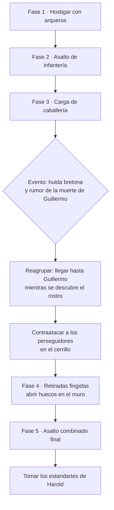
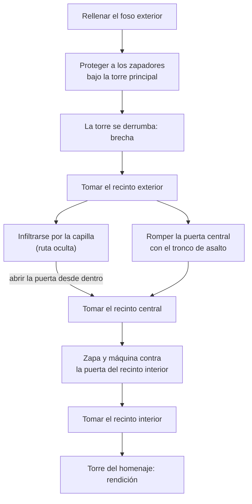
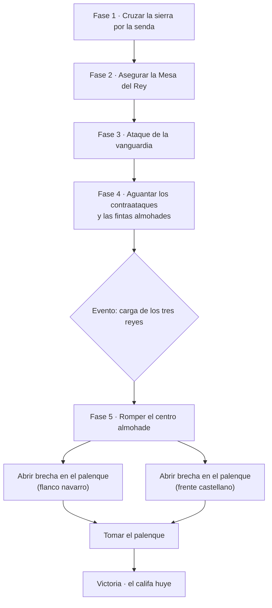
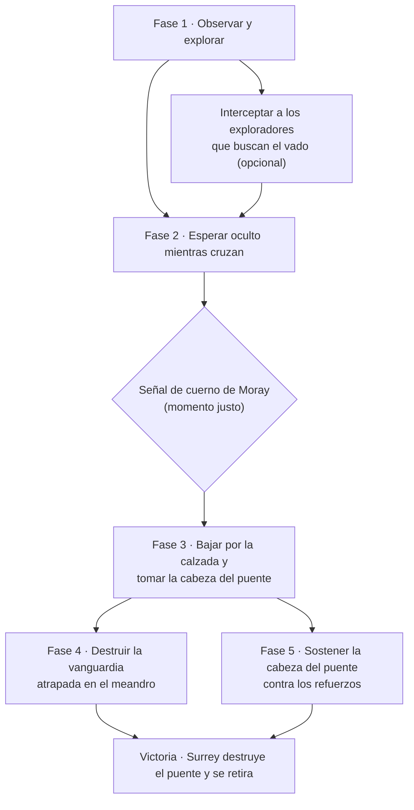
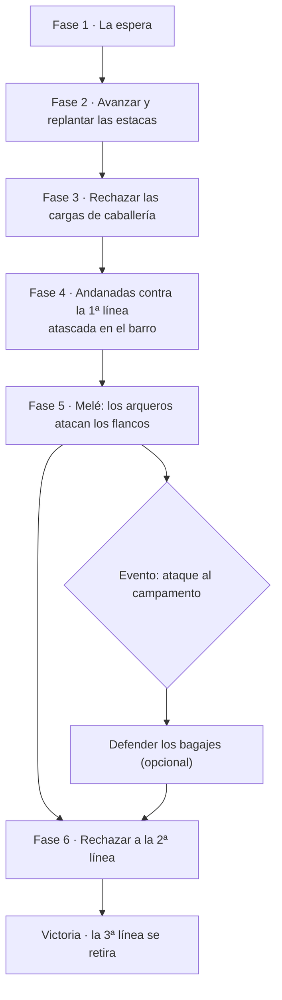

# ESTANDARTES — GDD · Volumen II: Niveles del Modo Historia (Edad Media)

> Parte del [GDD de Estandartes](README.md). Versión 0.3 (30-10-2026).
> Este volumen define los **5 niveles** con los que arranca el Modo Historia del primer juego, *Estandartes: Edad Media*.

---

## Índice

- [1. Criterios de selección](#1-criterios-de-selección)
- [2. Resumen de la campaña](#2-resumen-de-la-campaña)
- [3. Estructura común de un nivel](#3-estructura-común-de-un-nivel)
- [Nivel 1. Hastings 1066](#nivel-1-hastings-1066)
- [Nivel 2. Asedio de Château Gaillard 1203–1204](#nivel-2-asedio-de-château-gaillard-12031204)
- [Nivel 3. Las Navas de Tolosa 1212](#nivel-3-las-navas-de-tolosa-1212)
- [Nivel 4. Puente de Stirling 1297](#nivel-4-puente-de-stirling-1297)
- [Nivel 5. Agincourt 1415](#nivel-5-agincourt-1415)
- [4. Candidatas para ampliar la campaña medieval](#4-candidatas-para-ampliar-la-campaña-medieval)
- [5. Fuentes consultadas](#5-fuentes-consultadas)

---

## 1. Criterios de selección

Las cinco batallas se han elegido para que cada una enseñe **una idea estratégica distinta** y, juntas, cubran todo lo que el juego sabe hacer:

| Criterio | Cómo se cumple |
|---|---|
| **Representativas** | Son batallas famosas y decisivas de la Edad Media europea, con mucha documentación y reconocimiento del público. |
| **De estrategia** | En todas el resultado depende de una decisión táctica clara: el terreno, el momento, el engaño o el flanqueo. No son "choques de números". |
| **Variedad de tipo** | Tres campales (colina, sierra, terreno embarrado), una de cuello de botella con río y un asedio de castillo por recintos. |
| **Variedad de bando** | El jugador lucha con normandos, franceses, castellanos, escoceses e ingleses. Cinco culturas visuales distintas. |
| **Variedad de roles** | Cada nivel pone el foco en un rol: caballería e infantería (Hastings), zapadores y asalto (Gaillard), caballería pesada (Las Navas), lanceros (Stirling) y arqueros (Agincourt). |
| **Arco de aprendizaje** | Las mecánicas se introducen de forma progresiva (ver tabla siguiente). |
| **Una batalla hispánica** | Las Navas de Tolosa, decisiva en la historia de la península ibérica. |

---

## 2. Resumen de la campaña

| Nivel | Batalla | Fecha | El jugador lucha con | Idea estratégica | Mecánicas que introduce |
|---|---|---|---|---|---|
| **1** | **Hastings** | 14-10-1066 | Normandos (atacante) | Romper una posición fuerte en altura con armas combinadas y **retiradas fingidas** | Todos los roles básicos: arco, infantería, caballería; órdenes a la escuadra; moral y reagrupación |
| **2** | **Asedio de Château Gaillard** | 1203–6-3-1204 | Franceses (atacante) | Tomar un castillo **recinto a recinto**: zapa, brecha, infiltración | Máquinas de asedio, zapadores, tronco de asalto, grafo de objetivos encadenado, navegación por murallas |
| **3** | **Las Navas de Tolosa** | 16-7-1212 | Castellanos (atacante) | **Flanqueo estratégico** por un paso oculto y ruptura final con la reserva | Marcha y exploración, coalición de ejércitos aliados, carga de caballería pesada, asalto a una posición fortificada de campaña |
| **4** | **Puente de Stirling** | 11-9-1297 | Escoceses (defensor que contraataca) | **Paciencia y cuello de botella**: atacar en el momento justo | Espera táctica, señales de mando, captura de un punto que corta al enemigo, combate en terreno blando |
| **5** | **Agincourt** | 25-10-1415 | Ingleses (defensor que provoca) | **Elegir el terreno** y obligar al enemigo a atacar donde tú quieres | Estacas, andanadas, barro y aglomeración, cambio de rol de arquero a infante en plena batalla |

La campaña se juega en orden cronológico. Cada nivel desbloquea el siguiente, sus facciones y su mapa en el Modo Libre, y su variante "¿Y si…?".

---

## 3. Estructura común de un nivel

Todos los niveles siguen la misma plantilla (ver [Volumen I, 3.2](01_Diseno_General.md#32-estructura-de-una-batalla)):

1. **Briefing** del cronista sobre mapa animado.
2. **Fases jugables** separadas por objetivos. Entre fases, el cronista puede narrar un salto de tiempo (por ejemplo, días de asedio) con un fundido.
3. **Eventos guionizados con disparadores** (condición → acción) que empujan la batalla hacia los hitos históricos sin quitar libertad: si el jugador o la IA se adelantan o se retrasan, el evento se adapta.
4. **IA libre entre eventos**: los generales usan sus planes (ver [Volumen III](03_Arquitectura_IA.md)), con la personalidad histórica de cada mando.
5. **Epílogo** y desbloqueos.

**Escala:** las cifras históricas son estimaciones discutidas. El juego representa el **total estimado** con oleadas de refuerzo y mantiene en el campo el número de soldados activos que permita el preset del jugador (ver [Volumen I, 9.1](01_Diseno_General.md#91-objetivos-de-rendimiento)). En el preset Épico, varias batallas se acercan a la escala 1:1.

**Estrellas por nivel (hasta 5):** victoria (1), cada objetivo secundario (hasta 3) y el desafío histórico "hazlo como ocurrió" (1).

---

## Nivel 1. Hastings 1066

### Ficha

| Campo | Valor |
|---|---|
| Fecha y lugar | 14 de octubre de 1066 · Senlac, cerca de Hastings (Sussex, Inglaterra) |
| Bandos | **Normandos** (Guillermo, duque de Normandía) contra **anglosajones** (Harold II Godwinson) |
| Mandos normandos | Guillermo (centro, normandos), bretones (ala izquierda), franco-flamencos (ala derecha, con Eustaquio de Boulogne) |
| Mandos anglosajones | Harold II y sus hermanos Gyrth y Leofwine |
| Fuerzas estimadas | Unos 7.000–8.000 por bando según las estimaciones más habituales (las fuentes dan rangos amplios) |
| Escala en el juego | 7.500 contra 7.500 en total; activos según preset (Alto: unos 2.000 por bando) |
| Clima y hora | Otoño, despejado; de media mañana hasta el anochecer, condensado en ~40 minutos |
| El jugador | **Gautier**, joven escudero normando que empieza como arquero y termina en la caballería |
| Duración estimada | 35–45 minutos |

### Contexto

Harold acaba de vencer a los noruegos en Stamford Bridge y ha marchado al sur a toda prisa. Ocupa una cresta con un **muro de escudos** de huscarles y milicias (*fyrd*). Guillermo, con arqueros, infantería y caballería, tiene que romper esa línea antes de que caiga la noche o se queda sin campaña.

### El mapa

```
  NORTE
  ┌───────────────────────────────────────────────┐
  │        bosque              bosque             │
  │   ═══════ CRESTA DE SENLAC (anglosajones) ═══ │  ← estandartes de Harold en la cima
  │   ░░ ladera ░░░░░░░░░░░░░░░░░░░░░░░░░░ ░░░░░░ │
  │   ▓ cerrillo ▓      ladera suave              │  ← cerrillo: trampa para perseguidores
  │   ~~~ terreno húmedo ~~~      ~~~ arroyo ~~~  │
  │   [Bretones]     [Normandos]   [Franco-flam.] │  ← despliegue normando
  │                 campamento normando           │
  └───────────────────────────────────────────────┘
  SUR
```

| Zona | Tipo | Notas |
|---|---|---|
| Cresta de Senlac | Guerrero (enemiga) | El muro de escudos. Pendiente que cansa y protege del tiro directo |
| Cima con los estandartes (Dragón de Wessex y el Guerrero) | **Conquista final** | Objetivo de victoria |
| Ladera y pie de la colina | Guerrero (disputada) | Donde se libra casi todo el combate |
| Cerrillo del ala izquierda | Emboscada / evento | Los anglosajones que persigan acaban rodeados aquí |
| Terreno húmedo | Terreno | Frena y cansa; peligroso para perseguidores |
| Campamento normando | Despliegue y refuerzo | Flechas y caballos de refresco |

### Grafo de objetivos



### Fases

| Fase | Objetivo | Qué pasa y qué aprende el jugador |
|---|---|---|
| **1 · Hostigar** | Disparar contra el muro de escudos | El jugador es arquero. Aprende a tensar, apuntar y gestionar munición. **Lección:** disparar cuesta arriba contra escudos apenas causa bajas; la moral enemiga apenas se resiente. |
| **2 · Asalto de infantería** | Llegar al muro y trabarse | Cambio a espada y escudo. Aprende melé direccional, bloqueo, estamina y la presión de la masa. El ataque es rechazado (la IA anglosajona sostiene la línea con disciplina alta). |
| **3 · Carga de caballería** | Cargar contra el muro | El jugador monta. Aprende la carga y el reagrupamiento. Una carga frontal contra un muro de escudos intacto fracasa. |
| **Evento: pánico** | Sobrevivir y reagrupar | El ala bretona cede y huye; corre el rumor de que Guillermo ha muerto (golpe de moral a todo el ejército). Parte del *fyrd* baja a perseguir. **Objetivo:** llegar junto a Guillermo, que se levanta el yelmo para que le vean: el jugador aprende que la **cadena de mando** y el estandarte reagrupan a los que huyen. Después, contraataque contra los perseguidores atrapados en el cerrillo. |
| **4 · Retiradas fingidas** | Abrir huecos en el muro | El jugador manda una escuadra de caballería y recibe la orden **"Retirada fingida"**: retroceder con orden y volverse cuando el enemigo persiga. La IA anglosajona decide si persigue según su disciplina y su moral: las milicias muerden el anzuelo más que los huscarles. Cada grupo que baja y es destruido adelgaza el muro. |
| **5 · Asalto final** | Romper la línea y tomar la cima | Con el muro debilitado y el día acabando: andanadas de arqueros por elevación (que caen detrás de los escudos) y asalto combinado de infantería y caballería. Los estandartes de Harold son la zona de Conquista final. |

### La IA en este nivel

- **General anglosajón (Harold) — *prudente*:** su plan es **aguantar en la cresta** hasta el anochecer. Nunca baja voluntariamente. Su punto débil está en la tropa: las milicias tienen **disciplina baja** y pueden perseguir sin orden. Si el muro se adelgaza, Harold mueve huscarles para tapar huecos (decisión del comandante del centro).
- **General normando (Guillermo) — *astuto*:** usa armas combinadas por oleadas; tras el evento de pánico, adopta el plan **"Retirada fingida"** con las escuadras de caballería.
- **Lección para la IA:** este nivel es el escaparate de la moral, la disciplina y el contagio del pánico (ver [Volumen III, 11](03_Arquitectura_IA.md#11-moral-contagio-y-huida)).

### Victoria y derrota

- **Victoria:** capturar los estandartes de Harold o romper la moral del ejército anglosajón.
- **Derrota:** el ejército normando se rompe (moral global por debajo del umbral) o llega el anochecer sin romper la línea (tiempo límite de la fase 5).

### Objetivos secundarios

1. Ejecutar al menos **tres retiradas fingidas** con éxito.
2. Llegar hasta Guillermo en el evento de pánico **antes de 60 segundos**.
3. Abatir a los dos hermanos de Harold (Gyrth y Leofwine) en la melé.

**Desafío histórico:** ganar en la fase 5, no antes.

### ¿Y si…?

- **Jugar como anglosajón:** objetivo "resistir hasta el anochecer". El jugador, como huscarle, debe **mantener la disciplina** de su escuadra y evitar que persiga.
- **Harold sin el desgaste de Stamford Bridge:** el ejército anglosajón empieza con fatiga baja y más huscarles.

### Notas históricas y licencias

- Las cifras y la duración exacta son discutidas.
- Las retiradas fingidas están en las fuentes normandas, pero los historiadores debaten si fueron deliberadas o una huida real aprovechada.
- La flecha en el ojo de Harold procede de la interpretación del tapiz de Bayeux y es tradición; en el juego Harold cae en la fase final sin forzar esa versión.
- Licencia: la batalla de un día completo se condensa en unos 40 minutos.

---

## Nivel 2. Asedio de Château Gaillard 1203–1204

### Ficha

| Campo | Valor |
|---|---|
| Fecha y lugar | Agosto de 1203 – 6 de marzo de 1204 · Les Andelys, sobre el Sena (Normandía) |
| Bandos | **Reino de Francia** (Felipe II Augusto) contra la **guarnición angevina** (Roger de Lacy, por Juan Sin Tierra) |
| Fuerzas estimadas | Un ejército francés de varios miles contra una guarnición de unos pocos cientos |
| Escala en el juego | 3.000 atacantes en oleadas contra 600 defensores (licencia: guarnición aumentada para dar ritmo al asalto) |
| Clima y hora | Invierno: frío, barro helado; fases repartidas en varios días narrados |
| El jugador | **Aubri**, zapador picardo, compañero del soldado que la tradición llama Bogis |
| Duración estimada | 40–45 minutos en cuatro fases |

### Contexto

Ricardo Corazón de León construyó Château Gaillard en apenas dos años (1196–1198) para cerrar el camino de París a Ruan. Tras su muerte, Felipe II decide tomarlo. Después de un largo bloqueo durante el invierno, en febrero de 1204 empieza el asalto. El castillo tiene **tres recintos** sobre un espolón rocoso, cada uno separado por un foso: hay que tomarlos uno a uno.

### El mapa

```
           acantilado sobre el Sena
  ┌─────────────────────────────────────────────┐
  │   ┌───────── RECINTO INTERIOR ─────────┐    │
  │   │   muralla ondulada  ■ TORRE (donjon)│    │  ← núcleo
  │   └───────────────┬─────────────────────┘    │
  │       foso seco   │ puente de roca           │
  │   ┌──────── RECINTO CENTRAL ───────────┐    │
  │   │  capilla ✝  letrinas    patio      │    │  ← entrada alternativa
  │   └───────────────┬─────────────────────┘    │
  │       foso seco   │ puente fijo              │
  │   ┌── RECINTO EXTERIOR (triangular) ──┐     │
  │   │  torre principal ▲ (punta)         │     │  ← objetivo de zapa
  │   └───────────────────────────────────┘     │
  │        foso       líneas de asedio francesas │
  │   [campamento francés]  [máquinas] [mantas]  │
  └─────────────────────────────────────────────┘
```

| Zona | Tipo | Notas |
|---|---|---|
| Líneas de asedio | Despliegue, artillería, suministro | Mangoneles, mantas, haces de leña para rellenar el foso |
| Foso exterior | Objetivo "rellenar" | Hay que llenarlo para acercar a los zapadores |
| Torre principal del recinto exterior | Objetivo "derribar" (zapa) | Mina bajo la torre; brecha pre-fracturada |
| Recinto exterior | Conquista | Primer recinto |
| Capilla y letrinas del recinto central | Objetivo "infiltrarse" | Ruta alternativa |
| Puerta del recinto central | Objetivo "abrir desde dentro" o "romper" | Tronco de asalto si no hay infiltración |
| Recinto central | Conquista | Segundo recinto |
| Puerta y muralla del recinto interior | Objetivo "brecha" | Zapa + máquina de asedio |
| Torre del homenaje | **Conquista final** | Rendición de la guarnición |

### Grafo de objetivos



### Fases

| Fase | Objetivo | Qué pasa y qué aprende el jugador |
|---|---|---|
| **1 · El foso y la mina** (día 1) | Rellenar el foso y minar la torre principal | El jugador escolta a los porteadores de haces bajo mantas, opera un mangonel contra las almenas y protege a los zapadores. **Lección:** el asedio es un trabajo de ingeniería; la IA defensora concentra a sus ballesteros contra lo que más amenaza. La mina avanza por tiempo mientras los zapadores sigan vivos y protegidos. |
| **2 · Brecha y recinto exterior** (día 2) | Asaltar la brecha y tomar el recinto exterior | La torre cae (evento con la fractura precalculada). Asalto por los escombros. La guarnición **se repliega con orden** al recinto central cruzando el puente fijo. |
| **3 · La capilla** (noche del día 2) | Tomar el recinto central | **Dos rutas** (el jugador elige): **a)** infiltración con un pequeño grupo por las letrinas y la ventana de la capilla, de noche y en silencio; al ser descubiertos, prender fuego y abrir la puerta desde dentro; **b)** asalto con el **tronco de asalto** a la puerta, bajo el fuego de las almenas. La infiltración es más difícil pero ahorra muchas bajas. |
| **4 · El recinto interior** (días 3–4) | Abrir brecha y tomar la torre del homenaje | Zapa bajo la puerta interior y bombardeo con una máquina de asedio. Asalto final. Si la guarnición queda rodeada y con moral baja, **se rinde** (la IA evalúa que no hay ruta de escape ni esperanza de socorro). |

### La IA en este nivel

- **General defensor (Roger de Lacy) — *prudente*:** **defensa en profundidad**. Nunca arriesga a toda la guarnición en un recinto; deja una retaguardia que retrasa al atacante y repliega al resto. Hace **salidas** puntuales contra los zapadores si detecta que están poco protegidos (lectura del mapa de influencia).
- **IA aliada francesa:** las dotaciones de máquinas y los zapadores trabajan solos, pero piden protección; el jugador puede ordenar a su escuadra que les cubra.
- **Navegación multicapa:** soldados por patio, adarves, puentes y escaleras (ver [Volumen III, 15](03_Arquitectura_IA.md#15-navegación)).

### Victoria y derrota

- **Victoria:** tomar la torre del homenaje o forzar la rendición de la guarnición.
- **Derrota:** el atacante agota sus refuerzos o pierde a todos los zapadores sin haber abierto brecha en la fase en curso.

### Objetivos secundarios

1. Tomar el recinto central por **la ruta de la capilla**.
2. Que no muera **ningún zapador** en la fase 1.
3. Capturar **vivo** a Roger de Lacy.

**Desafío histórico:** completar las cuatro fases en orden con la ruta de la capilla.

### ¿Y si…?

- **Defender el castillo:** el jugador es un ballestero de la guarnición y debe **retrasar** el asedio el máximo de "días" posible.
- **Llega el socorro de Juan Sin Tierra:** a mitad del nivel aparece un ejército de socorro y el sitiador debe dividir sus fuerzas.

### Notas históricas y licencias

- Las fechas exactas del inicio del asedio y de la rendición varían ligeramente según la fuente (algunas dan el 8 de marzo).
- La entrada por las letrinas o la ventana de la capilla aparece en el relato tradicional; los detalles exactos son discutidos.
- Durante el bloqueo invernal, Roger de Lacy expulsó a los civiles, que quedaron atrapados entre las líneas y muchos murieron; se cuenta en el briefing y el códice, no se juega.
- Licencia: varias semanas de asalto condensadas en cuatro "días" de juego.

---

## Nivel 3. Las Navas de Tolosa 1212

### Ficha

| Campo | Valor |
|---|---|
| Fecha y lugar | 16 de julio de 1212 · cerca de Santa Elena (Jaén), Sierra Morena |
| Bandos | **Coalición cristiana**: Castilla (Alfonso VIII), Aragón (Pedro II), Navarra (Sancho VII), órdenes militares y concejos · contra el **califato almohade** (Muhammad al-Nasir, el *Miramamolín*) |
| Despliegue cristiano | Castilla en el centro (vanguardia de **Diego López de Haro**, cuerpo central con las órdenes militares, retaguardia con Alfonso VIII), Navarra a la derecha, Aragón a la izquierda |
| Despliegue almohade | Vanguardia de voluntarios y tropas ligeras, cuerpo central almohade y andalusí, caballería ligera en las alas, y detrás el **palenque**: el campamento fortificado del califa, rodeado de su guardia |
| Fuerzas estimadas | Estimaciones modernas: unos 12.000–14.000 cristianos frente a unos 22.000–30.000 almohades (las crónicas dan cifras mucho mayores) |
| Escala en el juego | 12.000 contra 20.000 en total; activos según preset |
| Clima y hora | Pleno verano, **calor extremo**: la fatiga sube más rápido. Amanecer → mediodía |
| El jugador | **Rodrigo**, escudero en la mesnada de Diego López de Haro |
| Duración estimada | 40–45 minutos |

### Contexto

Los almohades esperan en Sierra Morena y han cerrado el paso principal (la Losa, en el puerto del Muradal). Si los cristianos lo fuerzan, serán masacrados en el desfiladero. La tradición cuenta que un pastor les mostró **otro camino** por la sierra, que les llevó a una meseta (la Mesa del Rey) frente al ejército almohade. Tras un día de espera, el 16 de julio se libra la batalla.

### El mapa

```
  NORTE (Despeñaperros)
  ┌──────────────────────────────────────────────────────────┐
  │  paso de la Losa (cerrado) ✖        senda del pastor ┄┄┄┐ │
  │  ▲▲▲▲▲▲▲▲▲▲▲▲▲▲▲▲▲ SIERRA ▲▲▲▲▲▲▲▲▲▲▲▲▲▲▲▲▲▲▲▲▲▲▲▲▲▲┄┄┄┄┘ │
  │            MESA DEL REY (campamento cristiano)            │
  │   [Aragón]   [Castilla: vang. / centro / reta.]  [Navarra] │
  │   ░░░ ladera ░░░ arroyos ░░░ barrancos ░░░                │
  │        [voluntarios almohades]  ← vanguardia enemiga      │
  │   [cab. ligera]   [cuerpo almohade]   [cab. ligera]       │
  │              ■■ PALENQUE del califa ■■ (cerro)            │
  └──────────────────────────────────────────────────────────┘
  SUR
```

| Zona | Tipo | Notas |
|---|---|---|
| Senda del pastor | Marcha / infiltración | Fase de exploración; patrullas almohades |
| Bordes de la Mesa del Rey | Conquista | Asegurar la meseta antes de desplegar |
| Ladera central | Guerrero | Choque principal |
| Alas | Guerrero | Donde golpea la caballería ligera almohade |
| Palenque | **Conquista final** | Empalizada con cadenas y guardia de élite |
| Tienda roja del califa | Objetivo "capturar" | Secundario: capturar el estandarte |

### Grafo de objetivos



### Fases

| Fase | Objetivo | Qué pasa y qué aprende el jugador |
|---|---|---|
| **1 · La senda del pastor** | Llevar la columna hasta la meseta sin ser descubiertos | Marcha nocturna y al amanecer por un sendero estrecho. El jugador explora por delante y **elimina patrullas**. Si una patrulla escapa con la noticia, el enemigo refuerza los bordes de la meseta (la fase 2 será más dura). **Lección:** la información vale tanto como los soldados; la IA almohade solo sabe lo que sus patrullas le cuentan (niebla de guerra). |
| **2 · La Mesa del Rey** | Tomar los bordes de la meseta | Escaramuza contra tropas ligeras; se monta el campamento y el ejército despliega. |
| **3 · La vanguardia** | Bajar la ladera y romper a los voluntarios | El jugador carga con la caballería pesada de López de Haro. La vanguardia almohade cede pronto… |
| **4 · Las fintas** | Mantener la línea | …porque es parte del plan almohade: la caballería ligera **finge huir, hostiga y envuelve** por las alas. El cuerpo central cristiano se ve presionado y el calor agota a los de armadura pesada. **Lección inversa a Hastings:** ahora es el enemigo quien usa el engaño; perseguir sin orden es caer en la trampa. El jugador decide dónde ayudar: tapar un ala, sostener el centro o recuperar un estandarte caído. |
| **Evento: los tres reyes** | Unirse a la carga | Cuando el centro cristiano vacila (o pasado un tiempo), Alfonso VIII lanza la **retaguardia de los tres reyes**. Gran golpe de moral aliado. |
| **5 · El palenque** | Romper el centro y tomar el palenque | Asalto a la empalizada del califa, defendida por su guardia de élite. **Dos brechas posibles**: por el flanco navarro o por el frente castellano. El califa intenta huir: si el jugador llega a tiempo a la tienda, puede capturar su estandarte. |

### La IA en este nivel

- **General almohade — *astuto*:** su plan base es **"desgaste y envolvimiento"**: sacrificar la vanguardia ligera, atraer a la caballería pesada cristiana, cansarla con el calor y envolverla con la caballería ligera. Guarda la élite en el palenque.
- **Coalición aliada:** cada reino es un **comandante de ala** con su propia personalidad (Navarra agresiva, Aragón prudente, Castilla equilibrada) bajo el general Alfonso VIII. Las órdenes del general llegan a cada ala con su retraso de mando (ver [Volumen III, 12](03_Arquitectura_IA.md#12-cadena-de-mando-y-retrasos)).
- **Fatiga por calor:** la IA tiene en cuenta la fatiga en sus decisiones; las escuadras pesadas piden relevo antes.
- **Tropas andalusíes:** según algunas fuentes, se retiraron pronto; en el juego, su moral de partida es más baja.

### Victoria y derrota

- **Victoria:** tomar el palenque o romper la moral del ejército almohade.
- **Derrota:** el ejército cristiano se rompe, o la columna es descubierta y aniquilada en la sierra.

### Objetivos secundarios

1. Cruzar la sierra **sin que escape ninguna patrulla**.
2. Que el ala que el jugador ayude no pierda su estandarte en la fase 4.
3. Capturar el **estandarte del califa** en su tienda.

**Desafío histórico:** asaltar el palenque por el flanco navarro (según la tradición, los navarros se llevaron las cadenas que lo rodeaban, origen del escudo de Navarra).

### ¿Y si…?

- **Sin el pastor:** forzar el paso de la Losa contra un enemigo atrincherado en el desfiladero.
- **Jugar como almohade:** ejecutar el plan de desgaste y aguantar la carga de los tres reyes.

### Notas históricas y licencias

- El pastor (la tradición le llama Martín Alhaja) tiene un fuerte componente legendario; se presenta como tradición.
- Las cifras de las crónicas son exageradas; se usan las estimaciones modernas.
- Las "cadenas del palenque" y la guardia encadenada mezclan historia y leyenda; el juego representa la empalizada y una guardia de élite.

---

## Nivel 4. Puente de Stirling 1297

### Ficha

| Campo | Valor |
|---|---|
| Fecha y lugar | 11 de septiembre de 1297 · puente de Stirling sobre el río Forth (Escocia) |
| Bandos | **Escoceses** (Andrew Moray y William Wallace) contra **ingleses** (John de Warenne, conde de Surrey, y Hugh de Cressingham) |
| Fuerzas estimadas | Unos 5.300–6.300 escoceses frente a unos 9.000 ingleses (estimaciones; algunas fuentes dan hasta 10.000 ingleses) |
| Escala en el juego | 6.000 contra 9.000 |
| Clima y hora | Fin de verano, nubes bajas; mañana hasta primera hora de la tarde |
| El jugador | **Ewan**, lancero de la hueste de Andrew Moray |
| Duración estimada | 30–40 minutos |

### Contexto

El ejército inglés tiene que cruzar el Forth por un **puente de madera estrecho** (dos jinetes de frente) que desemboca en una calzada elevada entre terreno blando, dentro de un meandro del río. Los escoceses esperan en la colina de Abbey Craig. Si atacan demasiado pronto, solo encontrarán a unos pocos; si esperan demasiado, tendrán delante a todo el ejército inglés.

### El mapa

```
  NORTE
  ┌──────────────────────────────────────────────┐
  │          ▲ ABBEY CRAIG (escoceses ocultos)    │
  │              ╲ calzada elevada ╱              │
  │  ~~~~~~ terreno blando ░░ MEANDRO ░░ ~~~~~~   │  ← la vanguardia inglesa queda atrapada aquí
  │  ~~~~~~~~~~~~~~~ RÍO FORTH ~~~~~~~~~~~~~~~~~  │
  │            ═══ PUENTE ═══  (cabeza norte ◆)  │  ← punto clave
  │  vado lejano ✕ (río abajo)                    │
  │         [ejército inglés: Surrey]             │
  │              ■ castillo de Stirling           │
  └──────────────────────────────────────────────┘
  SUR
```

| Zona | Tipo | Notas |
|---|---|---|
| Abbey Craig | Despliegue escocés, emboscada | Posición elevada con visión del puente |
| Calzada | Guerrero | Estrecha: formaciones de columna |
| Meandro y terreno blando | Guerrero / terreno | La caballería pesada se atasca |
| Cabeza norte del puente | **Conquista clave** | Quien la controla corta o abre el paso |
| Vado lejano | Ruta alternativa (amenaza) | El enemigo podría usarlo para flanquear |
| Orilla sur | Despliegue inglés | Inaccesible para los escoceses |

### Grafo de objetivos



### Fases

| Fase | Objetivo | Qué pasa y qué aprende el jugador |
|---|---|---|
| **1 · Observación** | Explorar y vigilar | Desde Abbey Craig se ve el campamento inglés. Llegan emisarios a negociar (evento narrativo). Un caballero propone a Surrey cruzar por un **vado** con caballería para flanquear: si el jugador intercepta a los exploradores que lo buscan, esa opción desaparece del plan inglés. |
| **2 · Paciencia** | No atacar antes de tiempo | Los ingleses cruzan el puente poco a poco. El jugador está con su escuadra **oculto** tras la cresta. Los soldados de alrededor se impacientan (*barks*, gestos); si el jugador o una escuadra aliada atacan antes de la señal, solo atraparán a una parte pequeña y la batalla será más difícil. **Lección:** el momento es un arma. |
| **Evento: el cuerno** | — | El general escocés (IA) **calcula el momento** con su simulación de planes: ataca cuando la parte que ha cruzado es la mayor que puede vencer con seguridad. Es el mejor ejemplo del sistema de evaluación de planes (ver [Volumen III, 6](03_Arquitectura_IA.md#6-nivel-1-el-general)). |
| **3 · La cabeza del puente** | Tomar el extremo norte del puente | Carga de lanceros por la calzada hasta el puente. Al capturar la cabeza norte, **la vanguardia inglesa queda aislada**: los refuerzos solo pueden llegar de dos en dos. |
| **4 · El meandro** | Destruir la vanguardia atrapada | La caballería pesada inglesa se atasca en el terreno blando; los lanceros escoceses la rodean. Algunos ingleses intentan volver a nado. |
| **5 · Sostener** | Aguantar en el puente | Surrey intenta enviar refuerzos por el puente; el jugador y su escuadra lo cierran con un muro de lanzas. Cuando la IA inglesa concluye que la batalla está perdida, **destruye el puente y se retira**. |

### La IA en este nivel

- **General inglés (Surrey) — *tradicionalista* y lento:** cruza por el puente según la doctrina; con baja probabilidad, y solo si sus exploradores encuentran el vado, envía una fuerza de flanqueo (variación entre partidas).
- **General escocés (Moray/Wallace) — *prudente* en la espera, *agresivo* en el golpe:** su plan tiene dos tareas: *esperar oculto* y *golpear la cabeza del puente*. La transición la decide la **evaluación por simulación** (Monte Carlo sobre el modelo abstracto: "¿cuántos enemigos han cruzado y cuántos puedo vencer?").
- **Disciplina de espera:** las escuadras escocesas tienen una variable de **impaciencia** que crece con el tiempo y baja con la presencia del capitán; mostrar esa tensión es parte del espectáculo.

### Victoria y derrota

- **Victoria:** destruir la vanguardia inglesa y sostener la cabeza del puente hasta que el inglés se retira.
- **Derrota:** perder la cabeza del puente cuando ya han cruzado demasiados ingleses, o ser flanqueados por el vado sin respuesta.

### Objetivos secundarios

1. **Interceptar** a los exploradores del vado.
2. No atacar antes de la señal del cuerno.
3. Encontrar y abatir a **Hugh de Cressingham** en el meandro.

**Desafío histórico:** que la escuadra del jugador sea la primera en llegar a la cabeza del puente.

### ¿Y si…?

- **Surrey cruza por el vado:** media caballería inglesa aparece por el flanco.
- **Jugar como inglés:** organizar el cruce, proteger la cabeza del puente y mantener abierta la retirada.

### Notas históricas y licencias

- Las cifras varían según la fuente y la ubicación exacta de las posiciones escocesas es incierta.
- El derrumbe del puente "por sabotaje" es una tradición posterior; las fuentes indican que Surrey mandó destruirlo al retirarse. El juego sigue esta última versión.
- Andrew Moray fue herido de muerte en la batalla; se cuenta en el epílogo.

---

## Nivel 5. Agincourt 1415

### Ficha

| Campo | Valor |
|---|---|
| Fecha y lugar | 25 de octubre de 1415 (día de San Crispín) · entre los bosques de Tramecourt y Azincourt (Artois, norte de Francia) |
| Bandos | **Inglaterra** (Enrique V) contra **Francia** (mandos: el condestable Charles d'Albret y el mariscal Boucicaut, con varios grandes señores) |
| Mandos ingleses | Enrique V (centro), el duque de York (ala derecha), lord Camoys (ala izquierda), sir Thomas Erpingham (arqueros) |
| Fuerzas estimadas | Unos 6.000–9.000 ingleses (en su mayoría arqueros) frente a unos 12.000–15.000 franceses según estimaciones modernas (las cifras tradicionales son mucho mayores) |
| Escala en el juego | 7.000 contra 14.000 |
| Clima y hora | Tras una noche de lluvia; campo recién arado convertido en **barro**. Mañana fría |
| El jugador | **Tom Hale**, arquero de Cheshire |
| Duración estimada | 35–40 minutos |

### Contexto

El ejército de Enrique V, enfermo y agotado tras el asedio de Harfleur, intenta llegar a Calais. Un ejército francés mucho mayor le corta el paso. El campo es un **corredor de menos de un kilómetro** entre dos bosques, empapado por la lluvia. Tras horas de espera, Enrique hace lo inesperado: **avanza** para provocar el ataque francés.

### El mapa

```
  NORTE (posición francesa)
  ┌──────────────────────────────────────────────┐
  │ bosque de   [3ª línea francesa]   bosque de   │
  │ Azincourt   [2ª línea francesa]   Tramecourt  │
  │   ▓▓▓       [1ª línea: hombres de armas] ▓▓▓  │
  │   ▓▓▓  [caballería ala]     [caballería ala]▓▓▓ │
  │   ▓▓▓  ~~~~~ CAMPO ARADO Y EMBARRADO ~~~~~ ▓▓▓  │  ← se estrecha hacia los ingleses
  │    ▓▓▓  ✕✕✕ estacas ✕✕✕   ✕✕✕ estacas ✕✕✕  ▓▓▓   │
  │     ▓▓ [arq.] [Camoys][Enrique][York] [arq.] ▓▓  │
  │        posición inglesa tras el avance          │
  │              ■ campamento y bagajes inglés     │
  └──────────────────────────────────────────────┘
  SUR
```

| Zona | Tipo | Notas |
|---|---|---|
| Posición inglesa inicial | Despliegue | Fuera de alcance de tiro |
| Línea de avance | Objetivo "avanzar y replantar estacas" | A distancia de arco largo de los franceses |
| Corredor embarrado | Guerrero / terreno | Barro profundo, fatiga, caídas, aglomeración |
| Bosques laterales | Terreno | Encajonan a los franceses; los arqueros se apoyan en ellos |
| Campamento inglés | Objetivo "defender" | Evento de ataque a los bagajes |

### Grafo de objetivos



### Fases

| Fase | Objetivo | Qué pasa y qué aprende el jugador |
|---|---|---|
| **1 · La espera** | Mantener la posición | Horas de espera condensadas: ambos ejércitos esperan que el otro ataque. Ambiente: rezos, nervios, lluvia fina, el rey recorriendo la línea. Tutorial de arco largo y estacas. |
| **2 · El avance** | Arrancar las estacas, avanzar y replantarlas | A la señal (sir Thomas Erpingham), el ejército avanza hasta quedar a distancia de arco largo. **Momento de riesgo:** mientras se replantan las estacas, el ejército es vulnerable. La IA francesa puede decidir cargar en ese momento; el jugador y su escuadra deben replantar rápido y cubrir a los demás. **Lección:** provocar al enemigo para que ataque en tu terreno. |
| **3 · Las cargas** | Detener la caballería de las alas | Andanadas contra los caballos; las estacas paran la carga. Los caballos heridos huyen **a través de su propia infantería** y la desordenan (comportamiento emergente de la simulación de pánico y movimiento). |
| **4 · El barro** | Desgastar a la primera línea | Los hombres de armas franceses avanzan a pie por el barro. Llegan agotados; el corredor se estrecha y **se amontonan**: la presión de la masa les impide usar las armas. Andanadas de flanco desde los bosques. |
| **5 · La melé** | Cambiar de rol y atacar | Los arqueros sueltan los arcos y atacan los flancos de la masa francesa con mazos, hachas y espadas. El jugador **cambia de arma** y entra en la melé. Los franceses caídos en el barro apenas pueden levantarse. |
| **Evento: los bagajes** | Defender el campamento (opcional) | Una fuerza francesa ataca el campamento inglés por la retaguardia. El jugador decide si va a defenderlo o sigue en el frente. |
| **6 · La segunda línea** | Rechazar el último gran ataque | La segunda línea francesa ataca sobre los restos de la primera. Cuando fracasa, la IA francesa concluye que no puede ganar y **la tercera línea se retira** sin combatir. |

### La IA en este nivel

- **General francés — *agresivo* y con mando fragmentado:** el ejército francés tiene **varios grandes señores** que compiten. En el juego, sus comandantes de ala tienen **coordinación baja** y retrasos de mando altos: atacan por separado y sin sincronizar. Así la superioridad numérica no se aprovecha, como ocurrió.
- **Aglomeración:** la combinación de barro, fatiga, corredor estrecho y presión de la masa genera de forma natural el amontonamiento francés (ver [Volumen III, 9](03_Arquitectura_IA.md#9-nivel-3-la-escuadra) y [16](03_Arquitectura_IA.md#16-resolución-estadística-y-modelo-agregado)).
- **IA aliada inglesa:** los arqueros eligen blancos según la amenaza; al cambiar a melé, buscan flancos y enemigos caídos.

### Victoria y derrota

- **Victoria:** rechazar a la primera y segunda línea francesas.
- **Derrota:** la línea inglesa se rompe, o la caballería francesa arrolla a los arqueros durante el avance.

### Objetivos secundarios

1. Replantar las estacas de la escuadra del jugador en **menos de 45 segundos**.
2. Defender el campamento en el evento de los bagajes.
3. Capturar a un gran señor francés (por ejemplo, el duque de Orleans).

**Desafío histórico:** ganar sin que la línea de estacas sea rebasada en ningún punto.

### ¿Y si…?

- **Sin lluvia:** el campo está seco; la caballería y la infantería francesas llegan frescas.
- **Jugar como francés:** coordinar un ataque que use la superioridad numérica (por ejemplo, rodear por los bosques).

### Notas históricas y licencias

- Las cifras de ambos ejércitos están muy discutidas.
- Durante el ataque al campamento, Enrique V ordenó matar a parte de los prisioneros; es un hecho histórico que se explica en el epílogo y el códice, no se juega.
- Licencia: varias horas de espera condensadas en la fase 1.

---

## 4. Candidatas para ampliar la campaña medieval

Batallas para futuras actualizaciones de la campaña medieval:

| Batalla | Fecha | Idea estratégica |
|---|---|---|
| Asedio de Jerusalén | 1099 | Torres de asedio contra murallas urbanas, asalto por varios frentes |
| Hattin | 1187 | Sed, calor y fuego: la logística y el terreno como armas |
| Arsuf | 1191 | Marcha de combate bajo hostigamiento y contraataque en el momento justo |
| Lago Peipus | 1242 | Combate sobre el hielo |
| Bannockburn | 1314 | *Schiltrons* y terreno pantanoso contra la caballería pesada |
| Crécy | 1346 | Arco largo contra ballesteros genoveses y cargas cuesta arriba |
| Aljubarrota | 1385 | Posición defensiva con fosos y obstáculos |
| Grunwald | 1410 | Una de las mayores batallas campales de la Edad Media |
| Asedio de Orleans | 1428–1429 | Bastidas, Les Tourelles y el estandarte de Juana de Arco |
| Caída de Constantinopla | 1453 | Murallas teodosianas y los primeros grandes cañones de asedio; transición a la era de la pólvora |

---

## 5. Fuentes consultadas

Fuentes generales consultadas para este volumen (verificar siempre con bibliografía académica antes de cerrar el guion de cada nivel):

- [Battle of Las Navas de Tolosa — Wikipedia](https://en.wikipedia.org/wiki/Battle_of_Las_Navas_de_Tolosa)
- [1212 Tolosa — Universidad de Navarra (PDF)](https://www.unav.edu/documents/1807770/2776220/1212_Tolosa.pdf)
- [Mitos y realidades de la batalla — UPM](https://www.upm.es/gsfs/SFS19731)
- [Siege of Château Gaillard — Wikipedia](https://en.wikipedia.org/wiki/Siege_of_Ch%C3%A2teau_Gaillard)
- [Gaillard Castle — castles.nl](https://www.castles.nl/gaillard-castle)
- [Battle of Stirling Bridge — Wikipedia](https://en.wikipedia.org/wiki/Battle_of_Stirling_Bridge)
- [Springing the trap at Stirling Bridge — HistoryNet](https://www.historynet.com/springing-trap-stirling-bridge/)
- [Battle of Agincourt — Britannica](https://www.britannica.com/event/Battle-of-Agincourt)
- [Battle of Agincourt — New World Encyclopedia](https://newworldencyclopedia.org/entry/Battle_of_Agincourt)
- [Battle of Hastings — Mondes normands (Caen)](https://mondes-normands.caen.fr/angleterre/histoires/4/histoireNorm4_4.htm)
