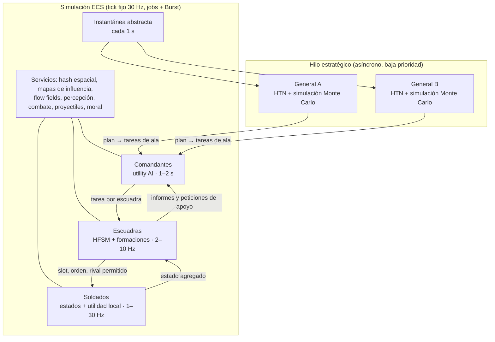
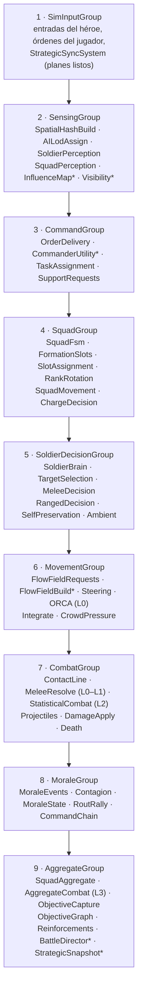

# ESTANDARTES — GDD · Volumen III: Arquitectura de la IA

> Parte del [GDD de Estandartes](README.md). Versión 0.3 (30-10-2026).
> El [Volumen I, sección 8](01_Diseno_General.md#8-inteligencia-artificial) explica **qué** hace la IA desde el punto de vista del jugador. Este volumen explica **cómo está construida**: datos, sistemas, algoritmos, fórmulas, hilos y orden de implementación. Es la referencia para programarla.

---

## Índice

- [1. Principios y requisitos](#1-principios-y-requisitos)
- [2. Vista general](#2-vista-general)
- [3. Modelo de datos ECS](#3-modelo-de-datos-ecs)
- [4. Orden de ejecución por tick](#4-orden-de-ejecución-por-tick)
- [5. Comunicación entre niveles](#5-comunicación-entre-niveles)
- [6. Nivel 1: el general](#6-nivel-1-el-general)
- [7. Mapas de influencia](#7-mapas-de-influencia)
- [8. Nivel 2: los comandantes](#8-nivel-2-los-comandantes)
- [9. Nivel 3: la escuadra](#9-nivel-3-la-escuadra)
- [10. Nivel 4: el soldado](#10-nivel-4-el-soldado)
- [11. Moral, contagio y huida](#11-moral-contagio-y-huida)
- [12. Cadena de mando y retrasos](#12-cadena-de-mando-y-retrasos)
- [13. Director de batalla](#13-director-de-batalla)
- [14. LOD de IA](#14-lod-de-ia)
- [15. Navegación](#15-navegación)
- [16. Resolución estadística y modelo agregado](#16-resolución-estadística-y-modelo-agregado)
- [17. Hilos, presupuestos y determinismo](#17-hilos-presupuestos-y-determinismo)
- [18. Datos editables por diseño](#18-datos-editables-por-diseño)
- [19. Depuración, pruebas y métricas](#19-depuración-pruebas-y-métricas)
- [20. Extensión a otras épocas](#20-extensión-a-otras-épocas)
- [21. Orden de implementación](#21-orden-de-implementación)

---

## 1. Principios y requisitos

| # | Principio | Consecuencia técnica |
|---|---|---|
| P1 | **Mismas reglas que el jugador.** La IA no ve más, no golpea más fuerte, no sabe más. | La IA lee el mundo a través de los mismos sistemas de percepción y combate. La dificultad cambia la calidad de decisión, no las estadísticas. |
| P2 | **Piensa a la escala adecuada.** Cada nivel decide sobre información resumida a su medida. | Cuatro niveles (general, comandante, escuadra, soldado) con frecuencias y datos distintos. Los niveles altos nunca recorren soldados uno a uno. |
| P3 | **Coste acotado.** El coste por tick no puede depender de "lo que pase" en la batalla. | Presupuestos por sistema, LOD de IA por cupos, colas con prioridad, actualización escalonada. |
| P4 | **Datos, no código.** Doctrinas, personalidades, planes, curvas y formaciones son datos editables. | ScriptableObjects convertidos a *BlobAssets* (ver [18](#18-datos-editables-por-diseño)). |
| P5 | **Explicable.** Cada decisión se puede inspeccionar con su motivo. | Registro de decisiones y depurador visual (ver [19](#19-depuración-pruebas-y-métricas)). |
| P6 | **Independiente de la época.** La IA razona sobre **arquetipos y capacidades**, no sobre "lanceros normandos". | Añadir una época es añadir datos y conductas nuevas puntuales (ver [20](#20-extensión-a-otras-épocas)). |
| P7 | **Determinista y reproducible.** Misma semilla y mismas entradas → misma batalla. | Tick fijo, orden estable, RNG con semilla por entidad, decisiones asíncronas registradas (ver [17](#17-hilos-presupuestos-y-determinismo)). |
| P8 | **Viva.** Variación individual, imperfección humana y conductas ambientales en todo lo que el jugador ve de cerca. | Personalidad por soldado, modelos de error y tiempo de reacción, conductas ambientales en L0–L1. |

**Requisitos cuantitativos** (equipo recomendado, preset Alto): 4.000 soldados activos, 60–80 escuadras, 8–12 comandantes, 2 generales; simulación ≤ 8 ms de tiempo real por tick a 30 Hz (ver [Volumen I, Anexo D](01_Diseno_General.md#anexo-d-presupuestos-de-rendimiento)).

---

## 2. Vista general

### 2.1 Capas y frecuencias



### 2.2 Qué sabe cada nivel

| Nivel | Lee | Escribe | Frecuencia |
|---|---|---|---|
| **General** | Instantánea abstracta: fuerzas propias agregadas por ala, **creencias** sobre el enemigo, grafo de objetivos, puntos clave del mapa, mapas de influencia reducidos | Plan activo → **tareas de ala** para cada comandante | Cada 2–5 s y por eventos |
| **Comandante** | Tareas de ala, estado de sus escuadras, mapas de influencia, peticiones de apoyo | **Tarea por escuadra**, grupos de sincronización | Cada 1–2 s, escalonado |
| **Escuadra** | Su tarea, su percepción por sectores, flow field, estado de sus soldados | Formación, ancla y orientación, slots, órdenes de carga y retirada, rival permitido | 2–10 Hz según LOD |
| **Soldado** | Su slot, vecinos (hash espacial), rival, estado propio, órdenes de su escuadra | Movimiento deseado, acción de combate, moral individual | 1–30 Hz según LOD |

### 2.3 Flujo de un tick (resumen)

1. Se aplican entradas: jugador, órdenes del jugador, decisiones asíncronas del general que estén listas.
2. **Percepción:** se reconstruye el hash espacial, se asigna el LOD de IA, se calcula la percepción de soldados y escuadras.
3. **Mando:** se entregan las órdenes cuyo retraso ha vencido; los comandantes a los que les toca piensan.
4. **Escuadras:** máquina de estados, formación, movimiento del ancla, rotación de filas.
5. **Soldados:** decisiones de los soldados a los que les toca pensar (o que se han despertado por un evento).
6. **Movimiento**, **combate**, **proyectiles**, **daño y muertes**.
7. **Moral:** eventos, contagio, cambios de estado, huidas y reagrupaciones.
8. **Agregados:** estado de escuadras, combate abstracto en L3, captura de objetivos, refuerzos, Director, instantánea para el general.
9. La presentación interpola y anima (fuera del tick).

---

## 3. Modelo de datos ECS

Todos los ejemplos usan la API de **Unity Entities 1.x** (`IComponentData`, `IBufferElementData`, `IEnableableComponent`, `BlobAssetReference<T>`). Los nombres de código van en inglés; la documentación, en español.

### 3.1 Entidades

| Entidad | Cuántas (preset Alto) | Qué representa |
|---|---|---|
| Soldado | ~4.000 activas | Un combatiente (incluido el héroe, como entidad "espejo") |
| Escuadra | 60–80 | Grupo táctico con formación, capitán, abanderado y músico |
| Comandante | 8–12 | Un ala o cuerpo (izquierda, centro, derecha, reserva, asedio…) |
| General | 2 | Enlace con el cerebro estratégico asíncrono |
| Objetivo | 5–30 | Nodo del grafo de objetivos (zona, puerta, máquina…) |
| Máquina de asedio | 0–20 | Con su dotación de soldados |
| Proyectil | 0–4.000 | Solo los simulados individualmente (las andanadas lejanas son "nubes") |
| Mensajero | 0–10 | Jinete que lleva órdenes a distancia |

### 3.2 Componentes del soldado

```csharp
public struct SoldierTag : IComponentData {}
public struct Team : IComponentData { public byte Value; }
public struct UnitDef : IComponentData { public BlobAssetReference<UnitBlob> Blob; }   // tipo de unidad (datos)

public struct SquadMember : IComponentData
{
    public Entity Squad;
    public ushort SlotIndex;
    public byte Rank;              // 0 = primera fila
    public SquadRole Role;         // Soldier, Captain, StandardBearer, Musician, Crew
}

public struct Health : IComponentData { public float Value, Max; public WoundLevel Wounds; }
public struct Stamina : IComponentData { public float Value, Max; }
public struct Fatigue : IComponentData { public float Value; }              // 0..1, acumulada (no se recupera en combate)

public struct Morale : IComponentData { public float Value; public MoraleState State; public float PanicTimer; }

public struct Personality : IComponentData                                   // generada al nacer dentro del rango del tipo
{
    public half Courage, Aggression, Skill, Discipline, Experience;
}

public struct Locomotion : IComponentData
{
    public float3 Velocity;
    public float DesiredSpeed;
    public byte NavLayer;          // capa de navegación (suelo, adarve, torre…)
    public LocomotionFlags Flags;  // Crowded, InMud, Climbing, Mounted…
}

public struct MeleeState : IComponentData
{
    public Entity Target;
    public MeleePhase Phase;       // Idle, Windup, Strike, Recover, Block, Parry, Stagger
    public byte Direction;         // 0 arriba, 1 izquierda, 2 derecha, 3 estocada
    public float PhaseTime;
    public float PendingReaction;  // retraso de reacción en curso (s)
}

public struct RangedState : IComponentData
{
    public byte Ammo;
    public float ReloadTimer;
    public float2 AimBias;         // corrección aprendida tras fallar al mismo blanco
    public Entity Target;
}

public struct SoldierBrain : IComponentData
{
    public SoldierState State;     // InFormation, Seeking, Dueling, Shooting, Retreating, Fleeing, Surrendered, Wounded
    public uint NextThinkTick;
    public byte Bucket;            // cubo de actualización escalonada
}

public struct AILod : IComponentData { public byte Level; public float Relevance; public float DowngradeTimer; }

public struct Wake : IComponentData, IEnableableComponent { public WakeReason Reason; }   // se activa para pensar ya

public struct ShortMemory : IBufferElementData                               // 4 entradas como máximo
{
    public Entity Who; public MemoryKind Kind; public uint Tick;            // "mató a mi compañero", "me atacó"…
}
```

### 3.3 Componentes de la escuadra

```csharp
public struct Squad : IComponentData
{
    public byte Team;
    public Entity Commander, Captain, StandardBearer, Musician;
    public BlobAssetReference<FormationBlob> Formation;
    public FormationParams Params;  // anchura deseada, espaciado, orden cerrado/abierto
}

public struct SquadState : IComponentData
{
    public SquadFsm State, SubState;
    public float StateTime;
    public float Cohesion;          // 0..1
    public float MoraleAvg, FatigueAvg;
    public int Alive;
    public SquadFlags Flags;        // Disorganized, Engaged, Wavering, Hidden, Impatient…
    public float Impatience;        // espera táctica (Stirling)
}

public struct SquadAnchor : IComponentData
{
    public float3 Position;
    public float2 Facing;
    public int FlowFieldId;
    public byte NavLayer;
}

public struct SquadTask : IComponentData
{
    public TaskType Type; public float3 Area; public int ObjectiveId; public Entity TargetSquad;
    public uint SyncGroup; public uint AssignedTick; public float Score;
}

public struct SquadPerception : IComponentData
{
    public float4 Threat;           // frente, flanco izquierdo, flanco derecho, retaguardia
    public float LocalForceRatio;   // propias / enemigas en 40 m (según mapa de influencia)
    public Entity NearestEnemySquad;
    public float TimeToContact;
    public float CavalryThreat;     // para decidir el erizo
}

public struct SquadAggregate : IComponentData   // usado por L3 y por la instantánea del general
{
    public float HpPool, Strength, MeleePower, RangedPower;
}

public struct FormationSlot : IBufferElementData { public float2 LocalOffset; public Entity Occupant; public byte Rank; }
public struct PendingOrder  : IBufferElementData { public Order Value; public uint DeliverTick; }
public struct DecisionLog   : IBufferElementData { public uint Tick; public DecisionCode Code; public float3 TopScores; }
```

### 3.4 Comandante, general y equipo

```csharp
public struct Commander : IComponentData
{
    public byte Team; public WingId Wing; public Entity General;
    public float Coordination;      // 0..1: calidad de sincronización (Agincourt: baja en el bando francés)
    public BlobAssetReference<PersonalityBlob> Personality;
    public uint NextThinkTick;
}

public struct WingTask       : IBufferElementData { public TaskType Type; public float3 Area; public int ObjectiveId;
                                                    public byte Priority; public uint SyncGroup; public uint NotBeforeTick; }
public struct SupportRequest : IBufferElementData { public Entity FromSquad; public float Urgency; }

public struct GeneralLink : IComponentData { public int BrainId; public uint PlanVersion; }  // el cerebro vive en el hilo estratégico

public struct TeamBlackboard : IComponentData        // un singleton por bando
{
    public int InfluenceMapHandle;                   // capas propias del bando
    public int BeliefsHandle;                        // contactos conocidos del enemigo
    public float GlobalMorale; public int Reinforcements; public uint LastSnapshotTick;
}
```

### 3.5 Definiciones (BlobAssets)

| Blob | Contenido principal |
|---|---|
| `UnitBlob` | Arquetipo (ver [20](#20-extensión-a-otras-épocas)), capacidades, estadísticas, armas, armadura por zona y tipo, rangos de personalidad, tamaño de escuadra |
| `WeaponBlob` | Familia, tipo de daño, daño base, penetración, alcance, tiempos de preparación/golpe/recuperación, coste de estamina, munición y recarga |
| `FormationBlob` | Tipo, generador de slots, espaciados, reglas de rango (quién va delante), flags (escudos solapados, orientación hacia fuera) |
| `DoctrineBlob` | Pesos de composición, plantilla de despliegue, planes preferidos y sus sesgos |
| `PersonalityBlob` | Agresividad, aversión al riesgo, paciencia, astucia, aversión a las bajas, temperatura de decisión |
| `UtilityCurveBlob` | Curvas de respuesta precalculadas en tablas de 64 muestras |
| `HtnDomainBlob` | Tareas compuestas, métodos con precondiciones, tareas primitivas (o se mantiene gestionado en el hilo estratégico) |
| `CombatCalibrationBlob` | Coeficientes de L2/L3 por par de tipos de unidad y condición |

---

## 4. Orden de ejecución por tick

La simulación vive en `FixedStepSimulationSystemGroup` con `Timestep = 1/30 s`. Dentro, grupos propios en este orden:



`*` = sistemas que no se ejecutan en todos los ticks (amortizados o escalonados).

- Los sistemas se declaran con `[UpdateInGroup]`, `[UpdateAfter]` y `[UpdateBefore]` para fijar el orden.
- Todo lo masivo son `IJobEntity` o `IJobParallelFor` con `[BurstCompile]`.
- Los **cambios estructurales** (crear o destruir entidades, añadir componentes) se acumulan en `EntityCommandBuffer` y se aplican en dos puntos de sincronización por tick: tras `CombatGroup` (muertes, proyectiles) y al final (refuerzos, objetivos).
- Los cambios de estado frecuentes se modelan con **componentes habilitables** (`IEnableableComponent`) en vez de añadir y quitar componentes, para no provocar cambios estructurales.
- La presentación (interpolación, animación, audio, VFX) vive en `PresentationSystemGroup` y solo lee.

---

## 5. Comunicación entre niveles

| Mecanismo | Uso | Implementación |
|---|---|---|
| **Órdenes** (bajan) | General → comandante → escuadra | `PendingOrder` con `DeliverTick` calculado por la cadena de mando (ver [12](#12-cadena-de-mando-y-retrasos)). `OrderDeliverySystem` mueve a `SquadTask` las que vencen. |
| **Informes** (suben) | Escuadra → comandante → general | Cada escuadra actualiza `SquadAggregate` y `SquadPerception`; el comandante los lee directamente; el general los recibe resumidos en la **instantánea abstracta**. |
| **Peticiones de apoyo** | Escuadra → comandante | `SupportRequest` en el *buffer* del comandante. |
| **Pizarras** | Conocimiento compartido de un bando | `TeamBlackboard`: mapas de influencia, creencias sobre el enemigo, estado de objetivos, plan activo. |
| **Eventos** | Daño, muertes, golpes de moral, avisos de proyectiles | `NativeQueue`/`NativeStream` por tipo de evento, escritos en paralelo y consumidos por el sistema correspondiente en el mismo tick. |
| **Despertar** | Reacción inmediata | Habilitar `Wake` en el soldado o la escuadra afectados. |

**Ejemplo de orden:**

```csharp
public struct Order
{
    public OrderType Type;          // Move, Hold, Attack, Charge, Formation, FireAtWill, Volley, Retreat, FeignedRetreat…
    public float3 Point; public Entity Target; public int ObjectiveId;
    public FormationType Formation;
    public Entity Issuer; public uint IssueTick;
    public CommandMedium Medium;    // Voice, Musician, Standard, Messenger
    public byte Priority;
}
```

---

## 6. Nivel 1: el general

### 6.1 Arquitectura

El general es un **cerebro gestionado** (código C# normal) que vive en un **hilo estratégico** de baja prioridad, uno para ambos generales. No toca el mundo ECS directamente:

1. Cada segundo, `StrategicSnapshotSystem` copia una **instantánea abstracta** (unos pocos KB) a un *buffer* doble.
2. El cerebro lee la instantánea más reciente, actualiza sus **creencias**, decide si replanifica y, si lo hace, **evalúa planes por simulación**.
3. El resultado (plan elegido y sus tareas de ala) se publica en una cola sin bloqueo.
4. En el siguiente tick, `StrategicSyncSystem` aplica el plan con **marca de tick** (y lo registra para las repeticiones).

### 6.2 Instantánea abstracta

| Elemento | Contenido |
|---|---|
| Grupos propios | Por escuadra: posición, orientación, tipo de arquetipo, efectivos, `HpPool`, poder de melé y de tiro, moral, fatiga, munición, tarea y estado |
| Creencias sobre el enemigo | Contactos conocidos (ver 6.3) |
| Objetivos | Estado de cada nodo del grafo: dueño, progreso, bloqueado o no, valor |
| Mapa | Puntos clave y pistas de IA del mapa (rutas de flanqueo, líneas defensivas, emboscadas), costes de terreno reducidos |
| Contexto | Tiempo transcurrido y restante, clima, refuerzos de cada bando (los propios exactos; los enemigos, estimados) |

### 6.3 Creencias y niebla de guerra

```csharp
public struct EnemyContact
{
    public int SquadKey;            // identidad estable del grupo enemigo observado
    public float2 LastPos, LastVel;
    public ArchetypeId Archetype;
    public float EstStrength;       // efectivos estimados (con error de observación)
    public uint LastSeenTick;
    public float Confidence;        // 1 al verlo; decae con el tiempo
}
```

- **Fuentes:** cualquier soldado o escuadra del bando que tenga visión (capa de visibilidad del mapa de influencia) aporta avistamientos al `TeamBlackboard`; los exploradores tienen más alcance.
- **Decaimiento de confianza:** `c(t) = exp(−(t − t_visto) / τ)` con τ ≈ 60 s.
- **Incertidumbre de posición:** radio `r(t) = v_max(arquetipo) × (t − t_visto)`; la simulación de planes muestrea posiciones dentro de ese radio.
- **Error de observación:** los efectivos se estiman con un error del ±10–30 % según la distancia, la niebla y la experiencia del observador.

### 6.4 Planificador HTN

El general usa una **red jerárquica de tareas (HTN)**: una tarea compuesta (por ejemplo, "Ganar la batalla") se descompone mediante **métodos**, cada uno con precondiciones, en subtareas hasta llegar a **tareas primitivas**, que son tareas de ala para los comandantes.

**Ejemplo de dominio (batalla campal, atacante):**

```
GanarBatalla
├─ Método «Yunque y martillo»      pre: caballería ≥ 15 % ∧ existe ruta de flanco transitable
│   ├─ FijarCentro(infantería, objetivo = centro enemigo)
│   ├─ Hostigar(tiradores, objetivo = centro enemigo, hasta = 3 andanadas)
│   ├─ Flanquear(caballería, ruta = mejor ruta de flanco)
│   └─ Sincronizar(carga de caballería ⇐ centro enemigo trabado)
├─ Método «Retirada fingida»        pre: enemigo en posición fuerte ∧ disciplina enemiga estimada < 0,5
│   ├─ Hostigar(tiradores, objetivo = línea enemiga)
│   ├─ Repetir(2–4){ FintaDeRetirada(caballería, zona = pie de la posición enemiga) }
│   └─ AsaltoGeneral(todas las alas)
├─ Método «Asalto frontal»          pre: superioridad estimada ≥ 1,5
│   └─ AsaltoGeneral(todas las alas, reserva = 15 %)
├─ Método «Desgaste y envolvimiento» pre: caballería ligera ≥ 20 % ∧ terreno abierto
│   ├─ Sacrificar(vanguardia ligera, objetivo = atraer)
│   ├─ Envolver(caballería ligera, alas)
│   └─ Contraatacar(élite, cuando = enemigo fatigado)
└─ Método «Esperar»                 pre: el tiempo juega a mi favor ∨ el enemigo debe atacar
    └─ Mantener(todas, posiciones actuales)
```

**Ejemplo de dominio (asedio, atacante):**

```
TomarFortificación
├─ Método «Asalto escalonado»       pre: grafo con cadena de objetivos
│   └─ Para cada objetivo desbloqueado en orden: Preparar(máquinas) → Asaltar(objetivo) → Consolidar
├─ Método «Finta y asalto real»     pre: ≥ 2 rutas al mismo objetivo
│   ├─ Fintar(ala A, ruta principal, ruido alto)
│   └─ Asaltar(ala B, ruta alternativa, cuando = reserva enemiga comprometida en la ruta principal)
└─ Método «Brecha»                  pre: tramo pre-fracturado ∧ artillería disponible
    ├─ Bombardear(artillería, tramo)
    └─ Asaltar(infantería, brecha, cuando = brecha abierta)
```

- Las precondiciones se evalúan sobre las **creencias**, no sobre la verdad: el general puede equivocarse.
- Los parámetros (qué flanco, qué ruta, qué ala) generan **variantes**; cada variante es un plan candidato.
- Las tareas primitivas se traducen a `WingTask` para cada comandante.

### 6.5 Evaluación de planes por simulación (Monte Carlo)

Para cada plan candidato `p`:

1. Se ejecutan **R simulaciones** (R = 8 / 32 / 64 según dificultad) con el **modelo agregado** de la [sección 16](#16-resolución-estadística-y-modelo-agregado), a paso de 2 s y horizonte de 3–5 minutos, con las posiciones enemigas muestreadas de las creencias y ruido en las tiradas.
2. Cada simulación devuelve: cambio en objetivos, bajas propias y enemigas, moral final y tiempo.
3. Utilidad de una simulación:

```
u = w_obj · ΔObjetivos + w_bajas_enemigas · BajasEnemigas
  − w_bajas_propias · AversiónBajas(personalidad) · BajasPropias
  − w_tiempo · Tiempo
```

4. Valor del plan: `U(p) = media(u) − λ · desviación(u)`, donde λ es la **aversión al riesgo** de la personalidad.
5. Elección con *softmax* y sesgos de personalidad:

```
P(p) = exp((U(p) + sesgo_personalidad(p)) / T) / Σ_q exp((U(q) + sesgo_personalidad(q)) / T)
```

  - `sesgo_personalidad`: un general *astuto* suma un bonus a los planes etiquetados como "engaño"; uno *agresivo*, a los de ataque.
  - `T` (temperatura): alta en *Recluta* (decisiones más variadas y peores), baja en *Maestro de guerra*.

Las simulaciones se ejecutan con código **Burst llamado directamente** desde el hilo estratégico (funciones estáticas `[BurstCompile]`), sin *jobs*, para no depender del hilo principal. Coste orientativo: 64 simulaciones × 150 pasos × 80 grupos ≈ 1 M de operaciones sencillas, del orden de pocos milisegundos en un hilo.

### 6.6 Replanificación y compromiso

**Disparadores:** una tarea del plan falla o es imposible; la moral global cambia más de 15 puntos; aparece un contacto enemigo nuevo y relevante; se gana o se pierde un objetivo; ha pasado el tiempo de revisión (30–60 s); el jugador hace algo con gran impacto (romper un ala).

**Compromiso:** el plan actual solo se sustituye si `U(nuevo) > U(actual) + δ`, con δ proporcional a la **paciencia** de la personalidad. Así el general no parece indeciso.

### 6.7 Personalidad del general

| Parámetro | Agresivo | Prudente | Astuto | Tradicionalista |
|---|---|---|---|---|
| Aversión a las bajas | 0,5 | 1,5 | 1,0 | 1,0 |
| Aversión al riesgo λ | 0,2 | 1,0 | 0,5 | 0,6 |
| Paciencia δ | Baja | Alta | Media | Alta |
| Sesgo "engaño" | 0 | 0 | +0,3 | 0 |
| Sesgo "ataque" | +0,3 | −0,2 | 0 | 0 |
| Sesgo "plan doctrinal" | 0 | 0 | 0 | +0,5 |
| Reserva mínima | 5 % | 25 % | 15 % | 15 % |

### 6.8 Adaptación al jugador

El cerebro del general mantiene contadores sencillos sobre el héroe y su escuadra: flanco preferido, uso de armas a distancia, bajas causadas por minuto, zonas visitadas. Si el héroe es muy dominante, el dominio HTN dispone de la tarea `Neutralizar(héroe)`, que asigna una escuadra de élite o tiradores con prioridad sobre él, y de sesgos para reforzar el flanco que el jugador ataca siempre.

---

## 7. Mapas de influencia

### 7.1 Rejilla y capas

- Celdas de **8 m**. Un mapa de 2 × 2 km tiene 250 × 250 = 62.500 celdas por capa (`NativeArray<half>`).
- Un juego de capas **por bando** (lo que ese bando sabe) más capas comunes de terreno.

| Capa | Significado | Fuente |
|---|---|---|
| `Presence` | Fuerza propia y enemiga (efectivos × calidad) | Escuadras propias exactas; enemigas desde las creencias |
| `MeleeThreat` | Amenaza cuerpo a cuerpo | Poder de melé, radio = alcance + velocidad × 5 s |
| `RangedThreat` | Amenaza a distancia | Poder de tiro, radio = alcance efectivo |
| `CavalryThreat` | Amenaza de carga | Caballería y su velocidad |
| `Danger` | Zonas batidas (andanadas, artillería, aceite, fuego) | Impactos recientes con decaimiento |
| `Control` | Quién domina cada celda | `Presence propia − Presence enemiga` suavizado |
| `Visibility` | Qué ve el bando ahora y qué vio hace poco | Visión de escuadras y exploradores |
| `Value` | Valor estratégico | Objetivos, puntos clave, rutas |

### 7.2 Cálculo

1. **Estampado por escuadra** (no por soldado): cada escuadra suma su aportación con caída radial
   `I(c) += S × max(0, 1 − d / R)^k` (k = 1–2). Se paraleliza **por filas de la rejilla**: cada *job* recorre las escuadras cercanas a su fila (agrupadas por zonas), sin escrituras concurrentes.
2. **Memoria y suavizado temporal:** `I_t = max(I_estampado, α · difuminado(I_{t−1}))` con α = 0,8–0,95 según la capa. La amenaza "recuerda" dónde estuvo el enemigo y se apaga poco a poco.
3. **Frecuencia:** cada 0,5 s (`Danger`, `Control`) o cada 1 s (resto), en ticks distintos para repartir la carga.

### 7.3 Consultas derivadas

| Consulta | Cálculo | Uso |
|---|---|---|
| **Tensión** | `Propia + Enemiga` | Dónde se concentra la batalla |
| **Vulnerabilidad** | `Tensión − abs(Propia − Enemiga)` | Frentes igualados donde un refuerzo decide |
| **Flanco débil** | Mínimo de `Presence enemiga` a lo largo de la línea de contacto, ponderado por `Value` | Elegir por dónde flanquear |
| **Zona segura** | `Control` alto y `Danger` bajo | Retiradas, reagrupación, artillería |
| **Ruta segura** | Coste de flow field + `Danger` + `RangedThreat` | Movimientos de flanqueo y marchas |

---

## 8. Nivel 2: los comandantes

### 8.1 Tipos de tarea

| Tarea | Parámetros | Notas |
|---|---|---|
| `Hold` | Zona | Sostener un frente o un punto |
| `Attack` | Escuadra u objetivo | Atacar un blanco concreto |
| `Capture` | Objetivo | Tomar y mantener un punto |
| `Flank` | Ruta, objetivo | Moverse por la ruta y golpear al llegar o a la señal |
| `Harass` | Objetivo | Tiradores y caballería ligera |
| `Escort` / `Protect` | Entidad o zona | Arietes, zapadores, artillería, el general |
| `Feint` | Zona | Amenazar con ruido sin comprometerse |
| `FeignedRetreat` | Zona | Retirarse para atraer y volverse |
| `Bombard` | Objetivo | Artillería y máquinas |
| `Engineer` | Objetivo | Minar, rellenar fosos, construir, reparar |
| `Reserve` | Zona | Esperar a ser llamada |
| `Retreat` | Zona | Repliegue ordenado a la siguiente línea |

### 8.2 Puntuación con utility AI

Para cada par (escuadra, tarea), el comandante calcula una puntuación combinando **consideraciones** normalizadas entre 0 y 1, cada una pasada por una **curva de respuesta**:

```
puntuación = prioridad_tarea × peso_plan × (Π_i c_i)^(1/n) × (1 + bonus_continuidad)
```

- La **media geométrica** hace que una sola consideración a 0 anule la opción (no se manda caballería a un bosque cerrado), sin que muchas consideraciones penalicen en exceso.
- `bonus_continuidad` = +15 % a la tarea que la escuadra ya tiene, para evitar cambios constantes.

**Curvas de respuesta** disponibles: lineal, polinómica (`x^k`), logística (`1 / (1 + e^(−k(x − x0)))`), logística inversa y escalón suavizado. Se precalculan en tablas de 64 muestras (`UtilityCurveBlob`).

**Ejemplo — escuadra de lanceros, tarea "Proteger el flanco izquierdo contra caballería":**

| Consideración | Entrada | Curva | Valor ejemplo |
|---|---|---|---|
| Distancia a la zona | 0–600 m | Logística inversa (x0 = 250 m) | 0,82 |
| Afinidad arquetipo/tarea | Tabla (lanceros vs. caballería = 1,0) | Constante | 1,00 |
| Fatiga | 0–1 | `1 − x²` | 0,91 |
| Moral | 0–100 | Logística (x0 = 40) | 0,95 |
| Superioridad local en la zona | Mapa de influencia | Logística (x0 = 0,8) | 0,60 |
| Amenaza de caballería en la zona | `CavalryThreat` | Lineal | 0,75 |

Puntuación ≈ prioridad × peso × (0,82 · 1 · 0,91 · 0,95 · 0,60 · 0,75)^(1/6) ≈ prioridad × peso × 0,83.

### 8.3 Asignación

1. Se generan todos los pares (escuadra, tarea) válidos y se puntúan.
2. **Subasta voraz:** se ordenan por puntuación y se asignan respetando la capacidad de cada tarea (mínimo y máximo de escuadras) y que cada escuadra tenga una sola tarea.
3. Con pocas escuadras (≤ 12) se puede usar el **algoritmo húngaro** para la asignación óptima.
4. Una escuadra no se reasigna más de una vez cada 10 s salvo emergencia (flanco roto, objetivo perdido).

### 8.4 Sincronización

- Las tareas pueden pertenecer a un **grupo de sincronización** con una condición de disparo: "centro enemigo trabado", "tres andanadas completadas", "señal del cuerno", "brecha abierta" o un tick mínimo (`NotBeforeTick`).
- Las escuadras del grupo se colocan en posición y esperan en el subestado `Ready`. El comandante da la orden de ejecución cuando se cumple la condición o vence el tiempo máximo.
- La **coordinación** del comandante (0–1) introduce retrasos y errores de sincronización: con coordinación baja, las escuadras se lanzan desfasadas (bando francés en Agincourt).

### 8.5 Peticiones de apoyo

Una escuadra emite `SupportRequest` si su `LocalForceRatio < 0,6` o su moral cae por debajo de 45. El comandante decide:

- **Enviar reserva** si el valor de la zona es alto y hay reserva disponible.
- **Reasignar** una escuadra cercana menos comprometida.
- **Ordenar repliegue** a la siguiente línea si la zona no merece el coste.
- Si no puede resolverlo, **escala** la petición al general (puede disparar una replanificación).

---

## 9. Nivel 3: la escuadra

### 9.1 Máquina de estados jerárquica

| Estado | Subestados | Sale hacia |
|---|---|---|
| `Deployed` | `Idle`, `Ready` (esperando sincronización), `Hidden` (emboscada) | `Marching`, `Charging`, `Engaged` |
| `Marching` | `Column`, `Line`, `Reforming` | `Deployed`, `Engaged` |
| `Charging` | `Accelerating`, `Impact` | `Engaged`, `Reforming` (caballería) |
| `Engaged` | `Holding`, `Pushing`, `Rotating` (rotación de filas), `Skirmishing` (tiradores) | `Withdrawing`, `Routing`, `Deployed` |
| `Withdrawing` | `Ordered` (retirada), `Feigned` (retirada fingida) | `Deployed`, `Routing`, `Charging` (al volverse) |
| `Routing` | — | `Rallying`, `Surrendered` |
| `Rallying` | — | `Deployed` |
| `Surrendered` | — | (fin) |

Las transiciones se evalúan a la frecuencia de la escuadra según su LOD (2–10 Hz) y por eventos (`Wake`).

### 9.2 Geometría de formaciones

Posición mundial de un slot: `p = ancla + R(orientación) · offset`.

| Formación | Generador de slots `offset(i, j)` | Espaciado típico |
|---|---|---|
| **Línea** | `W = clamp(round(N / filas_deseadas), W_min, W_max)`; `offset = ((i − (W − 1)/2) · s_x, −j · s_y)` | s_x = 1,0 m · s_y = 1,2 m |
| **Muro de escudos** | Línea con s_x = 0,7 m y flag `ShieldsOverlap` en la fila 0 | 0,7 / 1,0 m |
| **Columna de marcha** | Línea con W = 4–6 | 1,0 / 1,2 m |
| **Cuña** | La fila j tiene 2j + 1 slots: `offset = ((i − j) · s_x, −j · s_y)` | 1,2 / 1,2 m |
| **Erizo / schiltron** | Anillos k: radio `r_k = r_0 + k · s_y`, `n_k = floor(2π r_k / s_x)` slots a ángulo `2π m / n_k`, mirando hacia fuera | 0,9 / 1,1 m |
| **Orden abierto** | Línea con s_x = 2,5 m y desplazamiento aleatorio fijo por slot | 2,5 / 2,5 m |
| **Círculo defensivo** | Un anillo o dos | 1,0 m |

### 9.3 Asignación de slots

Al formar o cambiar de formación:

1. Se ordenan los **slots** por fila (j) y, dentro de cada fila, por posición lateral.
2. Se ordenan los **soldados** por su prioridad de fila (armadura y experiencia altas → primera fila; el abanderado, en el centro de la segunda; el capitán, en el extremo derecho de la primera o detrás del centro según la doctrina) y, dentro de cada grupo, por su coordenada lateral proyectada sobre la nueva formación.
3. Se emparejan en orden. Es O(n log n) y produce pocos cruces.
4. Si solo cambia la orientación o la posición del ancla, se **conserva el emparejamiento**.

### 9.4 Rotación de filas

Cada 0,5 s, en el subestado `Engaged.Holding`:

- Un soldado de la primera fila con `Fatigue > 0,6` o `Health < 35 %`, y que no esté en mitad de un golpe, intercambia su slot con el soldado que tiene detrás si este está más fresco.
- Máximo de intercambios simultáneos por escuadra: `ceil(W / 8)`, para no abrir huecos.
- El intercambio se anima (paso atrás y paso adelante) y es una de las conductas que más vida dan al frente.

### 9.5 Cohesión

`Cohesión = 1 − clamp(media(|p_soldado − p_slot|) / (2 · s_x), 0, 1)`

- Por debajo de 0,5, la escuadra se considera **desordenada**: menos defensa en melé y más vulnerabilidad a las cargas.
- Si no hay enemigo a menos de 30 m, entra en `Reforming`.

### 9.6 Percepción de escuadra

- Cada 0,5 s se consultan los enemigos en un radio de 40 m del ancla (hash espacial) y se reparten en **cuatro sectores** respecto a la orientación (frente, flancos, retaguardia), sumando su poder ponderado por distancia → `SquadPerception.Threat`.
- `TimeToContact` = distancia al enemigo más cercano / velocidad de cierre.
- `CavalryThreat` = poder de caballería enemiga que se acerca con `TimeToContact < 8 s`.
- `LocalForceRatio` se lee del mapa de influencia.

### 9.7 Decisiones tácticas de la escuadra

| Decisión | Regla |
|---|---|
| **Erizo / muro de lanzas** | Si `CavalryThreat` alto, la unidad tiene la capacidad `AntiCavalryFormation` y `TimeToContact > tiempo_de_cambio_de_formación` → cambiar. Si no da tiempo, cerrar filas. |
| **Cargar** | Utilidad con: distancia en la ventana óptima de carga del arquetipo, blanco desordenado o de flanco, blanco de tiradores, fatiga propia, cohesión, pendiente a favor, ausencia de amenaza anti-caballería. Umbral por personalidad del comandante. |
| **Reagrupar tras la carga** (caballería) | Tras 3–6 s de melé o si la cohesión cae < 0,4 → retirarse 80–150 m, reformar y volver a cargar. |
| **Hostigar** (tiradores) | Mantener distancia entre 0,5 y 0,9 del alcance; si la infantería enemiga se acerca a < 40 m, retroceder; si no puede, cambiar a arma de melé. |
| **Escudos contra flechas** | Si `Danger` (andanadas) en la zona y la unidad lleva escudo → postura de cobertura (testudo improvisado en muro de escudos). |
| **Espera oculta** | Subestado `Hidden`: sin moverse; `Impatience` crece con el tiempo y la tensión, baja con el capitán cerca y la disciplina. Si supera 1, la escuadra puede atacar sin orden (Stirling). |

---

## 10. Nivel 4: el soldado

### 10.1 Bucle de decisión

```text
cada vez que le toca pensar (según su LOD y su cubo) o cuando se le despierta:
    si moral en Huida → comportamiento de huida (11.4)
    si herido grave y en primera fila → pedir rotación o retirarse a retaguardia
    si la escuadra está trabada y estoy en primera fila → duelo (10.3)
    si soy tirador y puedo disparar → apuntar y disparar (10.4)
    si no → mantener slot (movimiento) y elegir conducta ambiental (10.6)
```

### 10.2 Elección de rival

Entre los enemigos a menos de 6 m (hash espacial):

```
S(e) = 1,0 · (1 − d / d_max)
     + 0,8 · [e me está atacando]
     + 0,6 · [e me da el flanco o la espalda]
     + 0,4 · (1 − salud_e)
     + 0,5 · [e mató a un compañero cercano]      (memoria corta)
     + 0,3 · [e está en el frente de mi slot]
     − 0,4 · atacantes_actuales(e)                 (reparto de rivales)
```

Se cambia de rival solo si `S(nuevo) > 1,2 · S(actual)` (histéresis).

### 10.3 Duelo cuerpo a cuerpo

Cada ataque tiene tres fases según el arma: **preparación** (0,35–0,8 s), **golpe** (≈ 0,15 s) y **recuperación** (0,3–0,6 s).

**Reacción a un ataque entrante:**

1. El defensor percibe el ataque con un **tiempo de reacción** `τ ~ LogNormal(μ, σ)`, limitado a [150, 700] ms, con `μ` que crece con la fatiga y el miedo y baja con la destreza (y depende de la dificultad, ver [Volumen I, 8.9](01_Diseno_General.md#89-dificultad-sin-trampas)).
2. Si `τ` es menor que lo que le queda al atacante de preparación, puede reaccionar:
   - **Bloquear** en la dirección correcta con probabilidad `p_dir = clamp(p_base(destreza, dificultad) − 0,3 · fatiga − 0,2 · miedo, 0,05, 0,98)`.
   - **Parada perfecta** si además le sobran ≥ 200 ms y supera una tirada de destreza.
   - **Retroceder** si tiene estamina y espacio.
   - **Contraatacar** si su golpe es claramente más rápido que lo que le queda al rival ("intercambio").
3. Si no puede reaccionar o falla la dirección, recibe el golpe (el modelo de daño del [Volumen I, 7.7](01_Diseno_General.md#77-modelo-de-daño) decide el resultado).

**Decisión de atacar:**

- Ataca cuando el rival está en recuperación, sin estamina, desordenado o tras una parada.
- Elige la dirección **contraria a la guardia** del rival con probabilidad creciente con la destreza.
- Soldados con destreza > 0,7: **fintas** con probabilidad 0,15.
- No ataca con estamina < 20 % salvo que tenga una apertura clara.
- La IA usa **el mismo sistema de combate** que el jugador: mismas fases, mismos tiempos, mismas reglas de bloqueo.

### 10.4 Tiro

- **Error angular:** `σ = σ_0(destreza) · (1 + 0,8 · fatiga) · (1 + 0,5 · miedo) · (1 + k_v · |v_blanco|) · f_clima`.
- **Corrección tras fallar:** `AimBias ← AimBias − η · desvío_observado` para el mismo blanco (el tirador "se ajusta").
- **Adelantamiento:** apunta a la posición futura del blanco con un error proporcional a su velocidad.
- **Disciplina de fuego:** *a discreción* (cada uno a su ritmo) o *andanada* (la escuadra fija un instante y cada tirador suelta en `t_andanada + U(0; 0,6 s)`).
- **Elección de blanco:** prioridad a lo que amenaza a su escuadra; después, blancos lentos y desprotegidos; evita disparar si hay aliados en la trayectoria (salvo con fuego amigo reducido).

### 10.5 Autopreservación

- **Herido grave** (salud < 30 %) en primera fila → pide rotación; si no es posible, retrocede.
- **Flechas entrantes:** el sistema de proyectiles emite avisos por zona de impacto prevista; los soldados con escudo lo levantan.
- **Carga que pasa:** si no está en erizo y una carga va a atravesar su posición, intenta apartarse o agacharse tras el escudo.
- **Sin arma:** recoge una del suelo cercana o se retira.

### 10.6 Conductas ambientales

Un **programador de conductas** elige cada tick hasta K conductas (K = 8–16) entre los soldados L0–L1 en estados de espera, según el contexto y con tiempos de enfriamiento por soldado y por escuadra:

| Contexto | Conductas |
|---|---|
| Antes de la carga enemiga | Golpear escudos, gritos de guerra, rezar, ajustarse el yelmo |
| Espera larga | Hablar con el de al lado, beber, apoyarse en la lanza, mirar al cielo |
| Cerca del héroe | Mirarle, señalarle al enemigo, saludar al capitán |
| Tras una victoria local | Levantar el arma, gritar, rematar o desarmar caídos |
| Heridos cerca | Arrastrar a un compañero hacia atrás, pedir ayuda |
| Tras capturar un objetivo | Plantar el estandarte, celebrar |

Las conductas se combinan con los ***barks*** (voces) del sistema de audio, con prioridad y sin repeticiones.

---

## 11. Moral, contagio y huida

### 11.1 Moral individual

Cada tick de moral (a la frecuencia del soldado):

```
m ← m + dt · (Σ fuentes_positivas − Σ fuentes_negativas) + contagio
m ← clamp(m, 0, 100)
```

Los golpes puntuales (eventos) se aplican al momento, escalados por `(1 − 0,5 · valor)` si son negativos:

| Evento | Efecto | Alcance |
|---|---|---|
| Ver morir a un aliado a < 10 m | −2 | Individual |
| Ser atacado por el flanco | −8 | Escuadra |
| Ser atacado por la retaguardia | −15 | Escuadra |
| Carga de caballería inminente sin formación anti-caballería | −10 | Escuadra |
| Cae el estandarte de la escuadra | −20 | Escuadra |
| Muere el capitán | −12 | Escuadra |
| Muere el general | −30 | Todo el ejército (llega con el retraso de la cadena de mando) |
| Fuego o aceite sobre la escuadra | −15 | Escuadra |
| Bajas recientes > 20 % en 30 s | −10 | Escuadra |
| Victoria local (enemigo cercano huye) | +10 | Escuadra |
| Llega un refuerzo aliado | +8 | Escuadra |
| Objetivo capturado | +10 | Ala |

Fuentes continuas: músico tocando (+0,5/s), estandarte visible a < 30 m (+0,3/s), héroe luchando a < 15 m (+0,3/s), fatiga (−0,4/s × fatiga), amenaza de flanco sostenida (−0,5/s).

### 11.2 Contagio

Con los vecinos a menos de 6 m (hash espacial):

```
m_i ← m_i + dt · κ · (media(m_vecinos) − m_i) · (1 − 0,5 · disciplina_i)
κ = 0,6 /s si la media de los vecinos es menor (el miedo se contagia rápido)
κ = 0,2 /s si es mayor (el valor se contagia despacio)
```

### 11.3 Estados y umbrales

| Moral | Estado | Efecto |
|---|---|---|
| ≥ 60 | **Firme** | Normal |
| 40–60 | **Vacilante** | Ataca menos, bloquea más, no carga |
| 25–40 | **Retrocede** | Pierde terreno poco a poco aunque no se le ordene |
| < 25 | **Huye** | Abandona la formación |
| Huye + sin salida | **Se rinde** | Suelta el arma y se arrodilla |

La moral de **escuadra** es la media ponderada de la individual × (1,1 si el capitán vive) × (1,1 si el estandarte está en pie). Cuando la moral de escuadra entra en "Huye", la escuadra pasa a `Routing`, aunque algunos individuos aguanten unos segundos más (lo que se ve muy natural).

### 11.4 Huida, rendición y reagrupación

- **Dirección de huida:** gradiente del mapa de influencia hacia `Control` propio alto y `Danger` bajo, preferiblemente hacia la zona de despliegue propia.
- **Rendición:** si huye y no hay ninguna celda segura alcanzable en 30 m (rodeado), se rinde. Los enemigos dejan de atacarle salvo en dificultad o reglas especiales.
- **Reagrupación:** si a la escuadra en huida no la persiguen enemigos a menos de 50 m y hay un capitán o un estandarte cerca, la moral se recupera (+2/s) hasta 45 y la escuadra pasa a `Rallying` y luego a `Deployed`. Un capitán puede "ir a buscar" a los que huyen (conducta de recogida).

---

## 12. Cadena de mando y retrasos

### 12.1 Medios de transmisión

| Medio | Alcance | Retraso | Limitaciones |
|---|---|---|---|
| **Voz** | 30 m | 0,3–1 s | Cualquier orden |
| **Músico** (cuerno, tambor, trompeta) | 400 m | 0,5–1,5 s | Solo órdenes codificadas: avanzar, cargar, alto, retirada, señal acordada |
| **Estandarte** | Línea de visión, 600 m | 1–3 s | Órdenes simples; requiere que la escuadra vea el estandarte del mando |
| **Mensajero a caballo** | Ilimitado | Distancia / 10 m/s + 2 s | Puede ser interceptado o morir por el camino |

`DeliverTick = tick_emisión + retraso(medio) + jitter`, donde el medio se elige automáticamente (el más rápido disponible para esa orden y esa distancia).

### 12.2 Pérdida del mando

- **Muere el capitán:** la escuadra queda `Disorganized`: ejecuta la última orden con cohesión reducida y no acepta órdenes nuevas complejas. Tras 5–15 s (menos con experiencia alta), el soldado con más experiencia es **promovido** a capitán.
- **Cae el estandarte:** golpe de moral y pérdida del medio "estandarte". Otro soldado puede recogerlo (objetivo implícito; el jugador también puede).
- **Muere el comandante de ala:** sus escuadras siguen con su tarea actual; el general asigna el ala a otro comandante con retraso.
- **Muere el general:** golpe de moral global y periodo de **vacío de mando** (30–90 s) en el que no hay replanificación.

---

## 13. Director de batalla

### 13.1 Intensidad

```
I(t) = EMA( 0,4 · enemigos_a_15m_norm + 0,3 · daño_recibido_norm + 0,2 · casi_impactos_norm + 0,1 · aliados_caídos_cerca_norm )
```

Ciclo objetivo con estados **Calma → Construcción → Pico → Respiro** (duraciones orientativas: 30–90 s, 30–60 s, 20–60 s, 20–40 s).

### 13.2 Acciones permitidas

| Acción | Detalle |
|---|---|
| **Foco de detalle** | Sube la relevancia (LOD de IA) de las escuadras cerca del jugador y en su campo de visión |
| **Empujón de desempate** | En Calma prolongada (> 60 s), añade hasta +10 % de puntuación a las tareas de escuadras cercanas al jugador cuando el comandante duda entre opciones casi iguales. No crea tropas ni cambia el plan del general |
| **Momentos** | Pide planos de cámara de momentos y acentos de música o silencio |
| **Ambiente** | Ajusta la densidad de conductas ambientales y *barks* según el estado del ciclo |

### 13.3 Prohibiciones

No teletransporta unidades, no cambia estadísticas, no regala información a ninguna IA, no altera tiradas de combate y no invalida decisiones del general. Todas sus acciones quedan registradas para depuración.

---

## 14. LOD de IA

### 14.1 Relevancia y cupos

```
relevancia = w_d · (1 − clamp(distancia_al_jugador / 500 m, 0, 1))
           + w_v · [en pantalla]                      (frustum de la cámara, comprobado por escuadra)
           + w_c · [combate contra el héroe o su escuadra]
           + w_f · [foco del Director]
           + w_o · [en un objetivo disputado]
```

`AILodAssignSystem` (cada tick, barato): ordena por relevancia **por escuadra** (no por soldado), reparte los cupos del preset (por ejemplo, Alto: L0 = 150 soldados, L1 = 1.500, resto L2/L3 según distancia) y, dentro de las escuadras de borde, asigna por soldado (los más cercanos al jugador, primero). El héroe y su rival siempre son L0.

**Histéresis:** subir de nivel es inmediato; bajar exige que la relevancia esté un 15 % por debajo del umbral durante 2 s (`DowngradeTimer`).

### 14.2 Qué se ejecuta en cada nivel

| Sistema | L0 | L1 | L2 | L3 |
|---|---|---|---|---|
| Decisión del soldado | 20–30 Hz | 10 Hz | 2–5 Hz | — |
| Decisión de la escuadra | 10 Hz | 5 Hz | 2 Hz | 1 Hz |
| Percepción individual | Completa | Completa | Reducida (solo rival) | — |
| Movimiento | Slot + ORCA | Slot + separación | Slot, sin evitación fina | Ancla de escuadra |
| Melé | Golpe a golpe, cápsulas, reacciones | Golpe a golpe simplificado | Estadística por pareja (16.1) | Modelo agregado (16.2) |
| Tiro | Proyectil individual | Proyectil individual | Andanada como "nube" | Agregado |
| Moral | Individual + contagio | Individual + contagio | Individual sin contagio fino | Solo de escuadra |
| Conductas ambientales | Sí | Algunas | No | No |
| Animación | Animator + IK | GPU con mezcla | GPU baja frecuencia | Impostor / nada |

### 14.3 Transiciones

- **Agregar (L1/L2 → L3):** la escuadra suma `HpPool`, media de fatiga y de moral; los soldados quedan "dormidos" (componentes habilitables desactivados) y dejan de procesarse; su posición se deriva del ancla y su slot.
- **Materializar (L3 → L2/L1):** cada soldado se coloca en su slot con un pequeño ruido; la salud se reparte a partir de `HpPool` (con más heridos en las primeras filas si la escuadra estaba trabada); fatiga y moral, de la media con variación individual. Las bajas producidas en L3 eliminan soldados de las últimas filas primero.
- Las transiciones se reparten entre ticks (máx. N escuadras por tick) para evitar picos.

### 14.4 Coherencia entre niveles

El resultado esperado de un combate debe ser el mismo en cualquier nivel (tolerancia ≤ 5 %). Se garantiza calibrando L2 y L3 contra L1 con batallas *headless* (ver [16.3](#163-calibración)).

---

## 15. Navegación

### 15.1 Rejilla de costes

- Celdas de **1 m**, agrupadas en **sectores de 64 × 64**. Un mapa de 2 × 2 km tiene ~31 × 31 sectores.
- Coste por celda (`byte`): base del terreno (camino, hierba, barro, bosque, agua somera), pendiente y obstáculos; 255 = intransitable.
- Capa dinámica de costes de **peligro** (desde el mapa de influencia `Danger`) para rutas que eviten zonas batidas, solo para quien lo pide (marchas, flanqueos).

### 15.2 Flow fields jerárquicos

1. **Grafo de portales:** los bordes transitables entre sectores vecinos forman portales; un A* sobre este grafo (pocos cientos de nodos) da la secuencia de sectores hacia el destino.
2. **Campo de integración:** en cada sector de la ruta, un barrido tipo Dijkstra con cola por cubos (o el método de barrido rápido) desde las celdas destino calcula el coste acumulado.
3. **Campo de flujo:** cada celda apunta al vecino (8 direcciones) de menor coste integrado.
4. **Clave de caché:** `(objetivo o zona destino, capa de navegación, flags de peligro)`. Caché LRU de sectores calculados. Como los destinos importantes son pocos (objetivos, zonas de despliegue), la tasa de aciertos es muy alta.
5. **Coste orientativo:** 0,05–0,1 ms por sector en Burst; las peticiones entran en una cola con presupuesto por tick.

### 15.3 Quién sigue qué

- El **ancla de la escuadra** sigue el flow field hacia su destino, con la velocidad del miembro más lento y frenando si la cohesión baja.
- Los **soldados** buscan su slot (posición objetivo) con un controlador de llegada. Solo si están a más de 6 m de su slot ("perdidos") usan el flow field hacia la zona del slot.
- Los soldados en huida usan el flow field hacia la zona segura.

### 15.4 Navegación multicapa (castillos y murallas)

- Varias **capas** de rejilla: suelo, adarve, plantas de torres, interiores.
- **Enlaces** entre capas con coste y **capacidad**: escalera de caracol (1 a la vez), escalera de muro (2), escala de asalto (1, 2 s por subida, puede ser derribada), puente de torre de asedio (3 de frente), brecha (según anchura).
- Los enlaces con capacidad generan **colas** naturales en la base de las escalas, algo muy característico de un asedio.
- Puertas y rastrillos cerrados = intransitable; al abrirse o romperse, se invalidan solo los sectores afectados.

### 15.5 Evitación local

- **Separación** (L1–L2): fuerza `Σ (p_i − p_j) / |p_i − p_j|²` con los vecinos a menos de 0,8 m.
- **ORCA** (L0): evitación recíproca con hasta 10 vecinos.
- **Presión de masa:** cuando dos formaciones están trabadas, cada fila empuja con `masa × voluntad_de_avanzar`; la diferencia entre los dos bandos desplaza lentamente la línea de contacto. Los soldados en zonas muy comprimidas reciben el flag `Crowded`: no pueden usar armas de barrido amplio ni retroceder (Agincourt).

---

## 16. Resolución estadística y modelo agregado

### 16.1 L2: combate estadístico por parejas

Cada 0,5 s por pareja en la línea de contacto:

```
P(impacto) = σ( α · (destreza_a − destreza_d) + β_alc · Δalcance + β_flanco · flanco
              + β_est · (estamina_a − estamina_d) + β_mor · (moral_a − moral_d) + sesgo(arma_a, armadura_d) )
daño = E[modelo de daño(arma_a, armadura_d)] · ruido_lognormal
```

σ es la función logística. La presentación reproduce animaciones genéricas de ataque sincronizadas con los impactos para que, a media distancia, se vea un combate real.

### 16.2 L3: modelo agregado tipo Lanchester

Para dos escuadras trabadas A y B:

```
frente      n_c = min(anchura_A, anchura_B) / espaciado            (soldados en contacto)
melé        dN_B/dt = −k(A→B) · n_c · q_A · (1 + bonus_flanco) · f(fatiga_A) · g(moral_A)
tiro        dN_B/dt = −r_A · tiradores_A · p_impacto(distancia, armadura_B, cobertura, clima)
moral       dM_B/dt = −μ · (bajas_B por segundo / N_B) + fuentes de moral de escuadra
```

- La melé es **lineal en el frente** (solo combate quien está en contacto), como en la realidad; el tiro se acerca a la ley cuadrática de Lanchester.
- Es el mismo modelo que usa el general para **simular sus planes** (ver [6.5](#65-evaluación-de-planes-por-simulación-monte-carlo)).

### 16.3 Calibración

- Batallas *headless* de pares de arquetipos en distintas condiciones (terreno, fatiga, flanco, clima), simuladas en L1 con distintas semillas.
- Ajuste por mínimos cuadrados de `k(A→B)`, `r` y de los coeficientes de L2 sobre las curvas de bajas y moral.
- Resultado: `CombatCalibrationBlob` (tabla por par de arquetipos y condición). Se regenera automáticamente cuando cambia el balance.

---

## 17. Hilos, presupuestos y determinismo

### 17.1 Hilos

| Hilo | Qué ejecuta |
|---|---|
| Principal | Héroe, entrada, UI, programación de *jobs*, puntos de sincronización |
| *Workers* de Unity (núcleos − 1) | Todos los sistemas ECS masivos (*jobs* con Burst) |
| Estratégico (1, baja prioridad) | Cerebros de los dos generales: HTN, creencias, simulación Monte Carlo (Burst llamado directamente) |

### 17.2 Presupuestos

- Cada sistema declara su presupuesto (ver [Volumen I, Anexo D](01_Diseno_General.md#anexo-d-presupuestos-de-rendimiento)).
- El trabajo por colas (flow fields nuevos, asignaciones de slots, transiciones de LOD, replanificación de comandantes) pasa por un **programador con presupuesto** que procesa elementos por prioridad hasta agotar las "unidades de coste" del tick.
- **Actualización escalonada:** `cubo = índice_entidad % N_cubos(LOD)`; en cada tick piensan los soldados cuyo cubo coincide con `tick % N_cubos`, más los despertados por evento.

### 17.3 Determinismo

- Tick fijo de 30 Hz y orden de sistemas estable.
- **RNG por entidad y propósito:** `Random(hash(índice_entidad, tick, propósito))` de `Unity.Mathematics`, nunca un generador global compartido entre hilos.
- Donde el orden importa (asignaciones, resolución de empates), se ordena por índice de entidad.
- Las **decisiones asíncronas** del general se aplican con marca de tick y se guardan en el registro de la partida; en una repetición se reproducen desde el registro en vez de recalcularse, así la repetición no depende del ritmo del hilo estratégico.
- Objetivo: determinismo en la **misma máquina y la misma compilación** (repeticiones, depuración). El cooperativo futuro usará un modelo con anfitrión autoritativo, que no exige determinismo entre máquinas.

---

## 18. Datos editables por diseño

| Asset (ScriptableObject) | Qué edita el diseñador |
|---|---|
| `UnitDefinition` | Arquetipo, capacidades, estadísticas, armas, armadura, rangos de personalidad, tamaño de escuadra |
| `WeaponDefinition` | Familia, daño, penetración, alcance, tiempos, munición, recarga |
| `FormationDefinition` | Generador de slots, espaciados, reglas de fila |
| `DoctrineDefinition` | Composición, despliegue, planes preferidos y sus sesgos |
| `PersonalityDefinition` | Parámetros de la tabla 6.7 y del comandante |
| `HtnDomain` | Tareas compuestas, métodos, precondiciones, tareas primitivas (editor de árbol en el inspector; más adelante, editor gráfico) |
| `UtilityCurve` | Curva editable (`AnimationCurve`) que se convierte en tabla de 64 muestras |
| `MoraleEventTable` | Magnitud y alcance de cada evento de moral |
| `ObjectiveGraph` | Nodos, tipos, dependencias Y/O, efectos al capturar |
| `BattleScenario` | Ejércitos, mandos y personalidades, eventos guionizados, condiciones de victoria |

Todos se convierten en *BlobAssets* al cargar la batalla mediante *bakers*. Las tablas de balance se pueden exportar e importar en CSV. Cada asset tiene además una forma JSON equivalente y un ID estable en el registro de contenido, para que los mods puedan añadirlos o modificarlos (ver [Volumen V](05_Mapas_y_Mods.md)).

### 18.1 IA modificable por mods

| Se puede modificar por datos | Validación al cargar |
|---|---|
| Doctrinas (composición, despliegue, planes preferidos) | Los tipos de unidad y los planes referenciados existen |
| Personalidades de general y de comandante | Parámetros dentro de sus rangos (tabla 6.7) |
| Dominios HTN: métodos y tareas compuestas nuevas | Sin ciclos; solo **tareas primitivas existentes**; precondiciones con predicados conocidos; profundidad máxima limitada |
| Curvas de utilidad | Salida acotada entre 0 y 1; 64 muestras |
| Formaciones | Solo generadores de slots existentes, con parámetros dentro de rango |
| Tablas de moral | Magnitudes acotadas por evento |
| Unidades | Solo arquetipos y capacidades existentes |
| Pistas de IA de mapas | Generadas por el análisis automático del terreno o colocadas por el autor (ver [Volumen V, 3.6](05_Mapas_y_Mods.md#36-pistas-de-ia-y-análisis-automático-del-terreno)) |

**No se puede modificar:** los sistemas (código), el orden de ejecución, los presupuestos de rendimiento, los cupos de LOD ni las reglas de combate. Un mod con datos de IA inválidos se desactiva con un informe del error.

---

## 19. Depuración, pruebas y métricas

### 19.1 Herramientas

- **Superposiciones en el juego** (teclas de depuración en compilaciones de desarrollo): capas del mapa de influencia, flow fields, slots y cohesión, LOD de IA por colores, estado y tarea de cada escuadra, líneas de órdenes con su retraso.
- **Ventana de IA en el editor:** inspección de una escuadra o soldado (estado, puntuaciones de las tres mejores opciones, memoria, moral y sus fuentes).
- **Línea de tiempo del general:** planes evaluados, puntuaciones, plan elegido y motivo.
- **Registro de decisiones** (`DecisionLog`, *buffer* circular por escuadra): qué decidió, cuándo y con qué puntuaciones.
- **Pausa y paso a paso** de la simulación tick a tick.

### 19.2 Pruebas

| Tipo | Ejemplos |
|---|---|
| **Unitarias** (EditMode) | Elección de rival, fórmulas de moral y contagio, generadores de slots, asignación de slots, curvas de utilidad, modelo agregado, algoritmo de reparto |
| **Escenarios** (PlayMode, *headless*) | "Muro de escudos contra carga frontal: la carga fracasa en ≥ 80 % de 20 semillas"; "Erizo contra caballería"; "Retirada fingida contra milicia: al menos una escuadra persigue en ≥ 60 %"; "Asedio corto: la cadena de objetivos se completa" |
| **Rendimiento** | Escenas de 1.000 / 4.000 / 10.000 soldados con tiempos por sistema |
| **Regresión** | Todos los escenarios en cada cambio relevante; alerta si cambia el resultado o el coste más de lo tolerado |

### 19.3 Métricas de calidad de IA

- Escuadras ociosas sin motivo (objetivo: 0 durante más de 5 s).
- Eventos de atasco por minuto (objetivo: < 1 por cada 1.000 soldados).
- Variedad de planes elegidos entre partidas con distinta semilla.
- Porcentaje de órdenes completadas y tiempo medio hasta completarlas.
- Valoración de credibilidad en *playtests* ("¿parecían personas?", "¿tenía un plan el enemigo?").

---

## 20. Extensión a otras épocas

### 20.1 Arquetipos y capacidades

La IA no conoce "lanceros normandos" ni "tiradores de Waterloo": conoce **arquetipos** y **capacidades**. Cada `UnitDefinition` declara las suyas.

| Arquetipo | Ejemplos por época |
|---|---|
| Infantería de choque | Hombres de armas · samuráis a pie · infantería pesada romana |
| Infantería de asta | Lanceros, piqueros · ashigaru con yari · falange |
| Infantería de línea | Arcabuceros y mosqueteros · fusileros de línea |
| Tiradores | Arqueros, ballesteros · arqueros yumi · cazadores con rifle |
| Hostigadores | Jabalineros, honderos · tiradores en orden abierto |
| Caballería de choque | Caballeros · samuráis montados · coraceros |
| Caballería ligera | Jinetes · arqueros a caballo · húsares |
| Artillería | Trebuchet, balista · cañón de campaña · artillería napoleónica |
| Ingenieros | Zapadores medievales · zapadores modernos |
| Mando | General, capitán, abanderado, músico (en todas las épocas) |

| Capacidad | Conducta que activa |
|---|---|
| `Shield` | Postura contra proyectiles, muro de escudos |
| `AntiCavalryFormation` | Erizo, muro de lanzas, cuadro de infantería |
| `Reload(etapas, tiempo)` | Ciclo de recarga con vulnerabilidad; la escuadra coordina quién recarga |
| `VolleyFire` | Fuego por filas (contramarcha), descarga cerrada |
| `SmokeEmitter` | El disparo añade humo a la capa de visibilidad → la IA ve peor, igual que el jugador |
| `Bayonet` | Unidad de fuego que puede pasar a melé |
| `UseCover` | Busca puntos de cobertura del análisis del terreno (s. XIX) |
| `Mounted`, `HorseArcher` | Movimiento montado, tiro en movimiento, tácticas de huir y disparar |
| `SiegeCrew` | Opera máquinas o piezas de artillería |
| `Duelist` | Puede iniciar desafíos singulares (samuráis) |

### 20.2 Conductas nuevas por época

| Época | Conductas nuevas (sobre la misma arquitectura) |
|---|---|
| **Japón feudal** | Desafíos singulares entre samuráis (*ikki-uchi*) gestionados por el Director como eventos; moral por honor (los samuráis huyen menos, pero la muerte del señor pesa más); ashigaru con yari en muro; descargas de arcabuces *teppō* (Nagashino) |
| **Era de la pólvora** | Formaciones mixtas de pica y arcabuz (tercio: slots con rol por zona de la formación); contramarcha; humo; recarga coordinada |
| **Era del rifle (s. XIX)** | Línea, columna y cuadro; orden abierto con cobertura; artillería con munición de bala y metralla; contra-batería |
| **Antigüedad** | Testudo (flag de formación contra proyectiles); lanzamiento de *pila* antes de la carga; empuje de falange (modelo de presión de masa); elefantes de guerra con aura de miedo para ambos bandos y desbocamiento al huir |

La jerarquía de cuatro niveles, el LOD, los flow fields, los mapas de influencia, la moral y los objetivos **no cambian**.

---

## 21. Orden de implementación

Cada paso se detalla con instrucciones en el [Volumen IV](04_Guia_de_Construccion.md).

| Paso | Contenido | Depende de |
|---|---|---|
| 1 | Modelo de datos (3), *bakers*, generación de soldados y escuadras | — |
| 2 | Hash espacial, tick fijo, interpolación | 1 |
| 3 | Flow fields (15.1–15.3) y movimiento del ancla | 2 |
| 4 | Formaciones, slots y cohesión (9.2–9.5) | 3 |
| 5 | Combate L0–L1 (10.2–10.3), proyectiles y tiro (10.4) | 4 |
| 6 | LOD de IA, cupos y actualización escalonada (14, 17.2) | 5 |
| 7 | Máquina de estados de escuadra y decisiones tácticas (9.1, 9.6–9.7) | 6 |
| 8 | Moral, contagio, huida y cadena de mando (11, 12) | 7 |
| 9 | Mapas de influencia (7) | 7 |
| 10 | Comandantes: tareas, utility, asignación, sincronización (8) | 8, 9 |
| 11 | Modelo agregado L2/L3 y calibración (16) | 6 |
| 12 | General: instantánea, creencias, HTN, Monte Carlo (6) | 10, 11 |
| 13 | Director de batalla (13) | 12 |
| 14 | Herramientas de depuración y pruebas (19), en paralelo desde el paso 2 | — |
| 15 | Navegación multicapa (15.4) para asedios | 3 |
