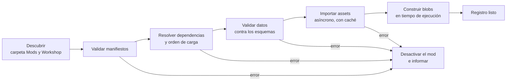

# ESTANDARTES — GDD · Volumen V: Constructor de mapas y mods

> Parte del [GDD de Estandartes](README.md). Versión 0.3 (30-10-2026).
> Diseño del **constructor de mapas para la comunidad** y del **soporte para implementar mods**. Es una función **posterior al lanzamiento**, pero la arquitectura se prepara desde la fase 0 para no tener que rehacer nada.

---

## Índice

- [1. Visión y alcance](#1-visión-y-alcance)
- [2. Principio: el juego base es un mod más](#2-principio-el-juego-base-es-un-mod-más)
- [3. Constructor de mapas](#3-constructor-de-mapas)
- [4. Soporte de mods](#4-soporte-de-mods)
- [5. Reglas de juego con mods](#5-reglas-de-juego-con-mods)
- [6. Rendimiento y límites](#6-rendimiento-y-límites)
- [7. Seguridad](#7-seguridad)
- [8. Política y aspectos legales](#8-política-y-aspectos-legales)
- [9. Documentación para modders](#9-documentación-para-modders)
- [10. Plan de implementación](#10-plan-de-implementación)
- [11. Riesgos](#11-riesgos)

---

## 1. Visión y alcance

La comunidad debe poder **crear sus propias batallas** y **ampliar el juego**: mapas nuevos, escenarios, campañas, unidades, facciones, armas, planes de IA, traducciones. Dos piezas:

| Pieza | Qué es | Quién la usa |
|---|---|---|
| **Constructor de mapas** | Herramienta **dentro del juego** (opción del menú principal) para crear mapas y escenarios jugables y publicarlos | Cualquier jugador, sin conocimientos técnicos |
| **Soporte de mods** | Sistema que **carga e integra** en el juego el contenido creado por la comunidad (datos, modelos, texturas, audio, mapas, escenarios) | Modders (crean) y jugadores (instalan y juegan) |

**Fuera de alcance:** el juego **no incluye una herramienta para crear mods**. Los modders usan herramientas estándar (Blender para modelos, editores de imagen y audio, un editor de texto para los datos). El juego aporta el **cargador**, los **formatos abiertos**, las **reglas** y la **documentación** (ver [9](#9-documentación-para-modders)).

**Cuándo:** después del lanzamiento, como actualización gratuita (fase 8, ver [10](#10-plan-de-implementación)). Antes, el equipo prepara la arquitectura para que añadirlo no obligue a cambiar el núcleo.

---

## 2. Principio: el juego base es un mod más

Todo el contenido del juego (unidades, armas, armaduras, facciones, doctrinas, personalidades, formaciones, mapas, escenarios, campañas) se **registra y se carga por el mismo sistema** que usarán los mods. El juego base es simplemente el primer paquete de contenido, con el espacio de nombres `estandartes`.

Consecuencias:

- Si el juego base funciona, el sistema de mods funciona: se prueba a diario desde el primer día.
- Nada en el código hace referencia directa a una unidad o un mapa concretos: todo se busca en el **registro de contenido** por su **ID** (ver [4.3](#43-registro-de-contenido-e-ids)).
- Los datos tienen siempre una **forma serializable a JSON** (aunque el equipo los edite como ScriptableObjects en Unity), y los *BlobAssets* de la simulación se pueden construir **también en tiempo de ejecución**.
- Los mapas y escenarios del Modo Historia se guardan en el **mismo formato** que los de la comunidad (ver [3.12](#312-formato-del-mapa)), salvo los datos de terreno de alta calidad que se generan con las herramientas de Unity.

---

## 3. Constructor de mapas

### 3.1 Acceso y organización

Se abre desde el menú principal (**Constructor**). La interfaz se organiza en **capas**, cada una con sus herramientas:

```mermaid
flowchart LR
    T["1 · Terreno<br/>relieve, texturas, agua"] --> V["2 · Vegetación<br/>bosques, cultivos, hierba"]
    V --> O["3 · Objetos<br/>edificios, castillos, puentes"]
    O --> J["4 · Juego<br/>zonas, objetivos, despliegue"]
    J --> I["5 · IA<br/>pistas y análisis automático"]
    I --> E["6 · Eventos<br/>condición → acción"]
    E --> A["7 · Ejércitos<br/>escenario por defecto"]
    A --> H["8 · Hornear y validar"]
    H --> P["9 · Probar y publicar"]
```



Cámara libre de editor, deshacer y rehacer ilimitados, guardado automático, plantillas de mapa para empezar (llanura, valle con río, colina con pueblo, castillo vacío).

### 3.2 Terreno

- **Tamaños:** 1 × 1, 2 × 2 y 4 × 4 km jugables, más un fondo de baja densidad hasta el horizonte.
- **Relieve:** pinceles de elevar, bajar, suavizar, aplanar, terrazas y erosión simple.
- **Importar mapas de alturas** de 16 bits (PNG o RAW), incluidos modelos de elevación reales (DEM) para reconstruir batallas históricas.
- **Texturas del terreno:** pintar con los materiales del juego o de mods (hierba, barro, tierra arada, roca, nieve, arena, camino). El material **afecta a la simulación**: el barro frena y cansa, el camino acelera (ver [Volumen I, 10.3](01_Diseno_General.md#103-el-terreno-importa)).
- **Agua:** ríos con su cauce y vados, lagos, pantanos (agua somera transitable, agua profunda intransitable).
- **Caminos:** trazado por curvas que aplana y pinta el terreno.
- Técnicamente, el terreno se edita en tiempo de ejecución sobre el Terrain de Unity (actualizando alturas y mapas de texturas por zonas) y se guarda en el formato del mapa.

### 3.3 Vegetación

- Pinceles de **bosque** (densidad, especies por época y región), **cultivos**, **matorral** y **hierba**.
- La vegetación **afecta a la IA**: los bosques bloquean la visión y las cargas y aumentan el coste de movimiento; los cultivos altos ocultan a la infantería agachada.
- Se representa por instancias con LOD e impostores, igual que en los mapas oficiales.

### 3.4 Objetos y estructuras

- **Biblioteca** de objetos del juego y de los mods instalados, filtrada por época y cultura: casas, iglesias, molinos, granjas, empalizadas, estacas, carros, tiendas, rocas.
- **Kit modular de fortificaciones** con encaje automático: tramos de muralla, torres, puertas, rastrillos, adarves, escaleras, fosos, puentes levadizos, torres del homenaje. El kit genera automáticamente los **enlaces de navegación** (escaleras, adarves) y las **capas** del asedio.
- **Destructibles:** puertas y tramos de muralla pre-fracturados que se pueden marcar como "brecha posible".
- **Puentes** con su capacidad de paso.
- Herramientas: colocar, rotar, escalar dentro de límites, alinear al terreno, dispersar en un área (para aldeas o campos de rocas), copiar y pegar grupos.

### 3.5 Capa de juego: zonas y objetivos

- **Zonas:** pintar áreas de cualquier tipo del [Volumen I, 4.4](01_Diseno_General.md#44-zonas-del-mapa) (Conquista, Guerrero, Despliegue, Reserva, Artillería, Suministro, Emboscada, Refuerzo, Retirada, Prohibida) y asignarles dueño inicial.
- **Objetivos:** colocar objetivos de cualquier tipo del [Volumen I, 5.1](01_Diseno_General.md#51-grafo-de-objetivos) (capturar, mantener, destruir, abrir, defender, escoltar, matar o capturar al líder, recuperar, resistir, cruzar, quemar, infiltrarse, construir o minar).
- **Editor del grafo de objetivos:** vista de nodos donde se enlazan dependencias **Y** / **O**, se marcan objetivos de no retorno y se definen sus efectos al cumplirse (abrir paso, mover el punto de refuerzo, desactivar defensas, victoria).
- **Condiciones de victoria** del mapa (las del [Volumen I, 4.5](01_Diseno_General.md#45-condiciones-de-victoria), combinables).

### 3.6 Pistas de IA y análisis automático del terreno

Para que la IA juegue bien en **cualquier mapa de la comunidad** sin que el autor tenga que enseñárselo, el constructor ejecuta un **análisis automático del terreno** que genera las mismas pistas que el equipo coloca a mano en los mapas oficiales:

| Pista | Cómo se detecta |
|---|---|
| **Alturas dominantes** | Máximos locales del relieve con ventaja de pendiente sobre las rutas de aproximación |
| **Cuellos de botella** | Pasos estrechos de la zona transitable (transformada de distancia sobre la rejilla de navegación) que unen regiones grandes: puentes, vados, desfiladeros, puertas |
| **Rutas de flanqueo** | Rutas alternativas entre zonas de despliegue y objetivos, distintas de la ruta directa (varios caminos más cortos con penalización por solaparse) |
| **Líneas defensivas** | Crestas, ríos y bordes de bosque perpendiculares a la dirección de avance enemiga |
| **Puntos de emboscada** | Zonas ocultas a la vista desde las rutas enemigas (capa de visibilidad precalculada) y cercanas a ellas |
| **Posiciones de artillería** | Alturas con línea de visión a los objetivos y protegidas del acceso directo |
| **Rutas de retirada** | Caminos desde cada zona hacia zonas seguras propias |

El autor puede **revisar, corregir, borrar o añadir** pistas a mano. El general y los comandantes de IA las usan exactamente igual que en los mapas oficiales (ver [Volumen III, 6.2](03_Arquitectura_IA.md#62-instantánea-abstracta)).

### 3.7 Navegación

- La rejilla de navegación y sus sectores (ver [Volumen III, 15](03_Arquitectura_IA.md#15-navegación)) se generan automáticamente a partir del terreno, el agua, la vegetación y los objetos.
- El kit de fortificaciones crea las capas y enlaces de los asedios; el autor puede añadir **enlaces manuales** (escalas posibles, pasos secretos, poternas) con su capacidad.
- Vista de depuración de la navegación para ver por dónde se puede ir.

### 3.8 Eventos

Editor visual de reglas **condición → acción** (el mismo sistema que usan los eventos guionizados del Modo Historia):

| Condiciones | Acciones |
|---|---|
| Tiempo transcurrido, objetivo cumplido o perdido, zona controlada, moral de un bando por debajo de X, muerte de un líder, número de bajas, el héroe entra en una zona | Llegan refuerzos, cambia el clima o la hora, mensaje o narración, se activa o desactiva un objetivo, se abre o cierra una puerta, cambia el plan o la personalidad de un general, suena una señal |

Las reglas se pueden encadenar y combinar con Y / O. No requieren programar (ver los niveles de mod en [4.1](#41-niveles-de-mod)).

### 3.9 Ejércitos y escenario

- El autor define los **ejércitos por defecto** del mapa con las mismas tres opciones del Modo Libre (rápido, detallado, planificador), incluidas las personalidades de los generales.
- Un mapa puede tener **varios escenarios** (por ejemplo, "asedio de día" y "asalto nocturno").
- Ficha del escenario: título, descripción, época, imagen, texto de briefing opcional y narración opcional (audio del propio autor).

### 3.10 Horneado y validación

**Hornear** genera los datos precalculados: rejilla de navegación, sectores y portales, visibilidad del terreno, mapas de influencia base, análisis automático del terreno, LOD e impostores de la vegetación.

**Validar** comprueba:

| Comprobación | Ejemplo de aviso |
|---|---|
| Accesibilidad | "La zona de Conquista 'Molino' no es alcanzable desde el despliegue azul" |
| Grafo de objetivos | "El objetivo final no se puede cumplir: depende de un objetivo bloqueado para siempre" |
| Despliegue | "El ejército rojo no cabe en su zona de despliegue con 4.000 soldados" |
| Rendimiento | "Densidad de vegetación por encima del presupuesto en el sector C4" (ver [6](#6-rendimiento-y-límites)) |
| Contenido | "Falta el mod 'castillos_iberia' del que dependen 12 objetos" |

No se puede publicar un mapa con errores; los avisos se muestran pero no bloquean.

### 3.11 Probar y publicar

- **Probar:** lanza una batalla rápida (IA contra IA en modo espectador, o con el héroe) en el mapa tal como está, sin salir del constructor.
- **Publicar:** sube el mapa a **Steam Workshop** con título, descripción, capturas, etiquetas (época, tipo de batalla, tamaño, número de jugadores recomendado, preset mínimo recomendado) y las dependencias de mods. Las actualizaciones posteriores conservan los suscriptores.
- Los mapas publicados aparecen en el selector de mapas del **Modo Libre** y pueden formar parte de **campañas de la comunidad** (ver [4.8](#48-campañas-de-la-comunidad)).

### 3.12 Formato del mapa

Un mapa es un paquete `.estmap` (un zip con estructura fija):

```text
mi_mapa.estmap
├── manifest.json        id, nombre, versión, versión del formato, época, tamaño, autor, dependencias
├── terrain/
│   ├── height.r16       mapa de alturas de 16 bits
│   ├── splat_*.png      mapas de mezcla de materiales del terreno
│   └── water.json       ríos, lagos, vados
├── vegetation.bin       instancias de vegetación (tipo, posición, escala)
├── objects.json         objetos colocados (ID del registro, transformación, estado inicial)
├── gameplay/
│   ├── zones.json       zonas y dueños
│   ├── objectives.json  grafo de objetivos (nodos, dependencias Y/O, efectos)
│   ├── ai_hints.json    pistas de IA (automáticas y manuales)
│   ├── nav_links.json   enlaces manuales de navegación
│   └── events.json      reglas condición → acción
├── scenarios/*.json     ejércitos, generales, reglas y textos de cada escenario
├── baked/               datos horneados (regenerables; se recalculan si faltan o cambia la versión)
└── preview/*.png        miniaturas y capturas
```

- Los objetos se referencian **por ID** del registro, nunca por ruta de archivo.
- El formato lleva **número de versión**; el juego incluye **migraciones** para abrir mapas de versiones anteriores.

---

## 4. Soporte de mods

### 4.1 Niveles de mod

| Nivel | Qué permite | Formato | Riesgo |
|---|---|---|---|
| **1 · Datos** | Unidades, armas, armaduras, facciones, doctrinas, personalidades de general, formaciones, curvas de utilidad, tablas de moral, **planes de IA** (dominios HTN), escenarios, campañas, traducciones; **parches** que cambian campos concretos del juego base o de otros mods | JSON con esquemas publicados; CSV para tablas | Bajo |
| **2 · Assets** | Modelos 3D (personajes, armas, armaduras, objetos, edificios), texturas, heráldica y estandartes, audio (voces, *barks*, música, efectos), materiales de terreno, mapas | glTF 2.0 (`.glb`), PNG o KTX2, OGG o WAV, `.estmap` | Medio (rendimiento) |
| **3 · Reglas con *script*** (más adelante, opcional) | Reglas de escenario más complejas que las del editor de eventos | Lenguaje de eventos ampliado o Lua en un entorno aislado, sin acceso a archivos, red ni sistemas internos | Medio |

**Nunca se cargan DLL ni código nativo.** Así se protege al jugador (seguridad), la estabilidad del juego y el determinismo de la simulación.

### 4.2 Estructura de un mod

```text
almogavares/
├── mod.json
├── data/
│   ├── units/almogavar.json
│   ├── weapons/azcona.json
│   └── patches/arco_largo.patch.json
├── models/      *.glb
├── textures/    *.png | *.ktx2
├── audio/       *.ogg
├── maps/        *.estmap
├── scenarios/   *.json
├── campaigns/   *.json
└── localization/es.json, en.json
```

**`mod.json` (manifiesto):**

```json
{
  "id": "almogavares",
  "name": "Almogávares de la Corona de Aragón",
  "version": "1.2.0",
  "gameVersion": ">=1.1.0 <2.0.0",
  "authors": ["NombreDelAutor"],
  "description": "Infantería ligera aragonesa con azconas.",
  "dependencies": [ { "id": "iberia_extra", "version": ">=1.0.0" } ],
  "loadAfter": ["iberia_extra"],
  "content": ["units", "weapons", "models", "textures", "audio", "localization"],
  "era": "medieval",
  "tags": ["unidades", "iberia"],
  "changesRules": true
}
```

**Ejemplo de unidad** (los campos son los mismos que usa el juego base, ver [Volumen III, 18](03_Arquitectura_IA.md#18-datos-editables-por-diseño)):

```json
{
  "id": "almogavares:unit/almogavar",
  "archetype": "Skirmisher",
  "capabilities": ["Javelins", "Shield"],
  "weapons": ["almogavares:weapon/azcona", "estandartes:weapon/espada_corta"],
  "armor": { "cut": 0.15, "pierce": 0.10, "blunt": 0.10 },
  "stats": { "health": 100, "morale": 70, "discipline": 55, "walk": 1.6, "run": 6.5 },
  "personality": { "courage": [0.6, 0.9], "aggression": [0.6, 0.9] },
  "squadSize": 40,
  "cost": 9,
  "visual": { "culture": "estandartes:culture/iberica_xiii", "kit": "almogavares:kit/almogavar" },
  "voices": "almogavares:voices/catalan_antiguo"
}
```

### 4.3 Registro de contenido e IDs

- Cada elemento tiene un **ID estable** con la forma `espacio:tipo/nombre` (por ejemplo, `estandartes:unit/lancero_castellano` o `almogavares:weapon/azcona`). El espacio de nombres es el `id` del mod.
- El **registro de contenido** guarda todos los elementos cargados, de qué mod viene cada uno y qué mods lo han modificado.
- Las referencias entre datos (una unidad que usa un arma, un mapa que usa un objeto) se hacen **siempre por ID** y se comprueban al cargar.

### 4.4 Orden de carga, reemplazos y parches

- Los mods se cargan **después del juego base**, en el orden que resulta de sus dependencias y `loadAfter` (orden topológico), ajustable por el jugador en el gestor de mods.
- Tres formas de aportar contenido:

| Forma | Efecto |
|---|---|
| **Añadir** | Un ID nuevo (una unidad nueva) |
| **Reemplazar** | El mismo ID que un elemento existente: el último mod cargado gana |
| **Parchear** | Cambia solo algunos campos de un elemento existente, para que varios mods puedan tocar la misma unidad sin pisarse |

**Ejemplo de parche:**

```json
{
  "patch": "estandartes:weapon/arco_largo",
  "set": { "baseDamage": 50, "range": 230 }
}
```

- El gestor de mods muestra los **conflictos** (dos mods reemplazan el mismo ID, o dos parches cambian el mismo campo) y qué mod gana.

### 4.5 Tubería de carga



- La importación convierte los assets a formatos internos y los guarda en una **caché local**; las siguientes cargas son rápidas mientras el mod no cambie.
- Un mod con errores **se desactiva solo**, con un informe legible ("unidad `almogavar`: el arma `azcona` no existe"), sin romper el juego ni el resto de mods.

### 4.6 Importación de assets

| Tipo | Cómo se carga | Requisitos |
|---|---|---|
| **Personajes y armaduras** | glTF en tiempo de ejecución (paquete glTFast de Unity) | **Riggeados al esqueleto oficial** del juego (máximo 4 huesos por vértice). Así usan directamente las animaciones por GPU del juego (texturas de huesos compartidas por esqueleto) sin hornear nada nuevo |
| **Armas, objetos, edificios** | glTF | Pivote y escala según la guía; colisionador simple opcional |
| **LOD e impostores** | Si el mod los trae, se usan; si no, el juego genera al importar una versión simplificada y un impostor (y los guarda en la caché) | — |
| **Texturas** | PNG o KTX2 (paquete KTX de Unity) | Tamaños potencia de 2, dentro del presupuesto |
| **Audio** | OGG o WAV | Voces y *barks* con su tabla de contexto en JSON |
| **Heráldica** | PNG con máscaras de color | Se integra en la variación por *shader* |

### 4.7 IA en los mods

Como la IA está definida por datos (ver [Volumen III, 18](03_Arquitectura_IA.md#18-datos-editables-por-diseño)), los mods pueden:

- Crear **doctrinas** y **personalidades de general** nuevas.
- Añadir **planes** al general (métodos y tareas compuestas en los dominios HTN) usando las tareas primitivas existentes.
- Ajustar **curvas de utilidad**, **formaciones** (con los generadores existentes y sus parámetros) y **tablas de moral**.
- Combinar **capacidades** existentes en unidades nuevas.

No pueden añadir sistemas nuevos ni cambiar los presupuestos de rendimiento. Todo se valida al cargar (ver [Volumen III, 18.1](03_Arquitectura_IA.md#181-ia-modificable-por-mods)).

### 4.8 Campañas de la comunidad

Una campaña es una **serie de escenarios** (de mapas oficiales o de la comunidad) con briefings de texto e imágenes, narración opcional, condiciones para avanzar y un epílogo. Aparecen en el Modo Historia en una sección **Campañas de la comunidad**, separada de la campaña oficial.

### 4.9 Gestor de mods

En el menú principal:

- Lista de mods instalados (carpeta local `Mods/` y suscripciones de Workshop), con activar o desactivar, orden de carga, dependencias que faltan y conflictos.
- **Perfiles** de mods (por ejemplo, "Histórico puro", "Iberia ampliada") para cambiar de conjunto con un clic.
- Acceso a **Steam Workshop** para buscar, suscribirse y valorar.
- **Modo desarrollador de mods**: consola con los errores de carga y **recarga en caliente** de los archivos JSON mientras el juego está abierto, para que los modders prueben cambios sin reiniciar.

---

## 5. Reglas de juego con mods

| Tema | Regla |
|---|---|
| **Tipos de mod según su efecto** | Un mod "cambia las reglas" si toca datos de juego o de IA (lo declara en `changesRules` y además el cargador lo detecta). Mapas, escenarios, cosméticos, audio y traducciones no cambian las reglas |
| **Logros y estadísticas** | Desactivados mientras haya mods que cambien las reglas; los mapas y cosméticos no los desactivan |
| **Modo Historia oficial** | Se puede jugar con mods cosméticos; con mods que cambian reglas, la partida se marca como "con mods" |
| **Guardado y repeticiones** | Guardan la lista de mods y sus versiones; al cargar con una lista distinta se avisa |
| **Cooperativo futuro** | Todos los jugadores necesitan la misma lista de mods (se compara un *hash*); los mods de Workshop se descargan automáticamente al unirse |

---

## 6. Rendimiento y límites

El contenido de la comunidad no puede romper el rendimiento que garantiza el juego. Valores iniciales, a confirmar tras la fase 1:

| Elemento | Límite orientativo |
|---|---|
| Personaje (LOD0 / LOD1 / LOD2 / LOD3) | 15.000 / 6.000 / 2.000 / 500 triángulos |
| Arma o pieza de armadura (LOD0) | 3.000 triángulos |
| Objeto o edificio (LOD0) | 10.000 triángulos; LOD obligatorios por encima de 2.000 |
| Texturas | 2.048 × 2.048 (4.096 solo para terreno y elementos singulares) |
| Mapa | Hasta 4 × 4 km jugables; presupuesto de instancias de objetos y de densidad de vegetación por sector |
| Escenario | Soldados máximos según el preset; el escenario declara el **preset mínimo recomendado** |

- El validador avisa al superar un límite y **bloquea** la publicación si se supera en más del doble.
- En partida, el juego aplica siempre sus cupos de LOD de IA y de render: un escenario con demasiados soldados para el equipo del jugador usa refuerzos por oleadas en lugar de bajar el rendimiento.

---

## 7. Seguridad

- **Sin código ejecutable:** ni DLL, ni ejecutables, ni *scripts* fuera del entorno aislado del nivel 3.
- **Lista blanca de tipos de archivo** (JSON, CSV, glTF/GLB, PNG, KTX2, OGG, WAV, `.estmap`); cualquier otro archivo se ignora.
- **Límites de tamaño** por archivo y por mod.
- **Rutas saneadas** al descomprimir (ningún archivo puede escribirse fuera de su carpeta).
- **Analizadores robustos** de JSON e imágenes, con límites de profundidad y tamaño.
- **Moderación** de Steam Workshop y botón de denuncia desde el juego.

---

## 8. Política y aspectos legales

- Los creadores aceptan el **acuerdo legal de Steam Workshop** al publicar.
- **Mods gratuitos:** no hay mods de pago.
- Prohibido incluir assets extraídos de otros juegos o con licencias que no permitan su redistribución.
- **Normas de contenido:** se acepta la violencia histórica propia del juego; no se acepta contenido de odio, sexual explícito o que suplante a personas reales vivas.
- El contrato de licencia del juego (EULA) incluye una cláusula de contenido creado por usuarios.

---

## 9. Documentación para modders

El juego no trae una herramienta de creación de mods, pero sí **todo lo necesario para crearlos con herramientas estándar**:

| Recurso | Contenido |
|---|---|
| **Wiki de modding** | Guías por tipo de contenido, convenciones de nombres, presupuestos, preguntas frecuentes |
| **Esquemas JSON** publicados | Permiten autocompletado y validación en editores de texto como VS Code |
| **Esqueleto oficial** | Archivo de referencia (glTF y FBX) con los nombres de huesos, para riggear personajes en Blender |
| **Mod de ejemplo oficial** | Una unidad nueva con su arma, modelo y voces, un parche de balance y un mapa pequeño con su escenario |
| **Registro de cambios de los formatos** | Qué cambia en cada versión del juego y cómo migrar |

---

## 10. Plan de implementación

### 10.1 Preparación desde el principio (antes del lanzamiento)

| Fase | Qué se prepara | Referencia |
|---|---|---|
| **0** | Convención de IDs `espacio:tipo/nombre`; todo el contenido base con espacio `estandartes` | [Vol. IV, paso 0.10](04_Guia_de_Construccion.md#paso-010--preparar-el-soporte-de-mods) |
| **1** | `ContentRegistry` y carga del contenido base por el registro; definiciones serializables a JSON; *BlobAssets* construibles en tiempo de ejecución | [Vol. IV, paso 1.2](04_Guia_de_Construccion.md#paso-12--datos-mínimos) |
| **3** | Zonas, grafo de objetivos, pistas de IA y eventos serializables en el formato `.estmap` | [Vol. IV, fase 3](04_Guia_de_Construccion.md#fase-3-ia-jerárquica-objetivos-y-modo-libre-rápido) |
| **5** | Escenarios del Modo Libre exportables en el mismo formato | [Vol. IV, fase 5](04_Guia_de_Construccion.md#fase-5-producción-niveles-3-a-5-y-modo-libre-completo) |

### 10.2 Fase 8 (después del lanzamiento)

Los pasos detallados están en el [Volumen IV, fase 8](04_Guia_de_Construccion.md#fase-8-constructor-de-mapas-y-mods): cargador de mods externos, importadores de assets, gestor de mods, Steam Workshop, constructor de mapas por capas, análisis automático del terreno, documentación y mod de ejemplo, beta cerrada con modders y lanzamiento como actualización gratuita.

---

## 11. Riesgos

| Riesgo | Impacto | Mitigación |
|---|---|---|
| Contenido de la comunidad que hunde el rendimiento | Alto | Presupuestos validados al importar y publicar; cupos de LOD siempre activos; preset mínimo declarado por escenario |
| Mods que dejan de funcionar con cada actualización | Alto | Formatos versionados con migraciones; parches por campo en lugar de reemplazos completos; registro de cambios de los formatos |
| La IA juega mal en mapas de la comunidad | Alto | Análisis automático del terreno; validador del grafo y de la accesibilidad; modo Probar con IA contra IA |
| Contenido inapropiado o que infringe derechos | Medio | Acuerdo de Workshop, normas de contenido, denuncias y moderación |
| Mods maliciosos | Medio | Sin código ejecutable, lista blanca de archivos, rutas saneadas, analizadores robustos |
| Coste de mantener el sistema | Medio | Principio "el juego base es un mod más": el sistema se prueba cada día con el propio juego |
